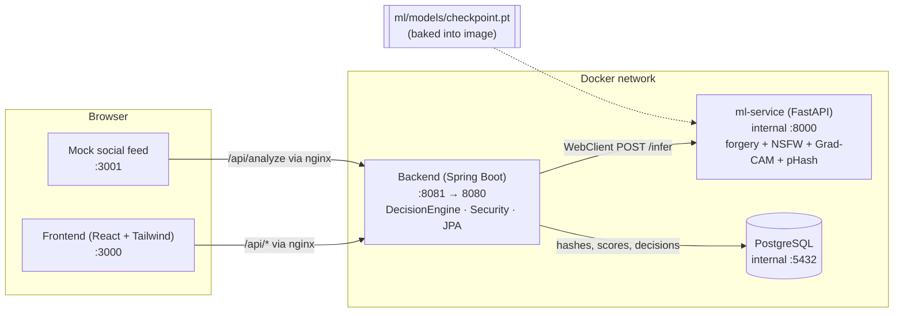

# Forged / Obscene Media Detection Engine

Upload an image and get two independent scores back: a **forgery score** (deepfake / face manipulation) from an EfficientNet-B0 detector with a Grad-CAM heatmap, and an **explicit-content score** from a separate NSFW classifier. A Spring Boot decision engine routes each upload to `ALLOW`, `REVIEW` (human moderator queue), or `AUTO_FLAG`. A compliance SLA engine tracks takedown deadlines under the IT Rules 2026: 2 hours for user deepfake / NCII complaints and 3 hours for government orders. Every analysed image also gets a traceable **provenance ID** and a signed manifest embedded in a labelled copy, which anyone can verify later along with the item's audit trail.

> **Data policy.** Models are trained and evaluated only on consenting-actor research benchmarks (FaceForensics++, DFDC, Celeb-DF). No real non-consensual or explicit imagery is included anywhere in this repo. Only perceptual hashes, scores, and metadata are stored. Raw media is never persisted.

The build plan and per-phase checklist live in [`IMPLEMENTATION_PLAN.md`](IMPLEMENTATION_PLAN.md).

---

## Architecture



**Request flow for `POST /api/analyze`:**

1. The browser uploads an image to nginx (frontend or mock feed), which proxies `/api/*` to the backend.
2. `AnalyzeController` forwards the bytes to `ml-service /infer` through `MlClientService` (WebClient).
3. ml-service returns `forgery_score`, `explicit_score`, a base64 Grad-CAM `heatmap`, and a `phash`. Models are loaded once at startup.
4. `DecisionEngineService.route(forgery, explicit)` applies the thresholds configured in `application.yml` or the environment.
5. The result (pHash, pixel hash, scores, decision, provenance ID, and timestamp only) is saved to Postgres.
6. The backend calls `ml-service /provenance/embed` to get a **labelled copy** of the upload, which is returned to the caller and never stored.
7. `REVIEW` items appear in the moderator queue (`GET /api/queue`, requires the `MODERATOR` role).

**Provenance labels (Phase 14):**

- **Manifest.** Each label is an XMP packet (a JPEG APP1 segment or a PNG iTXt chunk). It carries the provenance ID, a SHA-256 of the decoded pixels, the analysis timestamp, the forgery and explicit scores, the decision, the issuer, and an optional `derivedFrom` ID. An HMAC-SHA256 signature covers all of those fields (`PROVENANCE_SIGNING_KEY`). Other formats are converted to PNG first.
- **Pixels are untouched.** JPEG and PNG pixel data is copied byte for byte, so a labelled copy scores and hashes exactly like the original.
- **Reading it back.** `/infer` reads any manifest already in an upload and reports one of three statuses: `VERIFIED`, `CONTENT_MODIFIED` (pixels edited after labelling), or `INVALID_SIGNATURE` (manifest forged or edited).
- **Re-uploads without a manifest.** If the metadata was stripped, the backend still traces the upload to an earlier analysis by identical pixel hash, or failing that by identical pHash. Either way it records a `REUPLOAD_DETECTED` event on the original's trail.
- **Audit trail.** An append-only table (`provenance_events`) records analysis, re-uploads, moderator decisions, complaints, SLA escalations, and resolutions. `GET /api/verify/{id}` serves it publicly, without complaint references or moderator names.

**Compliance SLA flow (`POST /api/compliance/complaints`):**

1. A complaint (`USER_COMPLAINT` or `GOVERNMENT_ORDER`) is analyzed like any upload, and its SLA clock starts at receipt: 2 h or 3 h.
2. `SlaClockService` re-evaluates every open clock on a schedule (`COMPLIANCE_SLA_CHECK_INTERVAL`) and moves it through `ON_TRACK` → `AT_RISK` (30 min or less left) → `BREACHED`.
3. Each transition into `AT_RISK` or `BREACHED` triggers `EscalationService`. It writes a `SLA ESCALATION` log line and, if `COMPLIANCE_ESCALATION_WEBHOOK_URL` is set, POSTs a JSON event to that webhook.
4. A moderator decision (take down or dismiss) stops the clock and freezes the final status.

| Service | Tech | Host port | Notes |
|---|---|---|---|
| `frontend` | React + Vite + Tailwind, served by nginx | 3000 | Demo, Moderation Queue, Compliance, Verify, Dashboard, Login |
| `mock-social-feed` | Static HTML/JS, served by nginx | 3001 | Simulates a platform upload pipeline |
| `backend` | Spring Boot 3 / Java 21 | 8081 | Public API + decision engine + auth |
| `ml-service` | Python 3.12 + FastAPI + PyTorch (CPU) | internal only | Inference microservice |
| `postgres` | PostgreSQL 16 | internal only | `analysis_results` (scores, decisions, SLA and provenance fields), `provenance_events` (audit trail) |

---

## Quick start (fresh clone)

**Prerequisites:** Docker Desktop (or Docker Engine + Compose v2) and about 6 GB of free disk space. The first build downloads CPU PyTorch, Maven, and npm dependencies, so it takes several minutes.

```bash
git clone <repo-url> forged-media-detector
cd forged-media-detector
cp .env.example .env          # PowerShell: Copy-Item .env.example .env
docker compose up --build -d
```

Wait until every service reports `healthy`. The ml-service cold start can take 1–3 minutes.

```bash
docker compose ps
```

Then open:

| URL | What |
|---|---|
| http://localhost:3000 | Demo upload page |
| http://localhost:3000/queue | Moderation queue (login `moderator` / `moderator`) |
| http://localhost:3000/compliance | Takedown SLA monitor (moderator login) |
| http://localhost:3000/verify | Provenance lookup and labelled-file check (public) |
| http://localhost:3000/dashboard | Evaluation dashboard |
| http://localhost:3001 | Mock social feed |
| http://localhost:8081/actuator/health | Backend health |

Stop with `docker compose down`. Add `-v` to also wipe the database volume.

---

## Demo script (about 5 minutes)

1. **Pitch (30 s).** "Platforms need to catch manipulated and explicit media without storing it. We score every upload twice, independently, and route it automatically, to a human, or not at all."
2. **Detection + explainability (1 min).** Open http://localhost:3000 and drag in any face image (for example a still from a research dataset). Point out the forgery score, the explicit score, the routing decision, and the **Grad-CAM heatmap** showing where the model looked.
3. **Platform integration (1 min).** Open http://localhost:3001. Click **Post manipulated sample**. The post shows `CHECKING…` and then a routing badge (`REVIEW`). This is what a real platform would call on every upload.
4. **Human in the loop (1 min).** Go to http://localhost:3000/queue and sign in as `moderator` / `moderator`. The post from the feed is in the queue with a **blurred** placeholder thumbnail (raw media is never stored, so moderators never see it unblurred). Approve or reject it. The item leaves the queue.
5. **Compliance SLA (1 min).** Open http://localhost:3000/compliance. The demo seeds four complaints: two on track, one at risk, one already breached. Countdowns tick live, the list is sorted by nearest deadline, and at-risk and breached items show when they were escalated. Click **File complaint** to start a new 2 h or 3 h clock, then **Take down** one item to stop its clock. `docker compose logs backend | grep "SLA ESCALATION"` shows the escalation events.
6. **Provenance (1 min).** Back on the Demo page, click **Download labelled image** under *Provenance label*, then analyse that downloaded file. A *Provenance label found · Verified* banner links back to the original analysis. Open **Verify** and drop the labelled file: the signature and pixel checks pass, and the audit trail lists the original analysis and each re-upload. An unknown ID shows *Unknown provenance ID* (HTTP 404).
7. **Access control (15 s).** Signed out, the queue and compliance views are not accessible. Unauthenticated `POST /api/queue/{id}/decision` returns 401. Verification stays public.
8. **Results (1 min).** Open http://localhost:3000/dashboard for per-dataset accuracy, the generalization gap, and live decision counts. Finish with the poster (`ml/results/poster.png`): in-domain vs. cross-dataset accuracy, API latency, and clean-set false positive rate.
9. **Privacy (15 s).** Only hashes, scores, the decision, and SLA / provenance metadata are stored: `docker compose exec postgres psql -U forged -d forged_media -c "select id, phash, forgery_score, decision, sla_status, provenance_id from analysis_results limit 5;"`.

> The demo `.env` lowers `DECISION_FORGERY_REVIEW` to `0.05` so the synthetic "manipulated sample" reliably lands in `REVIEW`. Raise it back to `0.50` for realistic routing. To watch an SLA clock change status live during a demo, shorten the windows in `.env`, for example `COMPLIANCE_SLA_USER_COMPLAINT=PT4M`, `COMPLIANCE_SLA_GOVERNMENT_ORDER=PT6M`, and `COMPLIANCE_SLA_AT_RISK=PT2M`.

---

## Configuration

All variables are optional. Compose falls back to the defaults shown.

| Variable | Default | Purpose |
|---|---|---|
| `POSTGRES_PASSWORD` | `forged` | DB password (postgres + backend) |
| `SPRING_DATASOURCE_URL` | `jdbc:postgresql://postgres:5432/forged_media` | Backend JDBC URL |
| `ML_SERVICE_URL` | `http://ml-service:8000` | Backend → ml-service base URL |
| `NSFW_BACKEND` | `heuristic` | `heuristic` (offline, fast), `transformers`, or `auto` |
| `DECISION_FORGERY_AUTO_FLAG` / `DECISION_EXPLICIT_AUTO_FLAG` | `0.85` | At or above: `AUTO_FLAG` |
| `DECISION_FORGERY_REVIEW` / `DECISION_EXPLICIT_REVIEW` | `0.50` (`.env.example`: forgery `0.05`) | At or above: `REVIEW` |
| `MODERATOR_USERNAME` / `MODERATOR_PASSWORD` | `moderator` / `moderator` | Seeded dev moderator. **Change for any public deployment.** |
| `COMPLIANCE_SLA_USER_COMPLAINT` | `PT2H` | SLA window for user deepfake / NCII complaints (ISO-8601 duration) |
| `COMPLIANCE_SLA_GOVERNMENT_ORDER` | `PT3H` | SLA window for government takedown orders |
| `COMPLIANCE_SLA_AT_RISK` | `PT30M` | Remaining time at which an item becomes `AT_RISK` and escalates |
| `COMPLIANCE_SLA_CHECK_INTERVAL` | `PT15S` | How often open SLA clocks are recalculated |
| `COMPLIANCE_ESCALATION_WEBHOOK_URL` | empty | Optional webhook that receives `SLA_AT_RISK` / `SLA_BREACHED` JSON events |
| `COMPLIANCE_SEED_DEMO` | `true` (compose) | Seed four demo complaints on an empty DB |
| `PROVENANCE_SIGNING_KEY` | `dev-only-provenance-signing-key` | HMAC key for embedded manifests. **Set a long random secret outside dev.** Changing it invalidates existing labels |
| `PROVENANCE_ISSUER` | `forged-media-detection` | Issuer name written into each manifest |

## API

| Method | Path | Auth | Description |
|---|---|---|---|
| `POST` | `/api/analyze` | public | Multipart `file`. Returns id, scores, decision, heatmap, pHash, `provenanceId`, `labelledImage` (base64) + `labelledMimeType`, and `embeddedSource` when the upload traces back to an earlier analysis |
| `GET` | `/api/verify/{provenanceId}` | public | Audit trail for an ID: current decision, scores, hashes, re-upload count, complaint status, events. 404 if unknown |
| `POST` | `/api/verify` | public | Multipart `file`. Reads the embedded manifest (`VERIFIED` / `CONTENT_MODIFIED` / `INVALID_SIGNATURE`) and resolves its trail. Stores nothing |
| `GET` | `/api/stats` | public | Totals by decision |
| `POST` | `/api/auth/login` | public | Moderator login |
| `GET` | `/api/auth/me` | public | Current user (if signed in) |
| `GET` | `/api/queue` | `MODERATOR` | Items with `decision = REVIEW` |
| `POST` | `/api/queue/{id}/decision` | `MODERATOR` | Body `{"decision": "ALLOW" \| "REVIEW" \| "AUTO_FLAG"}`. Also stops an open SLA clock |
| `POST` | `/api/compliance/complaints` | public | Multipart `file`, `complaintType` (`USER_COMPLAINT` \| `GOVERNMENT_ORDER`), optional `reference`. Starts an SLA clock |
| `GET` | `/api/compliance/queue` | `MODERATOR` | Open complaints sorted by nearest deadline, with live `slaStatus` and `remainingSeconds` |
| `GET` | `/api/compliance/breaches` | `MODERATOR` | All items that breached their SLA |
| `GET` | `/api/compliance/summary` | `MODERATOR` | Open count by status, total breaches, configured SLA windows |

```bash
curl -F file=@face.jpg http://localhost:8081/api/analyze
curl -u moderator:moderator http://localhost:8081/api/queue
curl -F file=@face.jpg -F complaintType=USER_COMPLAINT -F reference=NCII-2026-0001 \
  http://localhost:8081/api/compliance/complaints
curl -u moderator:moderator http://localhost:8081/api/compliance/queue
curl http://localhost:8081/api/verify/<provenance-id>
curl -F file=@face.labelled.jpg http://localhost:8081/api/verify
```

---

## Results

Artifacts in `ml/results/`:

| File | Description |
|---|---|
| `poster.png` | One-page results poster (headline numbers + all charts) |
| `generalization_chart.png` | Accuracy / F1 / AUC: FF++ (in-domain) vs. DFDC and Celeb-DF (held out) |
| `roc_curve.png` | ROC curves per dataset |
| `confusion_matrix.png` | Confusion matrices (threshold 0.5) |
| `metrics.json` | All metrics, latency, and FPR (source for everything above) |
| `failure_gallery/` | Hard / failure cases (research-style crops only) |


### End-to-end latency (`POST /api/analyze`)

- **Mean:** 134.1 ms
- **p50:** 131.7 ms
- **p95:** 188.2 ms
- Samples: n=5 after 1 warmup (full Docker stack, CPU only)

### False positive rate (clean / unaltered set)

- **FPR:** 0.0 (0 / 15) at forgery threshold 0.5
- Mean forgery score on the clean set: about 0.010

> **Caveat.** These numbers come from a smoke run on **synthetic** cross-dataset splits and the bundled demo checkpoint, which is trained on synthetic crops. Place licensed FaceForensics++ / DFDC / Celeb-DF crops under `ml/data/crops` (see `ml/data/download_instructions.md`), retrain, and re-run the steps below for report-quality figures.

### Re-generating results

With the stack running:

```bash
docker run --rm --add-host=host.docker.internal:host-gateway \
  -v "$(pwd)/ml:/app" -w /app python:3.12-slim \
  bash -c "pip install -q torch torchvision --index-url https://download.pytorch.org/whl/cpu \
    && pip install -q opencv-python-headless Pillow numpy tqdm matplotlib \
    && python phase11_eval.py --api-url http://host.docker.internal:8081/api/analyze \
    && python poster.py"
```

`phase11_eval.py` rewrites `metrics.json`, the ROC and confusion charts, and the failure gallery. `poster.py` rebuilds `generalization_chart.png` and `poster.png` from `metrics.json`. Copy `metrics.json` and the PNGs into `frontend/public/` to refresh the dashboard.

---

## Development

```bash
# Expose ml-service :8000 and postgres :5432, and live-mount ml-service code + checkpoint
docker compose -f docker-compose.yml -f docker-compose.dev.yml up --build

# Tests
cd backend && mvn test                                   # decision engine, API, auth, SLA engine, provenance
cd ml-service && python -m pytest                        # health, /infer, NSFW, provenance manifests
cd ml && python -m pytest tests data/tests               # pipeline, model, plots, poster
```

**Retraining the model:** `python ml/smoke_phase23.py` (synthetic smoke) or `ml/train.py` on real crops writes `ml/models/checkpoint.pt`. Rebuild the image with `docker compose build ml-service`.

## Troubleshooting

| Symptom | Fix |
|---|---|
| `port is already allocated` | Another process is using 3000, 3001, or 8081. Stop it or change the host side of `ports:` in `docker-compose.yml`. |
| Frontend or feed not up yet | They wait for the backend to be healthy, which waits for ml-service. Check `docker compose logs -f ml-service`. |
| Feed post returns `ALLOW` instead of `REVIEW` | Make sure `.env` exists with `DECISION_FORGERY_REVIEW=0.05`, then `docker compose up -d backend`. |
| Stale data or schema | `docker compose down -v` and start again. |

## Project structure

```
ml/                 offline data pipeline, training, evaluation, explainability, poster
  models/           EfficientNet-B0 definition + demo checkpoint.pt
  results/          metrics.json, charts, poster, failure gallery
ml-service/         FastAPI inference (forgery, NSFW, Grad-CAM, pHash) + provenance manifests
backend/            Spring Boot API, decision engine, compliance SLA engine, provenance audit trail, security, JPA
frontend/           React + Tailwind UI (Demo, Queue, Compliance, Verify, Dashboard, Login)
mock-social-feed/   static "platform" that calls /api/analyze on each post
docker-compose.yml       one-command demo stack
docker-compose.dev.yml   dev overlay (extra ports + live mounts)
```
