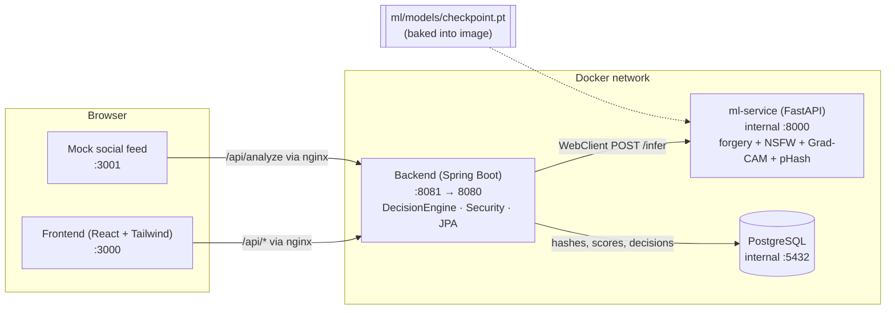

# Forged / Obscene Media Detection Engine

Upload an image and get two independent scores back: a **forgery score** (deepfake / face manipulation) from an EfficientNet-B0 detector with a Grad-CAM heatmap, and an **explicit-content score** from a separate NSFW classifier. A Spring Boot decision engine routes each upload to `ALLOW`, `REVIEW` (human moderator queue), or `AUTO_FLAG`. A compliance SLA engine tracks takedown deadlines per jurisdiction from a rules table: India's IT Rules 2026 (2 hours for user deepfake / NCII complaints, 3 hours for government orders), the US Take It Down Act (48 hours), or a generic fallback. Every analysed image also gets a traceable **provenance ID** and a signed manifest embedded in a labelled copy, which anyone can verify later along with the item's audit trail. Evidentiary PDF reports are Ed25519-signed and verifiable. A StopNCII-style **Check before you post** flow hashes images in the browser and sends only the hash.

> **Data policy.** Models are trained and evaluated only on consenting-actor research benchmarks (FaceForensics++, DFDC, Celeb-DF). No real non-consensual or explicit imagery is included anywhere in this repo. Only perceptual hashes, scores, and metadata are stored. Raw media is never persisted.

**Full project documentation** (what it is, why, who it's for, how every part works, workflows, comparison, results and limits): [`docs/PROJECT_DOCUMENTATION.md`](docs/PROJECT_DOCUMENTATION.md).

The build plan and per-phase checklist live in [`IMPLEMENTATION_PLAN.md`](IMPLEMENTATION_PLAN.md). For a jargon-free summary to keep next to the poster, see [`ONE_PAGER.md`](ONE_PAGER.md), also in the app at http://localhost:3000/explained, with a **Print one-pager** button.

---

## Architecture



**Request flow for `POST /api/analyze`:**

1. The browser uploads an image to nginx (frontend or mock feed), which proxies `/api/*` to the backend.
2. `AnalyzeController` forwards the bytes to `ml-service /infer` through `MlClientService` (WebClient).
3. ml-service returns `forgery_score`, `explicit_score`, a base64 Grad-CAM `heatmap`, and a `phash`. Models are loaded once at startup.
4. `DecisionEngineService.route(forgery, explicit)` applies the thresholds configured in `application.yml` or the environment.
5. The result (pHash, pixel hash, scores, decision, provenance ID, timestamp, and a coarse numeric forensic signature for reports) is saved to Postgres.
6. The backend calls `ml-service /provenance/embed` to get a **labelled copy** of the upload, which is returned to the caller and never stored.
7. `REVIEW` items appear in the moderator queue (`GET /api/queue`, requires the `MODERATOR` role).

**Provenance labels (Phase 14):**

- **Manifest.** Each label is an XMP packet (a JPEG APP1 segment or a PNG iTXt chunk). It carries the provenance ID, a SHA-256 of the decoded pixels, the analysis timestamp, the forgery and explicit scores, the decision, the issuer, and an optional `derivedFrom` ID. An HMAC-SHA256 signature covers all of those fields (`PROVENANCE_SIGNING_KEY`). Other formats are converted to PNG first.
- **Pixels are untouched.** JPEG and PNG pixel data is copied byte for byte, so a labelled copy scores and hashes exactly like the original.
- **Reading it back.** `/infer` reads any manifest already in an upload and reports one of three statuses: `VERIFIED`, `CONTENT_MODIFIED` (pixels edited after labelling), or `INVALID_SIGNATURE` (manifest forged or edited).
- **Re-uploads without a manifest.** If the metadata was stripped, the backend still traces the upload to an earlier analysis by identical pixel hash, or failing that by identical pHash. Either way it records a `REUPLOAD_DETECTED` event on the original's trail.
- **Audit trail.** An append-only table (`provenance_events`) records analysis, re-uploads, moderator decisions, complaints, SLA escalations, resolutions, and generated reports. `GET /api/verify/{id}` serves it publicly, without complaint references or moderator names.

**Evidentiary reports (Phase 15):**

- **One click.** **Download report** on any Queue card (*Needs review* or *Auto-flagged* tab) or Compliance row calls `POST /api/queue/{id}/report`. The backend renders the PDF with OpenPDF. It contains the decision banner, case identification (analysis and provenance IDs, re-upload lineage, pixel hash and pHash), both scores against the configured thresholds, IT Rules 2026 SLA timestamps (received, deadline, escalated, resolved, outcome), Grad-CAM / FFT / ELA panels with a radial spectrum profile, the audit trail, and an integrity statement. Timestamps are printed in UTC plus `REPORT_LOCAL_ZONE`.
- **Panels without keeping media.** At analysis time the ml-service also stores a coarse, non-invertible **forensic signature**: a 14×14 attention grid, a 16×16 error-level grid, a 32×32 log-spectrum grid, and a 32-bin radial profile, as numbers only. The report draws its panels from that signature.
- **Optional original.** The paperclip next to the button attaches the original file for full-resolution panels. The backend checks it against the stored pixel hash (422 if it is a different image) and discards it after rendering. Items whose explicit score is at or above the review threshold never get the image embedded, even when the original is attached.
- **Chain of custody.** Each PDF's SHA-256 is recorded as a `REPORT_GENERATED` event and returned in the `X-Report-Sha256` header, so a recipient can confirm the file is unaltered.
- Items analysed before Phase 15 (and the seeded demo complaints) have no signature. Their reports still include every other field and say that panels are unavailable, unless the original is attached.

**Third-party API (Phase 16):** partner platforms call `POST /api/v1/analyze` from their own upload pipelines with an API key. The full integration guide is **[API_DOCS.md](API_DOCS.md)**.

- **Keys.** Moderators issue, rotate, revoke, and re-plan keys on the **API** page (`/api-access`). A key (`fmd_live_` plus 256 random bits) is shown once. Only its SHA-256 and a short display prefix are stored (`api_clients`).
- **Separate security chain.** `/api/v1/**` is stateless and accepts API keys only (`X-API-Key` or `Authorization: Bearer`). Moderator Basic auth and cookies are rejected there, and a key never opens moderator endpoints. A missing, invalid, or revoked key gets `401`.
- **Rate limits.** Each key gets an in-memory token bucket sized by its plan (FREE 10, PRO 60, ENTERPRISE 600 requests per minute by default), with `X-RateLimit-*` headers on every response and `429` plus `Retry-After` when the bucket is empty.
- **Usage.** `GET /api/v1/usage` reports the key's plan, remaining quota, request and throttled counts, and analyses by decision. It isn't metered. Each analysis records the submitting client (`api_client_id`), and no media is stored.

**Diffusion-era robustness (Phase 17):** the detector was retrained with diffusion-style fakes mixed in, and `/infer` now returns `generation_family` (`gan` / `diffusion` / `unknown`) plus `family_confidence`. That comes from a small secondary head on the same backbone, trained on fakes only. It is best-effort: the answer is `unknown` when the forgery score is below 0.5, when the head is unsure (0.35 < P(diffusion) < 0.65), or when a checkpoint has no family head. The backend stores the family, and the Analyze page (`/analyze`), Queue cards, Compliance rows and PDF reports all show it. Numbers and caveats are under [Diffusion-era robustness](#diffusion-era-robustness-phase-17) below.

**Check before you post (Phase 18, StopNCII-style on-device hashing):**

- **Hash on the device.** `frontend/src/utils/onDeviceHash.js` computes a 64-bit DCT perceptual hash in the browser. It is a bit-exact JavaScript port of `imagehash.phash`, the hash the backend already stores: Pillow luma conversion, Pillow's fixed-point Lanczos resize to 32×32, a 2-D DCT-II, and a median threshold over the low-frequency 8×8. `onDeviceHash.test.js` checks it against vectors generated by the Python library. A JS pHash was chosen over a WASM PDQ build so it can be compared directly with hashes already in the DB, and so it has no binary dependency.
- **Only the hash leaves the browser.** `POST /api/prescreen` accepts JSON `{"hash","algorithm"}` and nothing else. Any other field, or a multipart body, is rejected, so image bytes cannot be sent even by mistake. The endpoint checks the hash against `known_hashes` by Hamming distance (at most 8/64 bits for pHash, 31/256 for PDQ), returns only `match: true|false` plus advice, never reveals the distance or the source, and stores nothing about the request.
- **Known-hash list.** `KnownHash` rows carry the hash, the algorithm, a source (`INTERNAL_CONFIRMED` / `STOPNCII_IMPORT`) and the date added. When a moderator confirms a takedown (a decision of `AUTO_FLAG`), the item's pHash is added automatically as `INTERNAL_CONFIRMED`. `PRESCREEN_SEED_HASHES` seeds the hash of the synthetic demo pattern `frontend/public/prescreen-demo.png`, and moderators can bulk-import hashes through `POST /api/admin/known-hashes/import`.
- **How a real StopNCII integration would work.** StopNCII.org has victims hash their own images on their own device (PDQ for images, MD5 for video) and shares only those hashes with participating platforms, which then match uploads against them. A production integration would pull the StopNCII hash list through their partner API on a schedule into `known_hashes` with `source = STOPNCII_IMPORT` and `algorithm = pdq` (the import endpoint and PDQ matching are ready for that). The platform would also compute PDQ server-side on every upload, act on matches under its own policy, and report outcomes back as the StopNCII agreement requires. **This phase implements StopNCII-compatible matching logic only. A live production integration additionally requires formal approval as a StopNCII participating organisation, plus their API credentials and data-sharing terms. Nothing here connects to StopNCII.**

**Multi-jurisdiction compliance (Phase 19):** SLA deadlines are data, not constants.

- **Rules table.** `jurisdiction_rules` holds jurisdiction code, complaint type, deadline in hours, a label, and a legal reference. The first boot seeds India (`IN`: 2h user complaint, 3h government order, "India IT Rules 2026"), the United States (`US`: 48h for user complaints, "US Take It Down Act") and a `GENERIC` fallback (`COMPLIANCE_GENERIC_*_HOURS`, default 24h). Missing rows are added and existing rows are never overwritten, so edits made in the DB stick.
- **Explicit jurisdiction.** Every analysis gets `jurisdiction` from the `jurisdiction` request parameter on `POST /api/compliance/complaints`, or from `COMPLIANCE_DEFAULT_JURISDICTION` (default `IN`). There is deliberately no geo-IP inference, which keeps the choice explicit and auditable. Unknown codes fall back to `GENERIC`, then to the `COMPLIANCE_SLA_*` windows.
- **Lookup and badges.** `SlaClockService` resolves the rule when a clock starts and freezes its label on the item, so later rule edits don't rewrite open cases. Queue and Compliance rows show a badge such as "India IT Rules 2026 — 2h" or "US Take It Down Act — 48h". `GET /api/compliance/rules` lists every rule for transparency, and the Compliance page has a rules card.
- **No code change needed.** `INSERT INTO jurisdiction_rules (jurisdiction, complaint_type, deadline_hours, label, legal_reference) VALUES ('BR', 'USER_COMPLAINT', 24, 'Brazil ECA Digital', '…');` applies to the next BR complaint.

**Signed evidentiary reports (Phase 20):**

- **Signing.** `ReportSigningService` builds a canonical, versioned (`fmd-evidentiary-report/v1`) text snapshot of the report's facts: report ID, signing time, analysis and provenance IDs, decision, scores, generation family, hashes, jurisdiction, complaint and SLA timestamps. It hashes the snapshot with SHA-256 and signs the hash with Ed25519.
- **Where the signature lives.** The signature, content hash, key ID and timestamp are stored on the `AnalysisResult` row. They are also embedded in the PDF, both in a "Digital signature" section and in the PDF metadata (`FMD-Signature`, `FMD-Signed-Content-SHA256`, `FMD-Signing-Key-Id`, `FMD-Signed-At`).
- **Verifying.** `GET /api/verify-report/{id}` (public; takes the report ID `RPT-…` or the analysis ID) rebuilds the snapshot from the current DB row, recomputes the hash and checks the signature. It returns `VALID`, `TAMPERED` (with the names of the fields that changed, not their values) or `NOT_FOUND` (unknown, never signed, or superseded by a newer report). The **Verify report integrity** button next to **Download report** calls it. A legitimate change such as a later moderator decision also shows as `TAMPERED`; generate a new report to re-sign.
- **Keys.** In development the backend generates an Ed25519 keypair on first start and persists it under `REPORT_SIGNING_KEY_DIR` (the `signing_keys` Docker volume). The public key is served at `/api/verify-report/public-key`.
- **Honest scope.** This demonstrates the chain-of-custody mechanism only. **A private key in a file on disk is not acceptable in production**: use a KMS/HSM (AWS KMS, GCP Cloud KMS, Azure Key Vault, or an HSM) that never exports the key. The timestamp is the server's own clock. Real legal admissibility would additionally need a trusted third-party timestamp authority (RFC 3161), a managed key lifecycle (rotation, revocation, published key history), and review by counsel for the relevant evidence rules.

**User-friendly reporting and moderation (Phase 21):**

- **Report wizard (`/report`, no account).** Four short steps: choose the image, say who is in it and confirm consent, optional details (where it was seen, notes, email or phone for updates, location), then check and send. A privacy statement is shown before any file is picked, with a link to the on-device check. The image preview is blurred by default. The reporter gets a case number such as `FMD-7K3Q-9XPA` (no look-alike characters such as `0/O` or `1/I`) and a 6-digit PIN that is shown once. They can save both as a text file.
- **What happens on the server.** `POST /api/complaints` files a normal `USER_COMPLAINT`: the image is analysed and discarded, and the Phase 13/19 SLA clock starts from the chosen jurisdiction's rule. The case appears in the moderator queue and on the Compliance page. The PIN is stored only as a BCrypt hash. The optional contact detail and free-text notes are the only personal data kept, and are used only for status notices.
- **Case status (`/status`).** Enter the case number and PIN to see *Being reviewed*, *Content removed* or *Reviewed, not removed*, with a timeline and the legal deadline. The PIN goes in the `X-Case-Pin` header, never the URL. An unknown case and a wrong PIN get the same `404`. After 5 wrong PINs the case is locked for 15 minutes (`429` + `Retry-After`). No scores or IDs are exposed.
- **Notifications (stub).** When a moderator decision changes a case's stage, `CaseNotificationService` logs `CASE NOTIFY` with the contact masked (`r***@example.com`) and, if `COMPLAINTS_NOTIFY_WEBHOOK_URL` is set, POSTs the message in the reporter's language. No email or SMS provider is wired in.
- **Plain-language verdicts.** Results lead with *Likely forged* / *Needs a closer look* / *Looks genuine* and what happens next. Scores, generation family and the heatmap sit behind **See details**.
- **Moderator queue.** Complaints with the nearest legal deadline come first (then the oldest uploads), and each card has a deadline chip. Keyboard: `J`/`K` move, `A` approve, `R` reject, `S` skip, `X` select, `M` select similar (pHash within 10 bits), `U` or `Ctrl+Z` undo, `Esc` clear. Every decision, on the Queue or Compliance page, waits 10 seconds with an **Undo** countdown before it is sent. Undo therefore never has to reverse the append-only audit log, known-hash additions or notifications. Pending decisions are flushed if the tab closes.
- **Accessibility and language.** Skip link, labelled controls, focus management between wizard steps, and icons plus text on every verdict, stage and deadline, so nothing relies on colour alone. English and हिन्दी (react-i18next, remembered per browser) cover the wizard, case status, verdicts, privacy note and prescreen card. Moderator screens stay English-first. Errors are plain sentences, never raw HTTP codes.
- **Honest scope.** The Hindi strings are an in-house translation and should be reviewed by a native speaker before real use. PIN lockout is in memory, per backend instance. Notifications are a logging/webhook stub.

**Compliance SLA flow (`POST /api/compliance/complaints`):**

1. A complaint (`USER_COMPLAINT` or `GOVERNMENT_ORDER`, with an optional `jurisdiction`) is analyzed like any upload, and its SLA clock starts at receipt, using the window from the matching jurisdiction rule (for example IN 2 h / 3 h, US 48 h).
2. `SlaClockService` re-evaluates every open clock on a schedule (`COMPLIANCE_SLA_CHECK_INTERVAL`) and moves it through `ON_TRACK` → `AT_RISK` (30 min or less left) → `BREACHED`.
3. Each transition into `AT_RISK` or `BREACHED` triggers `EscalationService`. It writes a `SLA ESCALATION` log line and, if `COMPLIANCE_ESCALATION_WEBHOOK_URL` is set, POSTs a JSON event to that webhook.
4. A moderator decision (take down or dismiss) stops the clock and freezes the final status.

| Service | Tech | Host port | Notes |
|---|---|---|---|
| `frontend` | React + Vite + Tailwind, served by nginx | 3000 | Landing, Analyze, Report wizard, Case status, Moderation Queue, Compliance, Verify, Dashboard, Login |
| `mock-social-feed` | Static HTML/JS, served by nginx | 3001 | Simulates a platform upload pipeline |
| `backend` | Spring Boot 3 / Java 21 | 8081 | Public API + decision engine + auth |
| `ml-service` | Python 3.12 + FastAPI + PyTorch (CPU) | internal only | Inference microservice |
| `postgres` | PostgreSQL 16 | internal only | `analysis_results` (scores, decisions, SLA, provenance and report-signature fields), `provenance_events` (audit trail), `api_clients` (hashed API keys, plans, usage), `known_hashes` (prescreen list), `jurisdiction_rules` (SLA rules) |

---

## Quick start (fresh clone)

**Prerequisites:** Docker Desktop (or Docker Engine + Compose v2) and about 6 GB of free disk space. The first build downloads CPU PyTorch, Maven, and npm dependencies, so it takes several minutes.

```bash
git clone <repo-url> forged-media-detector
cd forged-media-detector
cp .env.example .env          # PowerShell: Copy-Item .env.example .env
docker compose up --build -d
```

Wait until every service reports `healthy`. The ml-service cold start can take 1–3 minutes.

```bash
docker compose ps
```

Then open:

| URL | What |
|---|---|
| http://localhost:3000 | Landing page: what the platform does, one entry point per role, how it works, how it differs |
| http://localhost:3000/analyze | Check an image (upload + verdict), plus *Check before you post* |
| http://localhost:3000/report | Report wizard for people affected (public, no account; English / हिन्दी) |
| http://localhost:3000/status | Case status by case number + PIN (public) |
| http://localhost:3000/queue | Moderation queue (login `moderator` / `moderator`) |
| http://localhost:3000/compliance | Takedown SLA monitor (moderator login) |
| http://localhost:3000/verify | Provenance lookup and labelled-file check (public) |
| http://localhost:3000/dashboard | Evaluation dashboard |
| http://localhost:3000/api-access | API keys, plans, and usage for partner platforms (moderator login) |
| http://localhost:3000/explained | Plain-English one-pager for visitors (public, printable) |
| http://localhost:3000/terms · /privacy | Terms and Conditions · Privacy Policy (public, printable, linked from the footer and the report wizard) |
| http://localhost:3001 | Mock social feed |
| http://localhost:8081/actuator/health | Backend health |

Stop with `docker compose down`. Add `-v` to also wipe the database volume.

---

## Demo script (about 5 minutes)

1. **Pitch (30 s).** "Platforms need to catch manipulated and explicit media without storing it. We score every upload twice, independently, and route it automatically, to a human, or not at all."
2. **Detection + explainability (1 min).** Open http://localhost:3000, scroll through the landing page's role cards and comparison, then click **Check an image** (http://localhost:3000/analyze) and drag in any face image (for example a still from a research dataset). Point out the forgery score, the explicit score, the routing decision, and the **Grad-CAM heatmap** showing where the model looked.
3. **Platform integration (1 min).** Open http://localhost:3001. Click **Post manipulated sample**. The post shows `CHECKING…` and then a routing badge (`REVIEW`). This is what a real platform would call on every upload.
4. **Human in the loop (1 min).** Go to http://localhost:3000/queue and sign in as `moderator` / `moderator`. The post from the feed is in the queue with a **blurred** placeholder thumbnail (raw media is never stored, so moderators never see it unblurred). Approve or reject it. The item leaves the queue.
5. **Compliance SLA (1 min).** Open http://localhost:3000/compliance. The demo seeds four complaints: two on track, one at risk, one already breached. Countdowns tick live, the list is sorted by nearest deadline, and at-risk and breached items show when they were escalated. Click **File complaint** to start a new 2 h or 3 h clock, then **Take down** one item to stop its clock. `docker compose logs backend | grep "SLA ESCALATION"` shows the escalation events.
6. **Provenance (1 min).** Back on the Analyze page, click **Download labelled image** under *Provenance label*, then analyse that downloaded file. A *Provenance label found · Verified* banner links back to the original analysis. Open **Verify** and drop the labelled file: the signature and pixel checks pass, and the audit trail lists the original analysis and each re-upload. An unknown ID shows *Unknown provenance ID* (HTTP 404).
7. **Evidentiary report (30 s).** On the Queue page, open the **Auto-flagged** tab (reject an item first if it's empty) and click **Download report**. The PDF has the decision, scores, provenance ID, forensic panels, and audit trail. Click it on a Compliance row to also get the SLA timestamps. Use the paperclip to attach the original for full-resolution panels. The item's Verify trail now lists *Evidentiary report issued* along with the PDF's SHA-256.
8. **Partner API (1 min).** Open **API**, click **New client**, pick a plan, and copy the key (it's shown once). Run the curl shown on the page: `/api/v1/analyze` returns the decision, scores, and provenance ID, with `X-RateLimit-*` headers. Send it again with no key or a wrong key for `401`. Loop it past the FREE limit (10 per minute) for `429` with `Retry-After`. `curl -H "X-API-Key: …" localhost:8081/api/v1/usage` shows the counts, and **Revoke** turns the key into a `401` immediately. If `.env` has `API_DEMO_KEY` set (it's in `.env.example`), the key `fmd_live_demo_local_only_do_not_use_in_prod` works without creating a client.
9. **Check before you post (30 s).** On the Analyze page, scroll to *Check before you post* and open DevTools → Network. Click **Try demo pattern**: the hash is computed in the browser, the only request is `POST /api/prescreen` with a JSON body of under 50 bytes, and the result is *Matches known abusive content* (its hash is seeded). Choose any other image and the result is *No match*. Neither request carries image bytes.
10. **Jurisdictions (30 s).** On Compliance, file one complaint with jurisdiction *India* and one with *United States*. Their badges read "India IT Rules 2026 — 2h" and "US Take It Down Act — 48h", and the deadlines differ accordingly. The *Jurisdiction rules* card (and `GET /api/compliance/rules`) lists every rule.
11. **Signed report (30 s).** Click **Download report**, then **Verify report integrity**: `VALID`, with the key ID and signing time. Change a stored field, for example `docker compose exec postgres psql -U forged -d forged_media -c "update analysis_results set forgery_score = 0.01 where id = <id>;"`, and verify again: `TAMPERED`, listing `forgery_score`. The PDF's section 7 carries the signature.
12. **Report as an affected person (1 min).** Signed out, click **Report** (switch to **हिं** to show the Hindi version). Choose an image, pick *It's me*, tick the consent box, add an email, and send. Note the case number and PIN, then open **Track case** and enter them: *Being reviewed*, with the legal deadline. Sign in and open Compliance: the report is listed with its case number and India deadline. (It is also in the Queue if the automated check routed it to review; complaints are ordered by nearest deadline there.) Click **Take down**, watch the 10-second countdown, click **Undo**, then take it down again and let it save. On the Queue, the same works from the keyboard: `R`, then `U`. Refresh the case status: *Content removed*. `docker compose logs backend | grep "CASE NOTIFY"` shows the masked notice.
13. **Access control (15 s).** Signed out, the queue and compliance views are not accessible. Unauthenticated `POST /api/queue/{id}/decision` returns 401. Verification stays public.
14. **Results (1 min).** Open http://localhost:3000/dashboard for per-dataset accuracy, the generalization gap, the GAN-era vs. diffusion-era card, and live decision counts. Finish with the poster (`ml/results/poster.png`): in-domain vs. cross-dataset accuracy, API latency, and clean-set false positive rate.
15. **Privacy (15 s).** Only hashes, scores, the decision, SLA / provenance metadata, and the coarse numeric forensic signature are stored: `docker compose exec postgres psql -U forged -d forged_media -c "select id, phash, forgery_score, decision, sla_status, provenance_id from analysis_results limit 5;"`.

> The demo `.env` lowers `DECISION_FORGERY_REVIEW` to `0.05` so the synthetic "manipulated sample" reliably lands in `REVIEW`. Raise it back to `0.50` for realistic routing. To watch an SLA clock change status live during a demo, shorten the windows in `.env`, for example `COMPLIANCE_SLA_USER_COMPLAINT=PT4M`, `COMPLIANCE_SLA_GOVERNMENT_ORDER=PT6M`, and `COMPLIANCE_SLA_AT_RISK=PT2M`.

---

## Configuration

All variables are optional. Compose falls back to the defaults shown.

| Variable | Default | Purpose |
|---|---|---|
| `POSTGRES_PASSWORD` | `forged` | DB password (postgres + backend) |
| `SPRING_DATASOURCE_URL` | `jdbc:postgresql://postgres:5432/forged_media` | Backend JDBC URL |
| `ML_SERVICE_URL` | `http://ml-service:8000` | Backend → ml-service base URL |
| `NSFW_BACKEND` | `heuristic` | `heuristic` (offline, fast), `transformers`, or `auto` |
| `DECISION_FORGERY_AUTO_FLAG` / `DECISION_EXPLICIT_AUTO_FLAG` | `0.85` | At or above: `AUTO_FLAG` |
| `DECISION_FORGERY_REVIEW` / `DECISION_EXPLICIT_REVIEW` | `0.50` (`.env.example`: forgery `0.05`) | At or above: `REVIEW` |
| `MODERATOR_USERNAME` / `MODERATOR_PASSWORD` | `moderator` / `moderator` | Seeded dev moderator. **Change for any public deployment.** |
| `COMPLIANCE_SLA_USER_COMPLAINT` | `PT2H` | SLA window for user deepfake / NCII complaints (ISO-8601 duration) |
| `COMPLIANCE_SLA_GOVERNMENT_ORDER` | `PT3H` | SLA window for government takedown orders |
| `COMPLIANCE_SLA_AT_RISK` | `PT30M` | Remaining time at which an item becomes `AT_RISK` and escalates |
| `COMPLIANCE_SLA_CHECK_INTERVAL` | `PT15S` | How often open SLA clocks are recalculated |
| `COMPLIANCE_ESCALATION_WEBHOOK_URL` | empty | Optional webhook that receives `SLA_AT_RISK` / `SLA_BREACHED` JSON events |
| `COMPLIANCE_SEED_DEMO` | `true` (compose) | Seed four demo complaints on an empty DB |
| `PROVENANCE_SIGNING_KEY` | `dev-only-provenance-signing-key` | HMAC key for embedded manifests. **Set a long random secret outside dev.** Changing it invalidates existing labels |
| `PROVENANCE_ISSUER` | `forged-media-detection` | Issuer name written into each manifest |
| `REPORT_LOCAL_ZONE` | `Asia/Kolkata` | IANA zone printed next to UTC on evidentiary reports |
| `API_RATE_LIMIT_FREE` / `_PRO` / `_ENTERPRISE` | `10` / `60` / `600` | `/api/v1` requests per minute per key, by plan |
| `API_DEMO_KEY` | empty (`.env.example`: a demo key) | Dev only: seeds a FREE "Demo Platform" client with this exact key (must start with `fmd_live_`). **Leave empty in production** |
| `PRESCREEN_PHASH_MAX_DISTANCE` / `PRESCREEN_PDQ_MAX_DISTANCE` | `8` / `31` | Hamming distance (bits) at or below which a prescreen hash counts as a match |
| `PRESCREEN_SEED_HASHES` | `c2423d3d3b783cc6` | Comma-separated pHashes seeded as `INTERNAL_CONFIRMED` on startup (default: the synthetic demo pattern) |
| `COMPLIANCE_DEFAULT_JURISDICTION` | `IN` | Jurisdiction used when a request doesn't set one |
| `COMPLIANCE_GENERIC_USER_COMPLAINT_HOURS` / `_GOVERNMENT_ORDER_HOURS` | `24` / `24` | Deadlines seeded for the `GENERIC` fallback rule |
| `REPORT_SIGNING_KEY_DIR` | `/app/data/signing-keys` (volume) | Where the dev Ed25519 keypair is generated and kept. **Use a KMS/HSM in production** |
| `COMPLAINTS_MAX_PIN_ATTEMPTS` / `COMPLAINTS_PIN_LOCKOUT` | `5` / `PT15M` | Wrong PINs allowed per case before it is locked, and for how long |
| `COMPLAINTS_NOTIFY_WEBHOOK_URL` | empty | Optional webhook that receives case status-change notices (blank = log only) |
| `VITE_LEGAL_OPERATOR` / `VITE_LEGAL_CONTACT_EMAIL` / `VITE_LEGAL_GRIEVANCE_OFFICER` / `VITE_LEGAL_GOVERNING_LAW` | demo placeholders (`privacy@example.org`, laws of India) | Operator details printed in `/terms` and `/privacy`. **Build-time** frontend variables: set them before `npm run build` / the frontend image build. Have both documents reviewed by counsel before a real launch |

## API

| Method | Path | Auth | Description |
|---|---|---|---|
| `POST` | `/api/analyze` | public | Multipart `file`. Returns id, scores, decision, heatmap, pHash, `provenanceId`, `labelledImage` (base64) + `labelledMimeType`, and `embeddedSource` when the upload traces back to an earlier analysis |
| `GET` | `/api/verify/{provenanceId}` | public | Audit trail for an ID: current decision, scores, hashes, re-upload count, complaint status, events. 404 if unknown |
| `POST` | `/api/verify` | public | Multipart `file`. Reads the embedded manifest (`VERIFIED` / `CONTENT_MODIFIED` / `INVALID_SIGNATURE`) and resolves its trail. Stores nothing |
| `POST` | `/api/v1/analyze` | API key | Third-party scoring: decision, scores, hashes, `provenanceId`, `reuploadOf`. Optional `include=heatmap,labelled`. Rate limited per key (`429` + `Retry-After`). See [API_DOCS.md](API_DOCS.md) |
| `GET` | `/api/v1/usage` | API key | Plan, remaining quota, request and throttled counts, analyses by decision (not metered) |
| `GET` / `POST` | `/api/admin/clients` | `MODERATOR` | List clients and plan limits / create a client (`{"name","plan"}`). The key is returned once |
| `POST` | `/api/admin/clients/{id}/rotate` \| `/revoke` \| `/plan` | `MODERATOR` | New key (old one stops working) / disable the key / change plan |
| `GET` | `/api/stats` | public | Totals by decision |
| `POST` | `/api/auth/login` | public | Moderator login |
| `GET` | `/api/auth/me` | public | Current user (if signed in) |
| `GET` | `/api/queue` | `MODERATOR` | Items with `decision = REVIEW`. `?status=flagged` returns the 50 most recent `AUTO_FLAG` items |
| `POST` | `/api/queue/{id}/decision` | `MODERATOR` | Body `{"decision": "ALLOW" \| "REVIEW" \| "AUTO_FLAG"}`. Also stops an open SLA clock |
| `POST` | `/api/queue/{id}/report` | `MODERATOR` | Evidentiary PDF (`application/pdf`, headers `X-Report-Id`, `X-Report-Sha256`, `X-Report-Panels`). Optional multipart `file` is the original: checked against the stored pixel hash (422 on mismatch) and never stored |
| `POST` | `/api/compliance/complaints` | public | Multipart `file`, `complaintType` (`USER_COMPLAINT` \| `GOVERNMENT_ORDER`), optional `reference` and `jurisdiction` (`IN`, `US`, …). Starts an SLA clock from the matching rule |
| `POST` | `/api/complaints` | public | Report wizard. Multipart `file`, `consent=true`, `relationship` (`SELF` \| `ON_BEHALF`), optional `details` (≤ 1000 chars), `contact` (email or phone), `jurisdiction`, `locale` (`en` \| `hi`). `201` with `caseNumber`, one-time `pin`, deadline and rule. `400 {error, message}` on invalid input, before any analysis |
| `GET` | `/api/complaints/{caseNumber}/status` | PIN (`X-Case-Pin`) | Plain-language `stage` (`IN_REVIEW` \| `REMOVED` \| `NO_ACTION`), `verdict`, deadline, timeline. `404 case_not_found` for unknown case or wrong PIN, `429 too_many_attempts` after repeated wrong PINs |
| `GET` | `/api/compliance/rules` | `MODERATOR` | Every jurisdiction rule with deadline, label, legal reference and badge text |
| `POST` | `/api/prescreen` | public | JSON `{"hash","algorithm"}` only (`phash` or `pdq`). Returns `match` + advice. Any other field → `400 only_hash_accepted` |
| `GET` / `POST` | `/api/admin/known-hashes` \| `/import` | `MODERATOR` | Known-hash counts by source / bulk import `{"source","algorithm","hashes"}` |
| `GET` | `/api/verify-report/{reportId}` | public | `VALID` / `TAMPERED` (+ changed field names) / `NOT_FOUND` for a signed evidentiary report |
| `GET` | `/api/verify-report/public-key` | public | Report-signing public key (PEM) |
| `GET` | `/api/compliance/queue` | `MODERATOR` | Open complaints sorted by nearest deadline, with live `slaStatus` and `remainingSeconds` |
| `GET` | `/api/compliance/breaches` | `MODERATOR` | All items that breached their SLA |
| `GET` | `/api/compliance/summary` | `MODERATOR` | Open count by status, total breaches, configured SLA windows |

```bash
curl -F file=@face.jpg http://localhost:8081/api/analyze
curl -u moderator:moderator http://localhost:8081/api/queue
curl -F file=@face.jpg -F complaintType=USER_COMPLAINT -F reference=NCII-2026-0001 \
  http://localhost:8081/api/compliance/complaints
curl -u moderator:moderator http://localhost:8081/api/compliance/queue
curl http://localhost:8081/api/verify/<provenance-id>
curl -F file=@face.labelled.jpg http://localhost:8081/api/verify
curl -u moderator:moderator -X POST -OJ http://localhost:8081/api/queue/<id>/report
curl -u moderator:moderator -F file=@face.jpg -OJ http://localhost:8081/api/queue/<id>/report
curl http://localhost:8081/api/verify-report/RPT-<id>-<timestamp>
curl -H "Content-Type: application/json" -d '{"hash":"c2423d3d3b783cc6","algorithm":"phash"}' http://localhost:8081/api/prescreen
curl -u moderator:moderator http://localhost:8081/api/compliance/rules
curl -F file=@face.jpg -F complaintType=USER_COMPLAINT -F jurisdiction=US http://localhost:8081/api/compliance/complaints
curl -F file=@face.jpg -F consent=true -F relationship=SELF -F contact=me@example.com http://localhost:8081/api/complaints
curl -H "X-Case-Pin: <pin>" http://localhost:8081/api/complaints/FMD-XXXX-XXXX/status
```

---

## Results

Artifacts in `ml/results/`:

| File | Description |
|---|---|
| `poster.png` | One-page results poster (headline numbers + all charts) |
| `generalization_chart.png` | Accuracy / F1 / AUC: FF++ (in-domain) vs. DFDC and Celeb-DF (held out) |
| `roc_curve.png` | ROC curves per dataset |
| `confusion_matrix.png` | Confusion matrices (threshold 0.5) |
| `metrics.json` | All metrics, latency, and FPR (source for everything above) |
| `failure_gallery/` | Hard / failure cases (research-style crops only) |


### End-to-end latency (`POST /api/analyze`)

- **Mean:** 134.1 ms
- **p50:** 131.7 ms
- **p95:** 188.2 ms
- Samples: n=5 after 1 warmup (full Docker stack, CPU only)

### False positive rate (clean / unaltered set)

- **FPR:** 0.0 (0 / 15) at forgery threshold 0.5
- Mean forgery score on the clean set: about 0.010

> **Caveat.** These numbers come from a smoke run on **synthetic** cross-dataset splits and the bundled demo checkpoint, which is trained on synthetic crops. Place licensed FaceForensics++ / DFDC / Celeb-DF crops under `ml/data/crops` (see `ml/data/download_instructions.md`), retrain, and re-run the steps below for report-quality figures.

### Re-generating results

With the stack running:

```bash
docker run --rm --add-host=host.docker.internal:host-gateway \
  -v "$(pwd)/ml:/app" -w /app python:3.12-slim \
  bash -c "pip install -q torch torchvision --index-url https://download.pytorch.org/whl/cpu \
    && pip install -q opencv-python-headless Pillow numpy tqdm matplotlib \
    && python phase11_eval.py --api-url http://host.docker.internal:8081/api/analyze \
    && python poster.py"
```

`phase11_eval.py` rewrites `metrics.json`, the ROC and confusion charts, and the failure gallery. `poster.py` rebuilds `generalization_chart.png` and `poster.png` from `metrics.json`. Copy `metrics.json` and the PNGs into `frontend/public/` to refresh the dashboard.

### Diffusion-era robustness (Phase 17)

> **This is a known, active research area, not a solved problem.** Detectors trained on GAN-era face swaps are widely reported to lose a large share of their AUC on diffusion-generated content. Retraining with diffusion examples helps on the kind of diffusion fakes it has seen. It does not give universal coverage of new generators.

`metrics.json` keeps two separate blocks, `gan_era` (FF++ / DFDC / Celeb-DF) and `diffusion_era`, each with accuracy / precision / recall / F1 / AUC for the pre-retraining baseline and the retrained model:

| Test set | Baseline AUC (GAN-era checkpoint) | Retrained AUC | Change |
|---|---|---|---|
| Diffusion era (held-out identities, n=80) | **0.119** (accuracy 0.50, recall 0.00) | **1.000** | +0.881 |
| GAN era: FF++ / DFDC / Celeb-DF (n=30) | 1.000 | 1.000 | 0.000 (allowed regression 0.02) |

Generation-family head accuracy on fakes: 40/40 diffusion, 15/15 GAN-era. Chart: `ml/results/diffusion_robustness.png`.

> **Caveat on these numbers.** They come from a **synthetic diffusion-inpainting stand-in** (`ml/data/build_diffusion_split.py --source synthetic`: smooth, low-noise, colour-shifted inpainted regions blended into the real crops) over the same **synthetic** crops as the rest of the results, so both sets are easy to separate. They show that the pipeline works (the baseline genuinely fails on the new artifact type, retraining fixes it, and the GAN-era set does not regress). They are not a claim about real diffusion deepfakes. For report-quality figures, generate diffusion fakes from the *real* subset of licensed FF++ data with a diffusion inpainting or face-swap pipeline, keeping the Phase 1 identity splits. Put them in a folder with `labels.csv` and run `python phase17.py --source import --import-dir <dir>`.

Re-run: `cd ml && python phase17.py`. This builds the split, evaluates the current checkpoint as the baseline (backed up locally as `models/checkpoint.gan_era.pt`), fine-tunes to `models/checkpoint.diffusion_aug.pt`, re-evaluates everything, writes both blocks and the chart, and promotes the checkpoint (`--no-promote` to skip). Then run `docker compose build ml-service`.

---

## Development

```bash
# Expose ml-service :8000 and postgres :5432, and live-mount ml-service code + checkpoint
docker compose -f docker-compose.yml -f docker-compose.dev.yml up --build

# Tests
cd backend && mvn test                                   # decision engine, API, auth, SLA + jurisdiction rules, provenance, signed PDF reports, API keys, prescreen, public complaints (case + PIN, lockout, notifications, queue order)
cd ml-service && python -m pytest                        # health, /infer, NSFW, provenance manifests, forensic signature, generation family
cd ml && python -m pytest tests data/tests               # pipeline, model, plots, poster, diffusion split + family head
cd frontend && npm test                                  # on-device pHash parity, Hindi/English key coverage, case-number + contact validation, queue urgency order, near-duplicates
```

**Retraining the model:** `python ml/smoke_phase23.py` (synthetic smoke) or `ml/train.py` on real crops writes `ml/models/checkpoint.pt`. Rebuild the image with `docker compose build ml-service`.

## Troubleshooting

| Symptom | Fix |
|---|---|
| `port is already allocated` | Another process is using 3000, 3001, or 8081. Stop it or change the host side of `ports:` in `docker-compose.yml`. |
| Frontend or feed not up yet | They wait for the backend to be healthy, which waits for ml-service. Check `docker compose logs -f ml-service`. |
| Feed post returns `ALLOW` instead of `REVIEW` | Make sure `.env` exists with `DECISION_FORGERY_REVIEW=0.05`, then `docker compose up -d backend`. |
| Stale data or schema | `docker compose down -v` and start again. |

## Project structure

```
ml/                 offline data pipeline, training, evaluation, explainability, poster
  models/           EfficientNet-B0 definition + demo checkpoint.pt
  results/          metrics.json, charts, poster, failure gallery
ml-service/         FastAPI inference (forgery, NSFW, Grad-CAM, pHash) + provenance manifests + forensic signature
backend/            Spring Boot API, decision engine, compliance SLA engine, provenance audit trail, PDF reports,
                    API keys + rate limiting (/api/v1), security, JPA
frontend/           React + Tailwind UI (Landing, Analyze, Report, Case status, Queue, Compliance, Verify,
                    Dashboard, API access, Explained, Login)
mock-social-feed/   static "platform" that calls /api/analyze on each post
docs/               PROJECT_DOCUMENTATION.md: the complete project guide
API_DOCS.md         third-party integration guide for /api/v1
docker-compose.yml       one-command demo stack
docker-compose.dev.yml   dev overlay (extra ports + live mounts)
```
