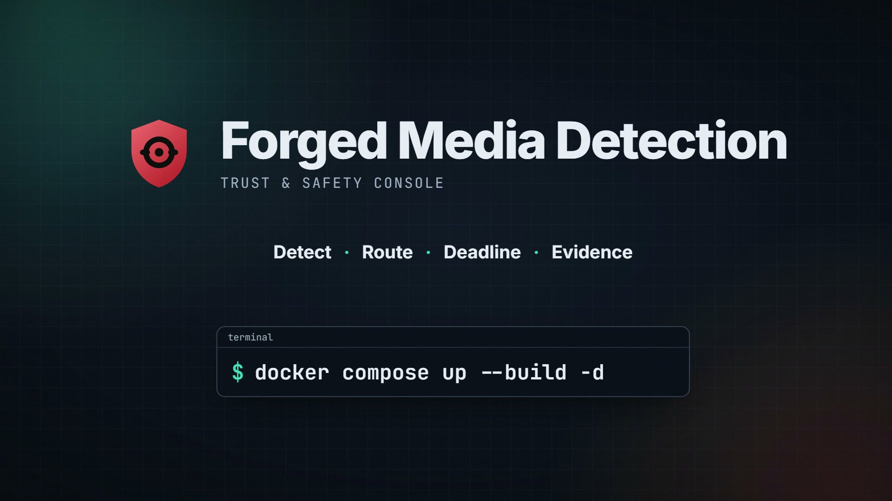
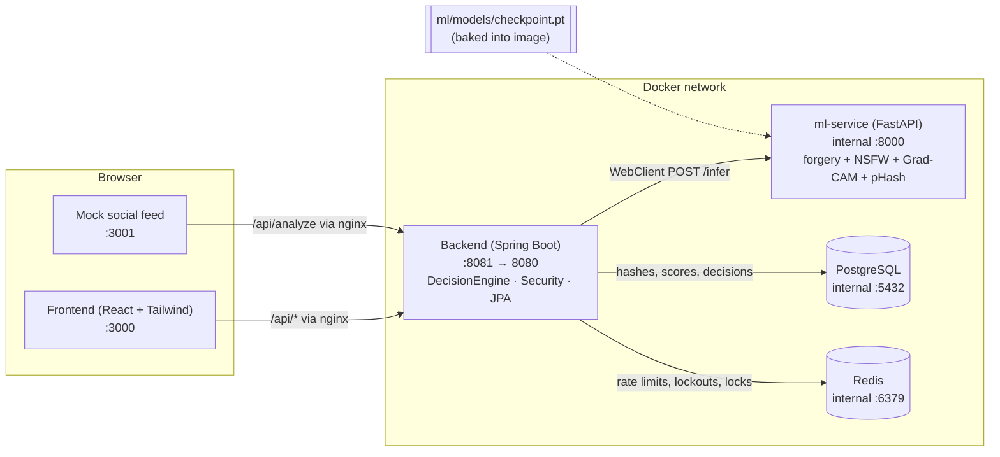
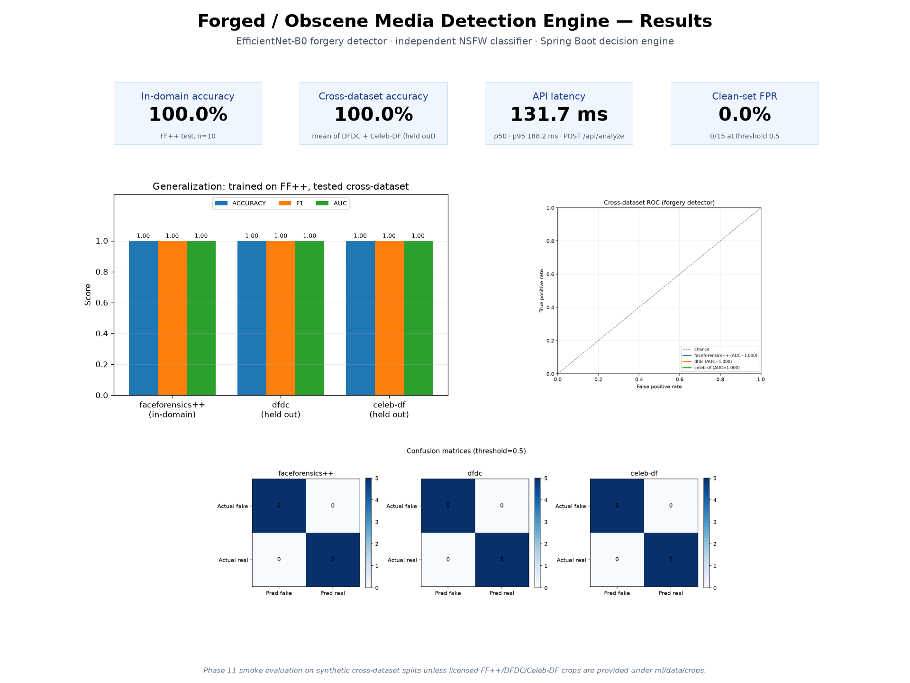

<div align="center">

# Forged Media Detection

**Detect deepfakes and explicit imagery, route them to the right outcome, meet legal takedown deadlines, and prove what happened, all without ever storing the image.**

[](https://github.com/SunilMaurya-18/Forged-Obscene-Media-Detection-Engine/actions/workflows/ci.yml)


[Quick start](#quick-start) · [One-click demo](#one-click-demo) · [Features](#what-it-does) · [Architecture](#architecture) · [Results](#results) · [API](#api-reference) · [Full documentation](docs/PROJECT_DOCUMENTATION.md) · [Partner API guide](API_DOCS.md)

[Design decisions (ADRs)](docs/adr/README.md) · [Threat model](docs/THREAT_MODEL.md) · [Model card](docs/MODEL_CARD.md) · [Host a public demo](docs/PUBLIC_DEMO.md)

<br>

<video src="brag-output/brag.mp4" poster="brag-output/brag.jpg" controls muted playsinline width="720">
  <a href="brag-output/brag.mp4"></a>
</video>

<sub>▶ <a href="brag-output/brag.mp4"><b>Watch the 35-second launch video</b></a> (MP4, 26 MB)</sub>

</div>

---

## Why it exists

Face-swap apps and diffusion generators make convincing fakes of real people in seconds, and the worst of them are non-consensual intimate images. Laws now put a clock on the response: **India's IT Rules 2026** give platforms **2 hours** for user deepfake / NCII complaints and **3 hours** for government orders, and the **US Take It Down Act** gives **48 hours**.

Existing tools each solve one piece. Detectors give a score but no workflow, hash-matching only catches *known* images, and manual review is slow and exposes moderators to harmful content. This project puts the whole chain in one place (detection, routing, legal deadlines, victim reporting and verifiable evidence) around two principles:

1. **Privacy by construction.** Raw media is never persisted. Only perceptual hashes, scores, decisions and timestamps are stored, which is enough to recognise re-uploads but can't be turned back into the picture.
2. **Humans decide the hard cases.** Automation handles the clear ones and gives moderators fast, safe tools for the rest.

## What it does

| Capability | Highlights |
|---|---|
| **Two independent scores** | EfficientNet-B0 forgery detector with a **Grad-CAM heatmap**, plus a separate explicit-content classifier. A best-effort **GAN vs. diffusion** family guess |
| **Automatic routing** | Spring Boot decision engine sends each upload to `ALLOW`, `REVIEW` (human queue) or `AUTO_FLAG` using configurable thresholds |
| **Video** | Clips are sampled at N fps in memory (no frame touches disk), every frame is scored, and the clip is routed once on an aggregate (top-k mean for forgery, max for explicit). Per-frame timeline in the UI and a frame-score strip in the PDF |
| **C2PA Content Credentials** | Reads an upload's C2PA manifest (signer, claim generator, edit actions, AI-generated flag) into the analysis and report, and signs a C2PA manifest into the labelled copy next to the HMAC XMP label |
| **Legal SLA engine** | Per-jurisdiction deadlines stored as data (India 2 h / 3 h, US 48 h, EU / UK / AU marked *pending legal review*, generic 24 h). Live countdowns, `ON_TRACK` → `AT_RISK` → `BREACHED`, webhook escalation. Add a country with one SQL insert |
| **Moderator workspace** | Deadline-first queue, greyscale + blurred media with an audit-logged reveal, keyboard shortcuts, near-duplicate batch select, a 10-second undo on every decision, teams, assignment, senior escalation, and mandatory second review before an automatic removal is overturned |
| **Due process** | Every upload gets a notice number + PIN. The uploader can appeal an automatic removal (EU DSA Art. 20 style); the appeal runs on its own SLA clock and must be decided by a different moderator |
| **Moderator wellbeing** | Per-session exposure counter with a configurable limit and an enforced break, plus a support-resources page |
| **Transparency report** | `GET /api/transparency?period=…` and a printable `/transparency` page: volumes, decisions, SLA compliance, appeal outcomes, overturn rate. Aggregates only |
| **No-account victim reporting** | Four-step wizard in **English and हिन्दी**, case number + one-time PIN, public case status with the legal deadline, brute-force lockout |
| **Provenance labels** | Every image gets a traceable ID and an HMAC-signed XMP manifest in a labelled copy (pixels untouched). Re-uploads are traced by label, pixel hash or pHash |
| **Signed evidentiary reports** | One-click PDF with scores, SLA timestamps, Grad-CAM / FFT / ELA panels and the audit trail, **Ed25519-signed** and publicly verifiable (`VALID` / `TAMPERED` / `NOT_FOUND`) |
| **Check before you post** | StopNCII-style: the browser computes the perceptual hash and sends **only the hash** (under 50 bytes). Never the image |
| **Partner API** | `POST /api/v1/analyze` with hashed API keys, FREE / PRO / ENTERPRISE rate limits and usage stats |
| **Accessible by default** | Skip links, focus management, icon + text on every status, dark / light themes, plain-language errors |

> **Data policy.** Models are trained and evaluated only on consenting-actor research benchmarks (FaceForensics++, DFDC, Celeb-DF). No real non-consensual or explicit imagery is included anywhere in this repo. Only perceptual hashes, scores, and metadata are stored. Raw media is never persisted.

### Who it's for

| Person | Starts at | Gets |
|---|---|---|
| **Person affected** | `/report` | Private, no-account report, case number + PIN, status page with the legal deadline |
| **Visitor / careful poster** | `/analyze` | Plain verdict (*Likely forged* / *Needs a closer look* / *Looks genuine*) for images and short videos, Content Credentials, and an on-device hash check |
| **Uploader whose post was removed** | `/appeal` | Appeal with the notice number + PIN; decided by a different moderator within the appeal deadline |
| **Moderator** | `/queue`, `/compliance`, `/support` | Deadline-first queue with teams, escalation, second review and appeals, SLA countdowns, one-click signed reports, exposure limit and breaks |
| **Public / regulator** | `/transparency` | Aggregate volumes, decisions, SLA compliance and appeal outcomes per period |
| **Partner platform** | `/api-access` | REST API with keys, rate limits and usage |
| **Verifier** (regulator, court, journalist) | `/verify` | Public audit trail, label check and report signature check |

---

## Architecture



| Service | Tech | Host port | Notes |
|---|---|---|---|
| `frontend` | React 19 + Vite + Tailwind 4, served by nginx | 3000 | Landing, Analyze, Report wizard, Case status, Moderation Queue, Compliance, Verify, Dashboard, Login |
| `mock-social-feed` | Static HTML/JS, served by nginx | 3001 | Simulates a platform upload pipeline |
| `backend` | Spring Boot 3.4 / Java 21 | 8081 | Public API + decision engine + auth |
| `ml-service` | Python 3.12 + FastAPI + PyTorch (CPU) | internal only | Inference microservice |
| `postgres` | PostgreSQL 16 | internal only | `analysis_results` (scores, decisions, SLA, provenance and report-signature fields), `provenance_events` (audit trail), `api_clients` (hashed API keys, plans, usage), `known_hashes` (prescreen list), `jurisdiction_rules` (SLA rules) |
| `redis` | Redis 7 | internal only | Short-lived state shared by every backend instance: API rate-limit buckets, PIN lockouts, moderator exposure counters and the SLA scheduler lock. No persistence |

**Request flow for `POST /api/analyze`:**

1. The browser uploads an image to nginx (frontend or mock feed), which proxies `/api/*` to the backend.
2. `AnalyzeController` forwards the bytes to `ml-service /infer` through `MlClientService` (WebClient).
3. ml-service returns `forgery_score`, `explicit_score`, a base64 Grad-CAM `heatmap`, and a `phash`. Models are loaded once at startup.
4. `DecisionEngineService.route(forgery, explicit)` applies the thresholds configured in `application.yml` or the environment.
5. The result (pHash, pixel hash, scores, decision, provenance ID, timestamp, and a coarse numeric forensic signature for reports) is saved to Postgres.
6. The backend calls `ml-service /provenance/embed` to get a **labelled copy** of the upload, which is returned to the caller and never stored.
7. `REVIEW` items appear in the moderator queue (`GET /api/queue`, requires the `MODERATOR` role).

---

## Quick start

**Prerequisites:** Docker Desktop (or Docker Engine + Compose v2) and about 6 GB of free disk space. The first build downloads CPU PyTorch, Maven, and npm dependencies, so it takes several minutes.

```bash
git clone <repo-url> forged-media-detector
cd forged-media-detector
cp .env.example .env          # PowerShell: Copy-Item .env.example .env
docker compose up --build -d
docker compose ps             # wait until every service is healthy (ml-service: 1–3 min)
```

Then open:

| URL | What |
|---|---|
| http://localhost:3000 | Landing page: what the platform does, one entry point per role, how it works, how it differs |
| http://localhost:3000/tour | **One-click demo**: a seeded, live story from flagged upload to signed report ([details](#one-click-demo)) |
| http://localhost:3000/analyze | Check an image (upload + verdict), plus *Check before you post* |
| http://localhost:3000/report | Report wizard for people affected (public, no account; English / हिन्दी) |
| http://localhost:3000/status | Case status by case number + PIN (public) |
| http://localhost:3000/queue | Moderation queue (login `moderator` / `moderator`) |
| http://localhost:3000/compliance | Takedown SLA monitor (moderator login) |
| http://localhost:3000/verify | Provenance lookup and labelled-file check (public) |
| http://localhost:3000/dashboard | Evaluation dashboard |
| http://localhost:3000/api-access | API keys, plans, and usage for partner platforms (moderator login) |
| http://localhost:3000/explained | Plain-English one-pager for visitors (public, with a **Print one-pager** button) |
| http://localhost:3000/terms · /privacy | Terms and Conditions · Privacy Policy (public, printable, linked from the footer and the report wizard) |
| http://localhost:3001 | Mock social feed |
| http://localhost:3002 | Grafana dashboard (`admin` / `admin`), with the observability overlay: `docker compose -f docker-compose.yml -f docker-compose.observability.yml up -d` |

Health and Prometheus metrics are on the backend's internal management port: `docker compose exec backend curl -fsS localhost:8090/actuator/health` (or publish port 8090 with `docker-compose.dev.yml`).

Stop with `docker compose down`. Add `-v` to also wipe the database volume.

### One-click demo

Open http://localhost:3000 and click **See it live in one click** (or go straight to http://localhost:3000/tour). One click seeds a complete, live story from built-in synthetic images (no real people, nothing explicit) and walks through it in five steps:

| Step | What you see | Where it leads |
|---|---|---|
| 1. Flagged upload | An upload auto-flagged by the models, with its uploader notice number and PIN | `/verify/<provenance id>`: the public audit trail |
| 2. Appeal | The uploader's appeal, on its own SLA clock, waiting for a moderator other than the one who flagged it | `/appeal` (PIN pre-filled, never in the URL), and the appeals queue |
| 3. Signed report | The Ed25519-signed evidentiary PDF and a live **Verify** button (`VALID`) | The PDF itself, `/api/verify-report/<id>` |
| 4. At-risk complaint | A victim's complaint with under 30 minutes left on its legal deadline, ticking live | `/status/<case>` (PIN pre-filled), `/compliance` |
| 5. Breached order | A government takedown order already past its deadline, escalated | `/compliance` |

The tour also lists the demo moderator accounts (`moderator`, `reviewer`, `senior`, `apac`; passwords come from `.env`) and has a **Reset demo** button for senior moderators. Every upload form offers **Use a sample** chips with the same synthetic files, so no one has to find an image to try the product.

The story is created on the first click, not at startup, and is idempotent: every visitor sees the same story until a reset. Turn it off with `DEMO_ENABLED=false`. It only runs under the `dev` Spring profile.

**Hosted public demo.** `docker-compose.demo.yml` runs the same thing for strangers on the internet: HTTPS through Caddy, only the bundled synthetic samples can be uploaded, the moderator logins are shown with one-click sign-in, anyone can reset (with a cooldown), and everything is wiped every six hours. Setup, DNS and the abuse limits are in [`docs/PUBLIC_DEMO.md`](docs/PUBLIC_DEMO.md).

```bash
DEMO_DOMAIN=demo.example.org docker compose -f docker-compose.yml -f docker-compose.demo.yml up -d --build --wait
```

<details>
<summary><b>Demo script (about 5 minutes, 15 steps)</b></summary>

1. **Pitch (30 s).** "Platforms need to catch manipulated and explicit media without storing it. We score every upload twice, independently, and route it automatically, to a human, or not at all."
2. **Detection + explainability (1 min).** Open http://localhost:3000, scroll through the landing page's role cards and comparison, then click **Check an image** (http://localhost:3000/analyze) and drag in any face image (for example a still from a research dataset). Point out the forgery score, the explicit score, the routing decision, and the **Grad-CAM heatmap** showing where the model looked.
3. **Platform integration (1 min).** Open http://localhost:3001. Click **Post manipulated sample**. The post shows `CHECKING…` and then a routing badge (`REVIEW`). This is what a real platform would call on every upload.
4. **Human in the loop (1 min).** Go to http://localhost:3000/queue and sign in as `moderator` / `moderator`. The post from the feed is in the queue with a **blurred** placeholder thumbnail (raw media is never stored, so moderators never see it unblurred). Approve or reject it. The item leaves the queue.
5. **Compliance SLA (1 min).** Open http://localhost:3000/compliance. The demo seeds four complaints: two on track, one at risk, one already breached. Countdowns tick live, the list is sorted by nearest deadline, and at-risk and breached items show when they were escalated. Click **File complaint** to start a new 2 h or 3 h clock, then **Take down** one item to stop its clock. `docker compose logs backend | grep "SLA ESCALATION"` shows the escalation events.
6. **Provenance (1 min).** Back on the Analyze page, click **Download labelled image** under *Provenance label*, then analyse that downloaded file. A *Provenance label found · Verified* banner links back to the original analysis. Open **Verify** and drop the labelled file: the signature and pixel checks pass, and the audit trail lists the original analysis and each re-upload. An unknown ID shows *Unknown provenance ID* (HTTP 404).
7. **Evidentiary report (30 s).** On the Queue page, open the **Auto-flagged** tab (reject an item first if it's empty) and click **Download report**. The PDF has the decision, scores, provenance ID, forensic panels, and audit trail. Click it on a Compliance row to also get the SLA timestamps. Use the paperclip to attach the original for full-resolution panels. The item's Verify trail now lists *Evidentiary report issued* along with the PDF's SHA-256.
8. **Partner API (1 min).** Open **API**, click **New client**, pick a plan, and copy the key (it's shown once). Run the curl shown on the page: `/api/v1/analyze` returns the decision, scores, and provenance ID, with `X-RateLimit-*` headers. Send it again with no key or a wrong key for `401`. Loop it past the FREE limit (10 per minute) for `429` with `Retry-After`. `curl -H "X-API-Key: …" localhost:8081/api/v1/usage` shows the counts, and **Revoke** turns the key into a `401` immediately. If `.env` has `API_DEMO_KEY` set (it's in `.env.example`), the key `fmd_live_demo_local_only_do_not_use_in_prod` works without creating a client.
9. **Check before you post (30 s).** On the Analyze page, scroll to *Check before you post* and open DevTools → Network. Click **Try demo pattern**: the hash is computed in the browser, the only request is `POST /api/prescreen` with a JSON body of under 50 bytes, and the result is *Matches known abusive content* (its hash is seeded). Choose any other image and the result is *No match*. Neither request carries image bytes.
10. **Jurisdictions (30 s).** On Compliance, file one complaint with jurisdiction *India* and one with *United States*. Their badges read "India IT Rules 2026 — 2h" and "US Take It Down Act — 48h", and the deadlines differ accordingly. The *Jurisdiction rules* card (and `GET /api/compliance/rules`) lists every rule.
11. **Signed report (30 s).** Click **Download report**, then **Verify report integrity**: `VALID`, with the key ID and signing time. Change a stored field, for example `docker compose exec postgres psql -U forged -d forged_media -c "update analysis_results set forgery_score = 0.01 where id = <id>;"`, and verify again: `TAMPERED`, listing `forgery_score`. The PDF's section 7 carries the signature.
12. **Report as an affected person (1 min).** Signed out, click **Report** (switch to **हिं** to show the Hindi version). Choose an image, pick *It's me*, tick the consent box, add an email, and send. Note the case number and PIN, then open **Track case** and enter them: *Being reviewed*, with the legal deadline. Sign in and open Compliance: the report is listed with its case number and India deadline. (It is also in the Queue if the automated check routed it to review; complaints are ordered by nearest deadline there.) Click **Take down**, watch the 10-second countdown, click **Undo**, then take it down again and let it save. On the Queue, the same works from the keyboard: `R`, then `U`. Refresh the case status: *Content removed*. `docker compose logs backend | grep "CASE NOTIFY"` shows the masked notice.
13. **Access control (15 s).** Signed out, the queue and compliance views are not accessible. Unauthenticated `POST /api/queue/{id}/decision` returns 401. Verification stays public.
14. **Results (1 min).** Open http://localhost:3000/dashboard for per-dataset accuracy, the generalization gap, the GAN-era vs. diffusion-era card, and live decision counts. Finish with the poster (`ml/results/poster.png`): in-domain vs. cross-dataset accuracy, API latency, and clean-set false positive rate.
15. **Privacy (15 s).** Only hashes, scores, the decision, SLA / provenance metadata, and the coarse numeric forensic signature are stored: `docker compose exec postgres psql -U forged -d forged_media -c "select id, phash, forgery_score, decision, sla_status, provenance_id from analysis_results limit 5;"`.

> The demo `.env` lowers `DECISION_FORGERY_REVIEW` to `0.05` so the synthetic "manipulated sample" reliably lands in `REVIEW`. Raise it back to `0.50` for realistic routing. To watch an SLA clock change status live during a demo, shorten the windows in `.env`, for example `COMPLIANCE_SLA_USER_COMPLAINT=PT4M`, `COMPLIANCE_SLA_GOVERNMENT_ORDER=PT6M`, and `COMPLIANCE_SLA_AT_RISK=PT2M`.

</details>

---

## How it works

Each subsystem below is summarised in one line; expand it for the implementation details. The complete guide, including workflows, data model and security model, is in [`docs/PROJECT_DOCUMENTATION.md`](docs/PROJECT_DOCUMENTATION.md). The phase-by-phase build plan is in [`IMPLEMENTATION_PLAN.md`](IMPLEMENTATION_PLAN.md).

<details>
<summary><b>Compliance SLA flow</b>: complaints start a legal clock that escalates as the deadline nears</summary>

1. A complaint (`USER_COMPLAINT` or `GOVERNMENT_ORDER`, with an optional `jurisdiction`) is analyzed like any upload, and its SLA clock starts at receipt, using the window from the matching jurisdiction rule (for example IN 2 h / 3 h, US 48 h).
2. `SlaClockService` re-evaluates every open clock on a schedule (`COMPLIANCE_SLA_CHECK_INTERVAL`) and moves it through `ON_TRACK` → `AT_RISK` (30 min or less left) → `BREACHED`.
3. Each transition into `AT_RISK` or `BREACHED` triggers `EscalationService`. It writes a `SLA ESCALATION` log line and, if `COMPLIANCE_ESCALATION_WEBHOOK_URL` is set, POSTs a JSON event to that webhook.
4. A moderator decision (take down or dismiss) stops the clock and freezes the final status.

</details>

<details>
<summary><b>Multi-jurisdiction rules</b>: SLA deadlines are data, not constants</summary>

- **Rules table.** `jurisdiction_rules` holds jurisdiction code, complaint type, deadline in hours, a label, and a legal reference. The first boot seeds India (`IN`: 2h user complaint, 3h government order, "India IT Rules 2026"), the United States (`US`: 48h for user complaints, "US Take It Down Act") and a `GENERIC` fallback (`COMPLIANCE_GENERIC_*_HOURS`, default 24h). Missing rows are added and existing rows are never overwritten, so edits made in the DB stick.
- **Explicit jurisdiction.** Every analysis gets `jurisdiction` from the `jurisdiction` request parameter on `POST /api/compliance/complaints`, or from `COMPLIANCE_DEFAULT_JURISDICTION` (default `IN`). There is deliberately no geo-IP inference, which keeps the choice explicit and auditable. Unknown codes fall back to `GENERIC`, then to the `COMPLIANCE_SLA_*` windows.
- **Lookup and badges.** `SlaClockService` resolves the rule when a clock starts and freezes its label on the item, so later rule edits don't rewrite open cases. Queue and Compliance rows show a badge such as "India IT Rules 2026 — 2h" or "US Take It Down Act — 48h". `GET /api/compliance/rules` lists every rule for transparency, and the Compliance page has a rules card.
- **No code change needed.** `INSERT INTO jurisdiction_rules (jurisdiction, complaint_type, deadline_hours, label, legal_reference) VALUES ('BR', 'USER_COMPLAINT', 24, 'Brazil ECA Digital', '…');` applies to the next BR complaint.

</details>

<details>
<summary><b>Provenance labels</b>: signed manifests, re-upload tracing and a public audit trail</summary>

- **Manifest.** Each label is an XMP packet (a JPEG APP1 segment or a PNG iTXt chunk). It carries the provenance ID, a SHA-256 of the decoded pixels, the analysis timestamp, the forgery and explicit scores, the decision, the issuer, and an optional `derivedFrom` ID. An HMAC-SHA256 signature covers all of those fields (`PROVENANCE_SIGNING_KEY`). Other formats are converted to PNG first.
- **Pixels are untouched.** JPEG and PNG pixel data is copied byte for byte, so a labelled copy scores and hashes exactly like the original.
- **Reading it back.** `/infer` reads any manifest already in an upload and reports one of three statuses: `VERIFIED`, `CONTENT_MODIFIED` (pixels edited after labelling), or `INVALID_SIGNATURE` (manifest forged or edited).
- **Re-uploads without a manifest.** If the metadata was stripped, the backend still traces the upload to an earlier analysis by identical pixel hash, or failing that by identical pHash. Either way it records a `REUPLOAD_DETECTED` event on the original's trail.
- **Audit trail.** An append-only table (`provenance_events`) records analysis, re-uploads, moderator decisions, complaints, SLA escalations, resolutions, and generated reports. `GET /api/verify/{id}` serves it publicly, without complaint references or moderator names.

</details>

<details>
<summary><b>Evidentiary reports</b>: one-click PDFs with forensic panels, without keeping the media</summary>

- **One click.** **Download report** on any Queue card (*Needs review* or *Auto-flagged* tab) or Compliance row calls `POST /api/queue/{id}/report`. The backend renders the PDF with OpenPDF. It contains the decision banner, case identification (analysis and provenance IDs, re-upload lineage, pixel hash and pHash), both scores against the configured thresholds, IT Rules 2026 SLA timestamps (received, deadline, escalated, resolved, outcome), Grad-CAM / FFT / ELA panels with a radial spectrum profile, the audit trail, and an integrity statement. Timestamps are printed in UTC plus `REPORT_LOCAL_ZONE`.
- **Panels without keeping media.** At analysis time the ml-service also stores a coarse, non-invertible **forensic signature**: a 14×14 attention grid, a 16×16 error-level grid, a 32×32 log-spectrum grid, and a 32-bin radial profile, as numbers only. The report draws its panels from that signature.
- **Optional original.** The paperclip next to the button attaches the original file for full-resolution panels. The backend checks it against the stored pixel hash (422 if it is a different image) and discards it after rendering. Items whose explicit score is at or above the review threshold never get the image embedded, even when the original is attached.
- **Chain of custody.** Each PDF's SHA-256 is recorded as a `REPORT_GENERATED` event and returned in the `X-Report-Sha256` header, so a recipient can confirm the file is unaltered.
- Items analysed before Phase 15 (and the seeded demo complaints) have no signature. Their reports still include every other field and say that panels are unavailable, unless the original is attached.

</details>

<details>
<summary><b>Signed reports</b>: Ed25519 signatures that detect tampering field by field</summary>

- **Signing.** `ReportSigningService` builds a canonical, versioned (`fmd-evidentiary-report/v2`) text snapshot of the report's facts: report ID, signing time, analysis and provenance IDs, decision, scores, generation family, hashes, jurisdiction, complaint and SLA timestamps, who decided, the appeal outcome, and (since v2) SHA-256 digests of the video frame timeline and the C2PA summary plus the senior-escalation record. It hashes the snapshot with SHA-256 and signs the hash with Ed25519. Verification rebuilds the snapshot in the version the report was signed with, so `v1` reports keep verifying.
- **Where the signature lives.** The signature, content hash, key ID and timestamp are stored on the `AnalysisResult` row. They are also embedded in the PDF, both in a "Digital signature" section and in the PDF metadata (`FMD-Signature`, `FMD-Signed-Content-SHA256`, `FMD-Signing-Key-Id`, `FMD-Signed-At`).
- **Verifying.** `GET /api/verify-report/{id}` (public; takes the report ID `RPT-…` or the analysis ID) rebuilds the snapshot from the current DB row, recomputes the hash and checks the signature. It returns `VALID`, `TAMPERED` (with the names of the fields that changed, not their values) or `NOT_FOUND` (unknown, never signed, or superseded by a newer report). The **Verify report integrity** button next to **Download report** calls it. A legitimate change such as a later moderator decision also shows as `TAMPERED`; generate a new report to re-sign.
- **Keys and rotation.** Signing goes through a `SigningKeyProvider`, so the report code only ever asks for a signature and never holds the private key. `REPORT_SIGNING_PROVIDER=file` (dev) keeps a keyring under `REPORT_SIGNING_KEY_DIR` (the `signing_keys` volume). `vault` signs with HashiCorp Vault Transit, a KMS whose Ed25519 key never leaves Vault. A key ID is the first 16 hex characters of the SHA-256 of the public key. A senior moderator rotates with `POST /api/admin/signing-keys/rotate` (audit-logged): new reports use the new key, and retired public keys stay published at `GET /api/verify-report/keys`, so older reports still verify and show `keyStatus: RETIRED`.
- **Trusted timestamps.** With `REPORT_TSA_URL` set, each signature is sent to an RFC 3161 Time-Stamping Authority. The TSA's token (over the SHA-256 of the signature) is stored with the report, its time and authority are printed in the PDF's signature section, and it is checked on verification: `timestamp.status` is `VERIFIED`, `MISMATCH` or `INVALID` (either of the last two makes the report `TAMPERED`), and `trusted` is true when the TSA certificate chains to `REPORT_TSA_TRUSTED_CERTS`. A TSA outage never blocks a report. It is issued without a token, and the verify response's `scope` says the signing time is only the server's clock.
- **Honest scope.** This shows the chain-of-custody mechanism. Outside `dev`, the backend refuses to start with file keys unless `REPORT_SIGNING_ALLOW_FILE_KEYS=true` is set deliberately. Vault Transit is exercised against a fake in tests; wire a real Vault, or implement `SigningKeyProvider` for AWS KMS, GCP Cloud KMS or an HSM. Legal admissibility would still need a qualified TSA, a documented key lifecycle (including revocation) and review by counsel for the relevant evidence rules.

</details>

<details>
<summary><b>Partner API</b>: API keys, plan-based rate limits and usage</summary>

Partner platforms call `POST /api/v1/analyze` from their own upload pipelines with an API key. The full integration guide is **[API_DOCS.md](API_DOCS.md)**.

- **Keys.** Moderators issue, rotate, revoke, and re-plan keys on the **API** page (`/api-access`). A key (`fmd_live_` plus 256 random bits) is shown once. Only its SHA-256 and a short display prefix are stored (`api_clients`).
- **Separate security chain.** `/api/v1/**` is stateless and accepts API keys only (`X-API-Key` or `Authorization: Bearer`). Moderator Basic auth and cookies are rejected there, and a key never opens moderator endpoints. A missing, invalid, or revoked key gets `401`.
- **Rate limits.** Each key gets a token bucket sized by its plan (FREE 10, PRO 60, ENTERPRISE 600 requests per minute by default), with `X-RateLimit-*` headers on every response and `429` plus `Retry-After` when the bucket is empty. With `STATE_STORE=redis` (the compose default) the bucket lives in Redis and is updated by an atomic Lua script against Redis's clock, so several backend instances spend one shared budget. `STATE_STORE=memory` is for a single instance.
- **Usage.** `GET /api/v1/usage` reports the key's plan, remaining quota, request and throttled counts, and analyses by decision. It isn't metered. Each analysis records the submitting client (`api_client_id`), and no media is stored.

</details>

<details>
<summary><b>Diffusion-era robustness</b>: retrained detector plus a GAN / diffusion family head</summary>

The detector was retrained with diffusion-style fakes mixed in, and `/infer` now returns `generation_family` (`gan` / `diffusion` / `unknown`) plus `family_confidence`. That comes from a small secondary head on the same backbone, trained on fakes only. It is best-effort: the answer is `unknown` when the forgery score is below 0.5, when the head is unsure (0.35 < P(diffusion) < 0.65), or when a checkpoint has no family head. The backend stores the family, and the Analyze page (`/analyze`), Queue cards, Compliance rows and PDF reports all show it. Numbers and caveats are under [Diffusion-era robustness](#diffusion-era-robustness) below.

</details>

<details>
<summary><b>Check before you post</b>: StopNCII-style on-device hashing</summary>

- **Hash on the device.** `frontend/src/utils/onDeviceHash.js` computes a 64-bit DCT perceptual hash in the browser. It is a bit-exact JavaScript port of `imagehash.phash`, the hash the backend already stores: Pillow luma conversion, Pillow's fixed-point Lanczos resize to 32×32, a 2-D DCT-II, and a median threshold over the low-frequency 8×8. `onDeviceHash.test.js` checks it against vectors generated by the Python library. A JS pHash was chosen over a WASM PDQ build so it can be compared directly with hashes already in the DB, and so it has no binary dependency.
- **Only the hash leaves the browser.** `POST /api/prescreen` accepts JSON `{"hash","algorithm"}` and nothing else. Any other field, or a multipart body, is rejected, so image bytes cannot be sent even by mistake. The endpoint checks the hash against `known_hashes` by Hamming distance (at most 8/64 bits for pHash, 31/256 for PDQ), returns only `match: true|false` plus advice, never reveals the distance or the source, and stores nothing about the request.
- **Known-hash list.** `KnownHash` rows carry the hash, the algorithm, a source (`INTERNAL_CONFIRMED` / `STOPNCII_IMPORT`) and the date added. When a moderator confirms a takedown (a decision of `AUTO_FLAG`), the item's pHash is added automatically as `INTERNAL_CONFIRMED`. `PRESCREEN_SEED_HASHES` seeds the hash of the synthetic demo pattern `frontend/public/prescreen-demo.png`, and moderators can bulk-import hashes through `POST /api/admin/known-hashes/import`.
- **How a real StopNCII integration would work.** StopNCII.org has victims hash their own images on their own device (PDQ for images, MD5 for video) and shares only those hashes with participating platforms, which then match uploads against them. A production integration would pull the StopNCII hash list through their partner API on a schedule into `known_hashes` with `source = STOPNCII_IMPORT` and `algorithm = pdq` (the import endpoint and PDQ matching are ready for that). The platform would also compute PDQ server-side on every upload, act on matches under its own policy, and report outcomes back as the StopNCII agreement requires. **This phase implements StopNCII-compatible matching logic only. A live production integration additionally requires formal approval as a StopNCII participating organisation, plus their API credentials and data-sharing terms. Nothing here connects to StopNCII.**

</details>

<details>
<summary><b>Reporting and moderation UX</b>: report wizard, case status, deadline-first queue with undo</summary>

- **Report wizard (`/report`, no account).** Four short steps: choose the image, say who is in it and confirm consent, optional details (where it was seen, notes, email or phone for updates, location), then check and send. A privacy statement is shown before any file is picked, with a link to the on-device check. The image preview is blurred by default. The reporter gets a case number such as `FMD-7K3Q-9XPA` (no look-alike characters such as `0/O` or `1/I`) and a 6-digit PIN that is shown once. They can save both as a text file.
- **What happens on the server.** `POST /api/complaints` files a normal `USER_COMPLAINT`: the image is analysed and discarded, and the SLA clock starts from the chosen jurisdiction's rule. The case appears in the moderator queue and on the Compliance page. The PIN is stored only as a BCrypt hash. The optional contact detail and free-text notes are the only personal data kept, and are used only for status notices.
- **Case status (`/status`).** Enter the case number and PIN to see *Being reviewed*, *Content removed* or *Reviewed, not removed*, with a timeline and the legal deadline. The PIN goes in the `X-Case-Pin` header, never the URL. An unknown case and a wrong PIN get the same `404`. After 5 wrong PINs the case is locked for 15 minutes (`429` + `Retry-After`). No scores or IDs are exposed.
- **Notifications (stub).** When a moderator decision changes a case's stage, `CaseNotificationService` logs `CASE NOTIFY` with the contact masked (`r***@example.com`) and, if `COMPLAINTS_NOTIFY_WEBHOOK_URL` is set, POSTs the message in the reporter's language. No email or SMS provider is wired in.
- **Plain-language verdicts.** Results lead with *Likely forged* / *Needs a closer look* / *Looks genuine* and what happens next. Scores, generation family and the heatmap sit behind **See details**.
- **Moderator queue.** Complaints with the nearest legal deadline come first (then the oldest uploads), and each card has a deadline chip. Keyboard: `J`/`K` move, `A` approve, `R` reject, `S` skip, `X` select, `M` select similar (pHash within 10 bits), `U` or `Ctrl+Z` undo, `Esc` clear. Every decision, on the Queue or Compliance page, waits 10 seconds with an **Undo** countdown before it is sent. Undo therefore never has to reverse the append-only audit log, known-hash additions or notifications. Pending decisions are flushed if the tab closes.
- **Accessibility and language.** Skip link, labelled controls, focus management between wizard steps, and icons plus text on every verdict, stage and deadline, so nothing relies on colour alone. English and हिन्दी (react-i18next, remembered per browser) cover the wizard, case status, verdicts, privacy note and prescreen card. Moderator screens stay English-first. Errors are plain sentences, never raw HTTP codes.
- **Honest scope.** The Hindi strings are an in-house translation and should be reviewed by a native speaker before real use. Notifications are a logging/webhook stub. PIN lockouts are shared across instances through Redis (`STATE_STORE=redis`).

</details>

<details>
<summary><b>Trust &amp; safety depth</b>: video, C2PA, appeals, teams, wellbeing, transparency</summary>

- **Video.** `POST /api/analyze` detects a video from its content type, extension or container magic bytes and calls ml-service `POST /infer-video`. PyAV decodes the upload from an in-memory buffer, samples frames at `VIDEO_FPS` (default 1 fps) and scores each one. When `fps × duration` would exceed `VIDEO_MAX_FRAMES`, the rate is lowered so the samples still span the whole clip (the response reports the effective `fps` and the `requested_fps`). It returns a per-frame timeline plus `max` and `topk_mean` aggregates. The backend routes on one aggregate per score (`VIDEO_FORGERY_AGGREGATE=TOPK_MEAN`, `VIDEO_EXPLICIT_AGGREGATE=MAX`; the maximum means a single explicit frame is enough) and stores the compact timeline, never the frames. Uploads stay in memory end to end: Spring's multipart threshold and Starlette's spool size are both set above the upload limits, and ml-service tests patch `open`, `tempfile` and `os.open` to prove neither frames nor a large upload touch disk. Images over 25 MB and videos over `VIDEO_MAX_BYTES` get `413`; media the ml-service can't decode gets `422` on `/api/v1`. The Analyze page draws a per-frame strip with the peak frame's Grad-CAM; the PDF adds a frame-score strip. Attaching an original to a video's report is `400` (panels are image-only).
- **C2PA Content Credentials.** `/infer` and `POST /api/verify` read any C2PA manifest with `c2pa-python` and summarise it: validation status (`TRUSTED` / `VALID` / `VALID_UNTRUSTED` / `INVALID`), signer and time, claim generator, edit actions and whether the manifest declares AI-generated content. The summary is stored with the analysis, shown on the Analyze page and Queue cards, and printed in section 5 of the report. The labelled copy also gets a C2PA manifest (`c2pa.opened` → `c2pa.published` plus an analysis assertion) next to the HMAC-signed XMP label; `/api/v1` returns its summary as `labelledContentCredentials`. In dev it is signed with a generated certificate, so validators report it as untrusted; set `C2PA_SIGNING_CERT` / `C2PA_SIGNING_KEY` to a real certificate chain. Without `C2PA_TSA_URL` a signature is only valid while its certificate is, so the committed `c2pa-sample.jpg` uses a 20-year dev leaf and a test fails if it ever stops validating.
- **Notices, statement of reasons and appeals.** Every analysis issues a notice number (`UPL-XXXX-XXXX`) and a one-time PIN (stored only as a BCrypt hash). For a removed upload the status page shows a DSA Art. 17-style statement of reasons: the grounds (manipulated media / explicit content), the basis (platform policy or a legal complaint), whether the removal was detected and decided automatically, and the routes to redress. The uploader can appeal on `/appeal`. The appeal gets its own deadline from the upload's jurisdiction `APPEAL` rule (72 h everywhere, pending legal review), and its clock escalates through the same log / metric / webhook path as complaints, under the cluster-wide scheduler lock. It can't be decided by anyone who removed the upload or kept the removal in place (`403 conflict_of_interest`; the list is returned as `conflicted`). Granting proposes a restore that a second, unconflicted moderator confirms; neither the granter nor the conflicted moderators can confirm *or* reject it, and rejecting it needs a note, which becomes the appeal's outcome (`UPHELD`, decided by the second reviewer). A reinstated item's pHash is removed from the known-hash list. `APPEAL_FILED` and `APPEAL_DECIDED` are recorded in the public trail (no names), the internal moderation log and the PDF.
- **Teams, escalation and second review.** Moderator accounts carry a role (`MODERATOR` or `SENIOR_MODERATOR`) and a team; dev accounts are `moderator`, `reviewer`, `senior` and `apac` (password = username; `MODERATOR_EXTRA_ACCOUNTS`). Items can be taken, released and escalated to a senior with a reason. Seniors can assign an item to a person or route it to a team's pool (`{"team"}`): an unclaimed routed item can only be taken or decided by that team or a senior (`409 team_queue`), and releasing a claimed one puts it back in the pool. An escalated item, including an automatic removal, needs a senior for every decision and for its second review; the escalation is resolved (`seniorResolvedBy`) when a senior decides it or completes that review. Overturning an automatic removal always becomes a proposal (`202`) that a different moderator must confirm on the **Second review** tab. `GET /api/queue/{id}/audit` is the internal log, which names moderators and is never public.
- **Wellbeing.** Queue media and the Analyze page preview are greyscale and blurred by default. A moderator can attach the original from their own device (it never leaves the browser) and reveal it; each reveal is audit-logged (`MEDIA_REVEALED`). Every distinct item acted on or revealed counts toward `WELLBEING_EXPOSURE_LIMIT` (40); at the limit the server enforces a `WELLBEING_BREAK_DURATION` break (`423 break_required` for decisions, reveals and reports) and the queue shows a countdown and the `/support` page (also linked in the moderator nav). Batch decisions are sent one at a time and stop at the break, and the toast says which were not saved.
- **More jurisdictions.** EU (DSA), GB (Online Safety Act) and AU (eSafety) are seeded as `JurisdictionRule` rows, plus `APPEAL` rules for EU, GB, AU, IN and US, all labelled "pending legal review" because the hours are platform targets until counsel signs off. EU member-state codes (`DE`, `FR`, …) use the EU rule before falling back to `GENERIC`. `POST /api/analyze` takes an optional `jurisdiction` for the upload's appeal clock.
- **Transparency.** `GET /api/transparency?period=` accepts `YYYY-MM`, `YYYY-Qn`, `YYYY` or `last-Nd` with N from 7 to 366 (default `last-30d`, UTC) and returns aggregates only: volumes, automated vs current decisions, complaint SLA compliance by jurisdiction, appeals filed / granted / upheld / reinstated with deadline compliance and median time to decision, the share of the model's allow/remove decisions a person overturned, and the share of moderator removals overturned on appeal. Counts from 1 to `TRANSPARENCY_MIN_CELL − 1` (default 5) and rates built on so few items are withheld as `null` and listed under `suppression.fields`. Reports are cached per period for `TRANSPARENCY_CACHE_TTL` (60 s). `/transparency` renders it as a printable page in English and Hindi.

</details>

<details>
<summary><b>Engineering maturity</b>: CI, end-to-end tests, metrics, two instances, hardening, supply chain, load</summary>

- **CI** (`.github/workflows/ci.yml`, badge at the top). Every push and pull request runs these jobs:
  - backend `mvn test`, including a Testcontainers Redis test of the shared rate limit;
  - ml-service and `ml/` `pytest`;
  - frontend lint, tests and build.

  A final job builds the compose stack and checks it end to end:
  - it smoke-tests `POST /api/analyze` and confirms the request ID reached the ml-service's logs;
  - it checks both metrics endpoints;
  - it runs the Playwright suite, the two-instance rate-limit check and the prod-profile refusal;
  - it then scans the images with Trivy and writes a CycloneDX SBOM per image.
- **End-to-end tests** (`e2e/`). Playwright drives the demo script through the real UI: analyse → `REVIEW` → moderator approves → SLA countdown ticks → signed report verifies `VALID` → public audit trail. It also covers the mock feed and request-ID propagation. Run it against a running stack with `cd e2e && npm ci && npx playwright install chromium && npx playwright test` (needs the demo `.env`).
- **Metrics.** The backend serves `/actuator/prometheus` on the internal management port 8090:
  - Spring's `http_server_requests_seconds`;
  - `fmd_decisions_total{source,decision,media}` and `fmd_moderation_overturns_total`;
  - `fmd_sla_escalations_total` / `fmd_sla_breaches_total`;
  - the `fmd_sla_open` and `fmd_review_queue` backlogs;
  - `fmd_model_score` (drift);
  - `fmd_ml_client_errors_total{reason}` and `fmd_api_rate_limited_total`.

  The ml-service serves `/metrics`: request counts, latency, in-flight requests, errors, score and frame histograms. Tags are aggregates only, never IDs, hashes or usernames. `docker-compose.observability.yml` adds Prometheus (`ops/prometheus`, with alerts for SLA breaches, at-risk complaints, ml-service errors, slow `/api/analyze`, queue backlog and down targets) and Grafana with the provisioned *Forged Media Detection — Overview* dashboard.
- **Logs and request IDs.** nginx keeps or mints an `X-Request-ID`. The backend validates it, echoes it, puts it in every log line and forwards it to the ml-service, which does the same. Both write one JSON object per line with the same field names (`@timestamp`, `log.level`, `message`, `request_id`, `http_method`, `http_path`, `http_status`, `duration_ms`), including one access line per request (paths only, never query strings). One ID therefore finds a request in both services' logs.
- **Two instances.** `docker-compose.ha.yml` adds `backend-2` on port 8082, sharing Postgres, Redis and the keyring. Rate-limit buckets, PIN lockouts, moderator exposure counters and the SLA scheduler lock are all in Redis, so a partner key's per-minute budget is spent across both instances and only one of them runs each SLA pass. `sh ops/ha-ratelimit-check.sh` proves it: ten requests alternated between the two use up one bucket, and the eleventh is refused by both.
- **Hardening.**
  - `dev` is the default profile. With `SPRING_PROFILES_ACTIVE` or `APP_PROFILE` set to anything else, the backend refuses to start while any demo secret is configured, and lists each one: a demo or weak moderator password (under 12 characters, or equal to the username), the demo DB password, `API_DEMO_KEY`, `COMPLIANCE_SEED_DEMO=true`, or file-based signing keys. The ml-service likewise refuses the demo `PROVENANCE_SIGNING_KEY`.
  - Backend calls to the ml-service time out after `ML_SERVICE_TIMEOUT`.
  - Keys, rotation and RFC 3161 timestamps are described under *Signed reports* above.
- **Supply chain.**
  - Dependabot covers Maven, pip, npm, Docker base images and Actions.
  - Trivy fails CI on any fixable critical CVE in the three images.
  - SBOMs are uploaded as a CI artifact.
  - Every container runs as a non-root user: UID 10001 for the backend and ml-service, `nginx-unprivileged` for the frontend and feed.
- **Load.** `load/analyze.js` is a k6 open-model ramp. On an 8-core laptop CPU sharing the whole stack, `POST /api/analyze` saturates at **about 8 req/s**, with end-to-end p95 375 ms below the knee. A second ml-service worker adds only about 10%, and batching video frames through the model (`VIDEO_BATCH_SIZE`) about 15%. `docker-compose.gpu.yml` is the GPU option. Method, per-step numbers and caveats are in [load/README.md](load/README.md).

</details>

---

## Results



| Metric | Value |
|---|---|
| End-to-end latency, `POST /api/analyze` (full Docker stack, CPU only, n=5 after 1 warmup) | mean **134.1 ms** · p50 **131.7 ms** · p95 **188.2 ms** |
| False positive rate on the clean set (threshold 0.5) | **0.0** (0 / 15), mean forgery score about 0.010 |
| Diffusion-era AUC, before → after retraining | **0.119 → 1.000** (+0.881) |
| GAN-era AUC (FF++ / DFDC / Celeb-DF) after retraining | **1.000** (no regression; 0.02 allowed) |
| Generation-family head accuracy on fakes | 40/40 diffusion · 15/15 GAN-era |

| Calibration (temperature scaling, Phase 22) | **Not fitted**: the synthetic validation set is perfectly separable, so scores are a ranking, not probabilities |
| Robustness: decision flip rate under social-app transcoding (0.75× + JPEG 75) | **0.50**: genuine images re-encoded this way are scored as forged (see the [model card](docs/MODEL_CARD.md#7-robustness-phase-22)) |
| Fairness audit (per-group FPR / FNR) | **Not run**: the synthetic splits carry no demographic annotations |

The full picture, including intended use, limitations and every metric's source, is in the **[model card](docs/MODEL_CARD.md)**. Live moderator agreement with the model's routing (REVIEW confirm rate, AUTO_FLAG overturn rate) is served by `GET /api/stats` under `moderation` and shown on the dashboard.

> **Caveat.** These numbers come from a smoke run on **synthetic** cross-dataset splits and the bundled demo checkpoint, which is trained on synthetic crops. Place licensed FaceForensics++ / DFDC / Celeb-DF crops under `ml/data/crops` (see `ml/data/download_instructions.md`), retrain, and re-run the steps below for report-quality figures.

Artifacts in `ml/results/`:

| File | Description |
|---|---|
| `poster.png` | One-page results poster (headline numbers + all charts) |
| `generalization_chart.png` | Accuracy / F1 / AUC: FF++ (in-domain) vs. DFDC and Celeb-DF (held out) |
| `roc_curve.png` | ROC curves per dataset |
| `confusion_matrix.png` | Confusion matrices (threshold 0.5) |
| `diffusion_robustness.png` | GAN-era vs. diffusion-era AUC, before and after retraining |
| `reliability_diagram.png` | Predicted vs observed P(fake), before and after temperature scaling |
| `robustness_chart.png` | Decision flip rate and score shift under JPEG, resize, blur, screenshot and transcode |
| `metrics.json` | All metrics, latency, FPR, calibration, robustness and fairness (source for everything above) |
| `failure_gallery/` | Hard / failure cases (research-style crops only) |

### Diffusion-era robustness

> **This is a known, active research area, not a solved problem.** Detectors trained on GAN-era face swaps are widely reported to lose a large share of their AUC on diffusion-generated content. Retraining with diffusion examples helps on the kind of diffusion fakes it has seen. It does not give universal coverage of new generators.

`metrics.json` keeps two separate blocks, `gan_era` (FF++ / DFDC / Celeb-DF) and `diffusion_era`, each with accuracy / precision / recall / F1 / AUC for the pre-retraining baseline and the retrained model:

| Test set | Baseline AUC (GAN-era checkpoint) | Retrained AUC | Change |
|---|---|---|---|
| Diffusion era (held-out identities, n=80) | **0.119** (accuracy 0.50, recall 0.00) | **1.000** | +0.881 |
| GAN era: FF++ / DFDC / Celeb-DF (n=30) | 1.000 | 1.000 | 0.000 (allowed regression 0.02) |

> **Caveat on these numbers.** They come from a **synthetic diffusion-inpainting stand-in** (`ml/data/build_diffusion_split.py --source synthetic`: smooth, low-noise, colour-shifted inpainted regions blended into the real crops) over the same **synthetic** crops as the rest of the results, so both sets are easy to separate. They show that the pipeline works (the baseline genuinely fails on the new artifact type, retraining fixes it, and the GAN-era set does not regress). They are not a claim about real diffusion deepfakes. For report-quality figures, generate diffusion fakes from the *real* subset of licensed FF++ data with a diffusion inpainting or face-swap pipeline, keeping the Phase 1 identity splits. Put them in a folder with `labels.csv` and run `python phase17.py --source import --import-dir <dir>`.

<details>
<summary><b>Re-generating results</b></summary>

With the stack running:

```bash
docker run --rm --add-host=host.docker.internal:host-gateway \
  -v "$(pwd)/ml:/app" -w /app python:3.12-slim \
  bash -c "pip install -q torch torchvision --index-url https://download.pytorch.org/whl/cpu \
    && pip install -q opencv-python-headless Pillow numpy tqdm matplotlib \
    && python phase11_eval.py --api-url http://host.docker.internal:8081/api/analyze \
    && python poster.py"
```

`phase11_eval.py` rewrites `metrics.json`, the ROC and confusion charts, and the failure gallery. `poster.py` rebuilds `generalization_chart.png` and `poster.png` from `metrics.json`. Copy `metrics.json` and the PNGs into `frontend/public/` to refresh the dashboard.

Credibility re-run (Phase 22): `cd ml && python phase22.py` runs calibration, robustness and fairness on the same splits and merges them into `metrics.json`. On licensed data use `python phase22.py --crops <dir> --splits <dir> --promote-calibration`. Promotion writes `models/calibration.json`, which ml-service applies at startup (see `/health` → `calibration`); rebuild with `docker compose build ml-service`. Fairness needs `skin_tone`, `age_band` or `gender_presentation` columns in the split CSVs.

Diffusion-era re-run: `cd ml && python phase17.py`. This builds the split, evaluates the current checkpoint as the baseline (backed up locally as `models/checkpoint.gan_era.pt`), fine-tunes to `models/checkpoint.diffusion_aug.pt`, re-evaluates everything, writes both blocks and the chart, and promotes the checkpoint (`--no-promote` to skip). Then run `docker compose build ml-service`.

</details>

---

## API reference

The partner-facing `/api/v1` endpoints are documented in full in [API_DOCS.md](API_DOCS.md).

<details>
<summary><b>All endpoints</b></summary>

| Method | Path | Auth | Description |
|---|---|---|---|
| `POST` | `/api/analyze` | public | Multipart `file` (image ≤ 25 MB or video ≤ 50 MB, else `413 too_large`), optional `jurisdiction` (`IN`, `EU`, `DE`, …; `400` if not a code) for the appeal clock. Returns id, scores, decision, heatmap, pHash, `provenanceId`, `labelledImage` (base64) + `labelledMimeType` + `labelledContentCredentials`, `embeddedSource` when the upload traces back to an earlier analysis, `mediaType`, `video` (per-frame timeline and aggregates), `contentCredentials` (C2PA summary) and `notice` (`noticeNumber`, one-time `pin`, `appealable`) |
| `POST` | `/api/appeals` | notice + PIN | JSON `{"noticeNumber","pin","statement"}` (≤ 1000 chars). `201` with the appeal case and `decisionDueBy`. `409 not_appealable` unless the upload is `AUTO_FLAG`, `409 already_appealed`, `404 not_found` for a wrong number or PIN, `429` after repeated wrong PINs |
| `GET` | `/api/appeals/{noticeNumber}/status` | PIN (`X-Case-Pin`) | Current decision, whether it can be appealed, `changePending`, a `statementOfReasons` for a removal (grounds, basis, automated detection / decision, redress), and the appeal's status, deadline, reason and `reinstated` flag |
| `GET` | `/api/appeals?status=open\|decided` | `MODERATOR` | Appeals with statement, contested decision, who made it, SLA, `conflicted` (moderators who removed or kept the removal) and `canDecide` |
| `POST` | `/api/appeals/{id}/decision` | `MODERATOR` | `{"outcome": "UPHOLD" \| "GRANT", "reason"}`. `403 conflict_of_interest` for anyone in `conflicted`. `GRANT` proposes a restore for second review |
| `GET` | `/api/transparency?period=` | public | Aggregate transparency report (`YYYY-MM`, `YYYY-Qn`, `YYYY`, `last-Nd` with N 7–366). Small counts are `null` (see `suppression`). `400 invalid_period` otherwise |
| `GET` | `/api/moderation/me` \| `/teams` | `MODERATOR` | Current moderator (role, team, senior) with wellbeing status / teams and members |
| `POST` | `/api/moderation/break` | `MODERATOR` | Start a break now (enforced like one triggered by the exposure limit) |
| `GET` | `/api/verify/{provenanceId}` | public | Audit trail for an ID: current decision, scores, hashes, re-upload count, complaint status, events. 404 if unknown |
| `POST` | `/api/verify` | public | Multipart `file`. Reads the embedded manifest (`VERIFIED` / `CONTENT_MODIFIED` / `INVALID_SIGNATURE`) and resolves its trail. Stores nothing |
| `POST` | `/api/v1/analyze` | API key | Third-party scoring: decision, scores, hashes, `provenanceId`, `reuploadOf`. Optional `include=heatmap,labelled`. Rate limited per key (`429` + `Retry-After`). See [API_DOCS.md](API_DOCS.md) |
| `GET` | `/api/v1/usage` | API key | Plan, remaining quota, request and throttled counts, analyses by decision (not metered) |
| `GET` / `POST` | `/api/admin/clients` | `MODERATOR` | List clients and plan limits / create a client (`{"name","plan"}`). The key is returned once |
| `POST` | `/api/admin/clients/{id}/rotate` \| `/revoke` \| `/plan` | `MODERATOR` | New key (old one stops working) / disable the key / change plan |
| `GET` | `/api/stats` | public | Totals by decision |
| `POST` | `/api/auth/login` | public | Moderator login |
| `GET` | `/api/auth/me` | public | Current user (if signed in) |
| `GET` | `/api/queue` | `MODERATOR` | `?status=review` (default) \| `escalated` \| `second-review` \| `flagged` (50 most recent `AUTO_FLAG`), `&scope=all` \| `mine` \| `team` \| `unassigned`. Items include assignment, escalation, pending proposal, notice number and appeal status |
| `POST` | `/api/queue/{id}/decision` | `MODERATOR` | Body `{"decision": "ALLOW" \| "REVIEW" \| "AUTO_FLAG", "reason"?}`. Also stops an open SLA clock. Overturning an `AUTO_FLAG` returns `202` with `pendingSecondReview: true`. `423 break_required` during a break; `409 appeal_open` / `second_review_pending` / `assigned_elsewhere` / `team_queue`; `403 senior_required` for any decision on an escalated item |
| `POST` | `/api/queue/{id}/second-review` | `MODERATOR` | `{"confirm": true \| false, "note"?}`. `403 conflict_of_interest` when the proposer confirms, or when the granter or a conflicted moderator confirms or rejects a granted appeal; `403 senior_required` on an escalated item; `400 reason_required` when rejecting a granted appeal without a note |
| `POST` | `/api/queue/{id}/assign` \| `/unassign` \| `/escalate` | `MODERATOR` | Take an item (seniors can assign others with `{"assignee"}` or route it to a team's pool with `{"team"}`; `400 unknown_team`) / release it (a routed item goes back to its team's pool) / hand it to a senior with `{"reason"}` |
| `POST` | `/api/queue/{id}/reveal` | `MODERATOR` | Audit-log that the moderator viewed the media unblurred; counts toward the exposure limit |
| `GET` | `/api/queue/{id}/audit` | `MODERATOR` | Internal moderation log (names moderators; never public) |
| `POST` | `/api/queue/{id}/report` | `MODERATOR` | Evidentiary PDF (`application/pdf`, headers `X-Report-Id`, `X-Report-Sha256`, `X-Report-Panels`). Optional multipart `file` is the original: checked against the stored pixel hash (422 on mismatch; 400 for a video) and never stored. `423` during a break |
| `POST` | `/api/compliance/complaints` | public | Multipart `file`, `complaintType` (`USER_COMPLAINT` \| `GOVERNMENT_ORDER`), optional `reference` and `jurisdiction` (`IN`, `US`, …). Starts an SLA clock from the matching rule |
| `POST` | `/api/complaints` | public | Report wizard. Multipart `file`, `consent=true`, `relationship` (`SELF` \| `ON_BEHALF`), optional `details` (≤ 1000 chars), `contact` (email or phone), `jurisdiction`, `locale` (`en` \| `hi`). `201` with `caseNumber`, one-time `pin`, deadline and rule. `400 {error, message}` on invalid input, before any analysis |
| `GET` | `/api/complaints/{caseNumber}/status` | PIN (`X-Case-Pin`) | Plain-language `stage` (`IN_REVIEW` \| `REMOVED` \| `NO_ACTION`), `verdict`, deadline, timeline. `404 case_not_found` for unknown case or wrong PIN, `429 too_many_attempts` after repeated wrong PINs |
| `GET` | `/api/compliance/rules` | `MODERATOR` | Every jurisdiction rule with deadline, label, legal reference and badge text |
| `POST` | `/api/prescreen` | public | JSON `{"hash","algorithm"}` only (`phash` or `pdq`). Returns `match` + advice. Any other field → `400 only_hash_accepted` |
| `GET` / `POST` | `/api/admin/known-hashes` \| `/import` | `MODERATOR` | Known-hash counts by source / bulk import `{"source","algorithm","hashes"}` |
| `GET` | `/api/verify-report/{reportId}` | public | `VALID` / `TAMPERED` (+ changed field names) / `NOT_FOUND` for a signed evidentiary report |
| `GET` | `/api/verify-report/public-key` | public | Active report-signing public key (PEM) |
| `GET` | `/api/verify-report/keys` | public | The keyring: `provider`, `activeKeyId`, and every key with `status` (`ACTIVE` / `RETIRED`), creation time and PEM |
| `POST` | `/api/admin/signing-keys/rotate` | `SENIOR_MODERATOR` | Makes a new signing key active; the old public key stays published for verification. Audit-logged |
| `GET` | `/api/compliance/queue` | `MODERATOR` | Open complaints sorted by nearest deadline, with live `slaStatus` and `remainingSeconds` |
| `GET` | `/api/compliance/breaches` | `MODERATOR` | All items that breached their SLA |
| `GET` | `/api/compliance/summary` | `MODERATOR` | Open count by status, total breaches, configured SLA windows, and an `appeals` block (open appeals by SLA status, next deadline) |
| `GET` | `/api/demo` | public | Demo status: `enabled`, `publicMode`, next reset, synthetic `samples`, demo `accounts` (passwords only in public mode) and the current `story`, if any. Never seeds. `{"enabled": false}` when off |
| `POST` | `/api/demo/story` | public | Seeds the one-click story if there is none (idempotent) and returns it: flagged upload + notice PIN, appeal, signed report, at-risk complaint + case PIN, breached order. `?fresh=true` (moderators) builds a new one. `409 demo_busy` while another request is seeding |
| `POST` | `/api/demo/reset` | `SENIOR_MODERATOR` (anyone in public mode) | Wipes all data and seeds a fresh story. Public visitors: once per `DEMO_RESET_COOLDOWN` (`429 demo_reset_cooldown` + `Retry-After`) |
| `GET` | `/api/demo/samples/{name}` \| `/api/demo/report.pdf` | public | A bundled synthetic sample / the story's signed PDF (`X-Report-Id`, `X-Report-SHA256`) |

In public demo mode every multipart upload, on every route, must be a bundled sample or a labelled copy the demo issued (`403 demo_samples_only`), and uploads share `DEMO_UPLOADS_PER_MINUTE` (`429 demo_rate_limited`).

</details>

<details>
<summary><b>curl examples</b></summary>

```bash
curl -F file=@face.jpg http://localhost:8081/api/analyze
curl -u moderator:moderator http://localhost:8081/api/queue
curl -F file=@face.jpg -F complaintType=USER_COMPLAINT -F reference=NCII-2026-0001 \
  http://localhost:8081/api/compliance/complaints
curl -u moderator:moderator http://localhost:8081/api/compliance/queue
curl http://localhost:8081/api/verify/<provenance-id>
curl -F file=@face.labelled.jpg http://localhost:8081/api/verify
curl -u moderator:moderator -X POST -OJ http://localhost:8081/api/queue/<id>/report
curl -u moderator:moderator -F file=@face.jpg -OJ http://localhost:8081/api/queue/<id>/report
curl http://localhost:8081/api/verify-report/RPT-<id>-<timestamp>
curl -H "Content-Type: application/json" -d '{"hash":"c2423d3d3b783cc6","algorithm":"phash"}' http://localhost:8081/api/prescreen
curl -u moderator:moderator http://localhost:8081/api/compliance/rules
curl -F file=@face.jpg -F complaintType=USER_COMPLAINT -F jurisdiction=US http://localhost:8081/api/compliance/complaints
curl -F file=@face.jpg -F consent=true -F relationship=SELF -F contact=me@example.com http://localhost:8081/api/complaints
curl -H "X-Case-Pin: <pin>" http://localhost:8081/api/complaints/FMD-XXXX-XXXX/status
curl -F file=@frontend/public/sample-clip.mp4 http://localhost:8081/api/analyze        # synthetic clip: per-frame timeline
curl -F file=@frontend/public/c2pa-sample.jpg http://localhost:8081/api/analyze        # synthetic C2PA-signed image
curl -H "Content-Type: application/json" -d '{"noticeNumber":"UPL-XXXX-XXXX","pin":"<pin>","statement":"Not edited."}' http://localhost:8081/api/appeals
curl -u reviewer:reviewer -H "Content-Type: application/json" -d '{"outcome":"GRANT","reason":"Compression artefacts."}' http://localhost:8081/api/appeals/<id>/decision
curl -u senior:senior -H "Content-Type: application/json" -d '{"confirm":true}' http://localhost:8081/api/queue/<id>/second-review
curl "http://localhost:8081/api/transparency?period=2026-Q3"
curl -X POST http://localhost:8081/api/demo/story                                     # one-click demo story
curl -u senior:senior -X POST http://localhost:8081/api/demo/reset                     # wipe and reseed
```

</details>

---

## Configuration

All variables are optional; Compose falls back to the defaults shown. Copy `.env.example` to `.env` to start from the demo settings.

<details>
<summary><b>Environment variables</b></summary>

| Variable | Default | Purpose |
|---|---|---|
| `POSTGRES_PASSWORD` | `forged` | DB password (postgres + backend) |
| `SPRING_DATASOURCE_URL` | `jdbc:postgresql://postgres:5432/forged_media` | Backend JDBC URL |
| `ML_SERVICE_URL` | `http://ml-service:8000` | Backend → ml-service base URL |
| `NSFW_BACKEND` | `heuristic` | `heuristic` (offline, fast), `transformers`, or `auto` |
| `DECISION_FORGERY_AUTO_FLAG` / `DECISION_EXPLICIT_AUTO_FLAG` | `0.85` | At or above: `AUTO_FLAG` |
| `DECISION_FORGERY_REVIEW` / `DECISION_EXPLICIT_REVIEW` | `0.50` (`.env.example`: forgery `0.05`) | At or above: `REVIEW` |
| `MODERATOR_USERNAME` / `MODERATOR_PASSWORD` | `moderator` / `moderator` | Seeded dev moderator (team `core`). **Change for any public deployment.** |
| `MODERATOR_EXTRA_ACCOUNTS` | `reviewer:reviewer:MODERATOR:core,senior:senior:SENIOR_MODERATOR:core,apac:apac:MODERATOR:apac` | Extra dev accounts as `username:password:ROLE:team`. Second review and appeals need a second person. **Change for any public deployment.** |
| `VIDEO_FPS` / `VIDEO_TOP_K` | `1.0` / `3` | Backend: frame sampling rate sent to ml-service and k for the top-k mean |
| `VIDEO_FORGERY_AGGREGATE` / `VIDEO_EXPLICIT_AGGREGATE` | `TOPK_MEAN` / `MAX` | Which aggregate each score is routed on (`MAX` or `TOPK_MEAN`) |
| `VIDEO_MAX_FRAMES` / `VIDEO_MAX_BYTES` | `64` / 50 MB | ml-service: sampling cap (long clips are sampled at a lower rate to stay within it) and upload limit for `/infer-video` |
| `IMAGE_MAX_BYTES` | 25 MB | ml-service: image upload limit (`413` above it; the backend enforces the same 25 MB) |
| `TRANSPARENCY_MIN_CELL` / `TRANSPARENCY_CACHE_TTL` | `5` / `PT60S` | Smallest count published in the transparency report (smaller non-zero counts are withheld) and how long a period's report is cached |
| `C2PA_WRITE` / `C2PA_SIGNING_CERT` / `C2PA_SIGNING_KEY` / `C2PA_TSA_URL` | `1` / dev cert / dev key / none | ml-service: write a C2PA manifest into labelled copies, and the certificate chain, key and timestamp authority to sign it with |
| `COMPLIANCE_GENERIC_APPEAL_HOURS` | `72` | Deadline seeded for the generic `APPEAL` rule (EU, GB, AU, IN and US have their own 72 h rows) |
| `WELLBEING_EXPOSURE_LIMIT` / `WELLBEING_BREAK_DURATION` / `WELLBEING_IDLE_RESET` | `40` / `PT15M` / `PT2H` | Items per session before an enforced break, its length, and the idle time after which a session starts over |
| `WELLBEING_SUPPORT_URL` | `/support` | Support-resources link shown to moderators |
| `COMPLIANCE_SLA_USER_COMPLAINT` | `PT2H` | SLA window for user deepfake / NCII complaints (ISO-8601 duration) |
| `COMPLIANCE_SLA_GOVERNMENT_ORDER` | `PT3H` | SLA window for government takedown orders |
| `COMPLIANCE_SLA_AT_RISK` | `PT30M` | Remaining time at which an item becomes `AT_RISK` and escalates |
| `COMPLIANCE_SLA_CHECK_INTERVAL` | `PT15S` | How often open SLA clocks are recalculated |
| `COMPLIANCE_ESCALATION_WEBHOOK_URL` | empty | Optional webhook that receives `SLA_AT_RISK` / `SLA_BREACHED` JSON events |
| `COMPLIANCE_SEED_DEMO` | `true` (compose) | Seed four demo complaints on an empty DB |
| `PROVENANCE_SIGNING_KEY` | `dev-only-provenance-signing-key` | HMAC key for embedded manifests. **Set a long random secret outside dev.** Changing it invalidates existing labels |
| `PROVENANCE_ISSUER` | `forged-media-detection` | Issuer name written into each manifest |
| `REPORT_LOCAL_ZONE` | `Asia/Kolkata` | IANA zone printed next to UTC on evidentiary reports |
| `API_RATE_LIMIT_FREE` / `_PRO` / `_ENTERPRISE` | `10` / `60` / `600` | `/api/v1` requests per minute per key, by plan |
| `API_DEMO_KEY` | empty (`.env.example`: a demo key) | Dev only: seeds a FREE "Demo Platform" client with this exact key (must start with `fmd_live_`). **Leave empty in production** |
| `PRESCREEN_PHASH_MAX_DISTANCE` / `PRESCREEN_PDQ_MAX_DISTANCE` | `8` / `31` | Hamming distance (bits) at or below which a prescreen hash counts as a match |
| `PRESCREEN_SEED_HASHES` | `c2423d3d3b783cc6` | Comma-separated pHashes seeded as `INTERNAL_CONFIRMED` on startup (default: the synthetic demo pattern) |
| `COMPLIANCE_DEFAULT_JURISDICTION` | `IN` | Jurisdiction used when a request doesn't set one |
| `COMPLIANCE_GENERIC_USER_COMPLAINT_HOURS` / `_GOVERNMENT_ORDER_HOURS` | `24` / `24` | Deadlines seeded for the `GENERIC` fallback rule |
| `APP_PROFILE` | `dev` | Spring profile for the backend and the ml-service's profile. Anything other than `dev` refuses to start while demo secrets are configured |
| `STATE_STORE` / `REDIS_HOST` / `REDIS_PASSWORD` | `redis` (compose; `memory` outside it) / `redis` / empty | Where rate limits, PIN lockouts, exposure counters and the SLA lock live. `memory` is for a single instance only |
| `ML_SERVICE_TIMEOUT` | `PT60S` | Backend timeout per ml-service call |
| `ML_WORKERS` / `ML_DEVICE` / `VIDEO_BATCH_SIZE` | `1` / `auto` / `8` | ml-service: uvicorn worker processes (each loads the models), `cpu` / `cuda` / `auto`, and video frames per forgery-model forward pass. See [load/README.md](load/README.md) |
| `BACKEND_LOG_FORMAT` / `ML_LOG_FORMAT` | `ecs` / `json` | JSON log lines with request IDs. Set `BACKEND_LOG_FORMAT=` (empty) or `ML_LOG_FORMAT=text` for readable logs |
| `REPORT_SIGNING_PROVIDER` | `file` | `file` (dev keyring in `REPORT_SIGNING_KEY_DIR`) or `vault` (HashiCorp Vault Transit: `VAULT_ADDR`, `VAULT_TOKEN`, `VAULT_NAMESPACE`, `VAULT_TRANSIT_MOUNT`, `VAULT_TRANSIT_KEY`) |
| `REPORT_SIGNING_KEY_DIR` | `/app/data/signing-keys` (volume) | Dev keyring location |
| `REPORT_SIGNING_ALLOW_FILE_KEYS` | `false` | Allows `file` keys outside `dev`. **Use `vault` (a KMS) in production** |
| `REPORT_TSA_URL` / `REPORT_TSA_TRUSTED_CERTS` / `REPORT_TSA_TIMEOUT` | empty / empty / `PT10S` | RFC 3161 timestamp authority for signed reports, and the path (inside the container) to a PEM bundle of TSA certificates (or their issuers) to treat as trusted |
| `GRAFANA_ADMIN_PASSWORD` | `admin` | Grafana login with the observability overlay |
| `COMPLAINTS_MAX_PIN_ATTEMPTS` / `COMPLAINTS_PIN_LOCKOUT` | `5` / `PT15M` | Wrong PINs allowed per case before it is locked, and for how long |
| `COMPLAINTS_NOTIFY_WEBHOOK_URL` | empty | Optional webhook that receives case status-change notices (blank = log only) |
| `DEMO_ENABLED` | `true` (compose; `false` outside it) | One-click demo story at `/tour`, the `/api/demo` endpoints and the **Use a sample** chips. `dev` profile only |
| `DEMO_PUBLIC` | `false` (`true` in `docker-compose.demo.yml`) | Hosted-demo mode: synthetic samples only, logins shown on the tour, anyone may reset. See [docs/PUBLIC_DEMO.md](docs/PUBLIC_DEMO.md) |
| `DEMO_RESET_INTERVAL` / `DEMO_RESET_COOLDOWN` | `PT6H` / `PT2M` | Public mode: automatic reset period (`PT0S` = off) and the minimum gap between visitor resets |
| `DEMO_UPLOADS_PER_MINUTE` | `60` | Public mode: uploads per minute shared by all visitors (`0` = unlimited) |
| `DEMO_JURISDICTION` | `IN` | Jurisdiction whose rules the demo story's deadlines follow |
| `DEMO_DOMAIN` | none | Hosted demo only: public host name; `feed.<DEMO_DOMAIN>` serves the mock feed |
| `VITE_LEGAL_OPERATOR` / `VITE_LEGAL_CONTACT_EMAIL` / `VITE_LEGAL_GRIEVANCE_OFFICER` / `VITE_LEGAL_GOVERNING_LAW` | demo placeholders (`privacy@example.org`, laws of India) | Operator details printed in `/terms` and `/privacy`. **Build-time** frontend variables: set them before `npm run build` / the frontend image build. Have both documents reviewed by counsel before a real launch |

</details>

---

## Development

```bash
# Expose ml-service :8000 and postgres :5432, and live-mount ml-service code + checkpoint
docker compose -f docker-compose.yml -f docker-compose.dev.yml up --build

# Tests
cd backend && mvn test                                   # decision engine, API, auth, SLA + jurisdiction rules, provenance, signed PDF reports, API keys, prescreen, public complaints, video routing, C2PA, appeals, teams + second review, wellbeing, transparency
cd ml-service && python -m pytest                        # health, /infer, NSFW, provenance manifests, forensic signature, generation family, /infer-video (no disk writes), C2PA read/write
cd ml && python -m pytest tests data/tests               # pipeline, model, plots, poster, diffusion split + family head
cd frontend && npm test                                  # on-device pHash parity, Hindi/English key coverage, case-number + contact validation, queue urgency order, near-duplicates, video/C2PA/appeal helpers
cd e2e && npx playwright test                            # the demo script through the UI, against a running stack with the demo .env
sh ops/ha-ratelimit-check.sh                             # two backends share one rate limit (with docker-compose.ha.yml)
```

CI runs all of these on every push and pull request, plus a Trivy scan and SBOM of each image (`.github/workflows/ci.yml`). Load testing is in [load/README.md](load/README.md).

**Retraining the model:** `python ml/smoke_phase23.py` (synthetic smoke) or `ml/train.py` on real crops writes `ml/models/checkpoint.pt`. Rebuild the image with `docker compose build ml-service`.

### Project structure

```
ml/                 offline data pipeline, training, evaluation, explainability, poster
  models/           EfficientNet-B0 definition + demo checkpoint.pt
  results/          metrics.json, charts, poster, failure gallery
ml-service/         FastAPI inference (forgery, NSFW, Grad-CAM, pHash) + provenance manifests + forensic signature
backend/            Spring Boot API, decision engine, compliance SLA engine, provenance audit trail, PDF reports,
                    API keys + rate limiting (/api/v1), security, JPA
  demo/             one-click demo story, reset, synthetic sample allowlist (Phase 25)
frontend/           React + Tailwind UI (Landing, Tour, Analyze, Report, Case status, Appeal, Queue, Compliance,
                    Verify, Dashboard, Transparency, Support, API access, Explained, Login)
mock-social-feed/   static "platform" that calls /api/analyze on each post
docs/               PROJECT_DOCUMENTATION.md: the complete project guide · MODEL_CARD.md: intended use, metrics, limits
  adr/              architecture decision records (no raw media, two models, Ed25519, hash-only prescreen, no geo-IP)
  THREAT_MODEL.md   threats, mitigations and residual risk
  PUBLIC_DEMO.md    hosting the public demo
API_DOCS.md         third-party integration guide for /api/v1
brag-output/        launch video (brag.mp4) and poster (brag.jpg)
e2e/                Playwright suite for the demo script
load/               k6 load test and measured throughput
ops/                Prometheus config + alerts, Grafana dashboard, two-instance rate-limit check, demo Caddyfile
.github/            CI workflow and Dependabot
docker-compose.yml                one-command demo stack
docker-compose.dev.yml            dev overlay (extra ports + live mounts)
docker-compose.observability.yml  Prometheus + Grafana
docker-compose.ha.yml             second backend sharing Redis
docker-compose.gpu.yml            CUDA ml-service
docker-compose.demo.yml           hosted public demo (Caddy + HTTPS, synthetic samples only)
```

### Troubleshooting

| Symptom | Fix |
|---|---|
| `port is already allocated` | Another process is using 3000, 3001, or 8081. Stop it or change the host side of `ports:` in `docker-compose.yml`. |
| Frontend or feed not up yet | They wait for the backend to be healthy, which waits for ml-service. Check `docker compose logs -f ml-service`. |
| Feed post returns `ALLOW` instead of `REVIEW` | Make sure `.env` exists with `DECISION_FORGERY_REVIEW=0.05`, then `docker compose up -d backend`. |
| Stale data or schema | `docker compose down -v` and start again. |

---

## Design decisions and threat model

The choices that shape everything else are written down as [Architecture Decision Records](docs/adr/README.md), each with its trade-offs and the code that enforces it:

| ADR | Decision |
|---|---|
| [0001](docs/adr/0001-no-raw-media-persistence.md) | Never persist raw media; keep hashes, scores and coarse forensic grids |
| [0002](docs/adr/0002-two-independent-models.md) | Two independent models (forgery, explicit), each with its own thresholds |
| [0003](docs/adr/0003-ed25519-report-signatures.md) | Ed25519 signatures over a canonical record snapshot, verifiable by anyone |
| [0004](docs/adr/0004-hash-only-prescreen.md) | The prescreen accepts a hash computed on the device, never an image |
| [0005](docs/adr/0005-explicit-jurisdiction-no-geoip.md) | Jurisdiction is always stated explicitly, never inferred from geo-IP |

The [threat model](docs/THREAT_MODEL.md) covers adversarial uploads, key theft, hash-list poisoning, moderator account compromise, report forgery and public-demo abuse. For each it lists the mitigations in place and the residual risk, including the gaps that are still open (no MFA or login throttling for moderators, single-moderator hash import, no edge rate limit on the public analyze endpoint).

---

## Honest scope

This is a working, end-to-end prototype, not a production deployment. The main gaps before real use:

- **Model numbers are from synthetic smoke splits.** Retrain on licensed FaceForensics++ / DFDC / Celeb-DF crops for report-quality figures. Diffusion-era detection remains an open research problem.
- **The demo checkpoint is fragile to compression.** JPEG re-encoding, blur and resampling push genuine images towards "forged" (flip rate 0.50 under social-app transcoding). Train with compression augmentation and re-run `ml/phase22.py` before trusting scores on re-shared media. Scores are also uncalibrated until fitted on real validation data. See the [model card](docs/MODEL_CARD.md).
- **The demo runs with dev keys and secrets.** The compose stack uses the file keyring, no timestamp authority, and demo passwords and HMAC key. Any non-`dev` profile refuses to start like that; production needs Vault Transit (or another KMS behind `SigningKeyProvider`), an RFC 3161 TSA and real secrets. The Vault and TSA integrations are tested against local fakes, not a live service.
- **StopNCII matching is compatible, not connected.** A live integration needs formal approval as a participating organisation.
- **Some pieces are stubs.** Notifications are log/webhook only. Throughput was measured on one laptop CPU (about 8 req/s); GPU numbers are not measured.
- **C2PA signing uses a dev certificate.** Validators report our manifests as `VALID_UNTRUSTED` until a certificate from a C2PA trust-list CA is configured. The EU / UK / AU deadlines are platform targets pending legal review.
- **The public demo is configuration, not a running instance.** `docker-compose.demo.yml` and [docs/PUBLIC_DEMO.md](docs/PUBLIC_DEMO.md) deploy it on your own VM and domain; this repository does not host one.
- **Moderator sign-in is HTTP Basic without MFA or login throttling.** Put the console behind an SSO provider with MFA before real use. See the [threat model](docs/THREAT_MODEL.md#t4-moderator-account-compromise).
- **Legal text is a template.** The Hindi translation, Terms and Privacy Policy need review by a native speaker and by counsel.

See [Limitations and Roadmap](docs/PROJECT_DOCUMENTATION.md#16-limitations) in the full documentation for the complete list.
