# Forged Media Detection — Project Documentation

A complete guide to the project: what it is, why it exists, who it serves, how every part works, how it helps, and how it differs from other approaches. Written so that a non-technical reader can follow the first half and an engineer can use the second half as a reference.

| If you want… | Read |
|---|---|
| The idea in two minutes | [1. Overview](#1-overview) and [2. Why this project exists](#2-why-this-project-exists) |
| Who uses it and how | [3. Who it is for](#3-who-it-is-for) and [6. User workflows](#6-user-workflows) |
| What it can do | [4. Features](#4-features) |
| How it works inside | [5. How it works](#5-how-it-works) |
| Why it matters | [7. How it helps](#7-how-it-helps) |
| Comparison with other tools | [8. How it is different](#8-how-it-is-different) |
| Numbers and their limits | [9. Results and honest caveats](#9-results-and-honest-caveats) |
| Running and extending it | [10](#10-technology-stack)–[14](#14-testing) |
| Safety, limits, future | [15](#15-ethics-safety-and-data-policy)–[17](#17-roadmap) |
| Terms and questions | [18. Glossary](#18-glossary) and [19. FAQ](#19-faq) |

Companion documents: [`README.md`](../README.md) (setup and demo script), [`API_DOCS.md`](../API_DOCS.md) (partner API), [`ONE_PAGER.md`](../ONE_PAGER.md) (plain-language summary, also at `/explained`), [`IMPLEMENTATION_PLAN.md`](../IMPLEMENTATION_PLAN.md) (phase-by-phase build plan).

---

## 1. Overview

**Forged Media Detection** is a platform that finds fake and harmful images, helps the people in them get those images taken down, and gives the platforms hosting them the tools to act within the legal deadline, all without keeping a copy of the images.

It does five things:

1. **Checks images.** Every uploaded image gets two independent scores: how likely it is to be a *forged face* (deepfake, face swap, face edit) and how likely it is to be *explicit*. A heatmap shows which part of the image the forgery model looked at.
2. **Routes them.** A rules engine turns the scores into one of three outcomes: allow, send to a human moderator, or flag automatically.
3. **Starts the legal clock.** When someone complains about an image, a countdown starts using the deadline set by that country's law (for example 2 hours in India for deepfake complaints, 48 hours in the US).
4. **Lets people report without an account.** A person who finds a fake image of themselves can report it in four short steps, in English or Hindi, and track the case with a case number and PIN.
5. **Proves what happened.** Every image gets a traceable ID and a signed label. Every action is written to an append-only audit trail, and a moderator can download a digitally signed evidence report that anyone can check for tampering.

What it deliberately does **not** do is store the images. The database holds fingerprints (perceptual hashes), scores, decisions and timestamps, never the pictures themselves.

### The platform at a glance

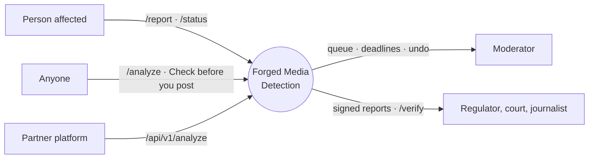

---

## 2. Why this project exists

### The problem

- **Fake images are cheap to make and fast to spread.** Face-swap apps and diffusion image generators let anyone produce a convincing fake of a real person in seconds.
- **The harm is personal.** The worst cases are non-consensual intimate images (NCII) and sexualised deepfakes of real people. For the person in the image, every hour it stays up means more copies.
- **Laws now set hard deadlines.** India's IT Rules (2026 amendments) require platforms to act on user complaints about deepfake or intimate imagery within **2 hours** and on government orders within **3 hours**. The US *Take It Down Act* sets **48 hours**. Missing the deadline has legal consequences.
- **Existing tools solve one piece each.** Detectors produce a score but no workflow. Hash-matching services catch *known* images but not new fakes. Manual review is accurate but slow, and exposes moderators to harmful content.
- **Victims face a wall.** Reporting often needs an account, legal language and several forms, and afterwards there is no way to see what happened.
- **Evidence is fragile.** A screenshot of a moderation dashboard proves little. A takedown decision that cannot be verified later is hard to rely on in a complaint or in court.

### The idea

Put the whole chain in one place (detection, routing, legal deadlines, reporting, evidence) and design it around two principles:

1. **Privacy by construction.** If the system never stores the image, it can never leak it. Only a fingerprint is kept, which is enough to recognise re-uploads but cannot be turned back into the picture.
2. **Humans decide the hard cases.** Automation handles the clear ones and gives moderators fast, safe tools for the rest.

---

## 3. Who it is for

| Person | Their goal | Where they start | What they get |
|---|---|---|---|
| **Person affected** (victim, or someone acting for them) | Get a fake or intimate image of themselves removed, quickly and privately | Landing page → **Report an image** (`/report`) | No-account report in 4 steps, English or हिन्दी, a case number + PIN, and a status page showing the legal deadline and outcome |
| **Curious visitor / careful poster** | Check whether an image looks manipulated, or whether it matches known abusive content before sharing | Landing page → **Check an image** (`/analyze`) | A plain verdict (*Likely forged* / *Needs a closer look* / *Looks genuine*) with details on request, and an on-device check that sends only a fingerprint |
| **Moderator / trust & safety team** | Clear the review queue safely and meet every legal deadline | **Sign in** → Queue (`/queue`) and Compliance (`/compliance`) | Deadline-first queue, blurred thumbnails, keyboard shortcuts, batch actions, 10-second undo, SLA countdowns with escalation, one-click signed reports |
| **Partner platform / developer** | Screen every upload automatically from their own backend | Landing page → **Integrate the API** (`/api-access`, keys issued by a moderator) | REST endpoint with API keys, plan-based rate limits and usage stats. See [`API_DOCS.md`](../API_DOCS.md) |
| **Verifier** (regulator, court, journalist, the reporter) | Confirm what happened to an image and that a report is genuine | Landing page → **Verify** (`/verify`) | Public provenance lookup and audit trail, label check, report signature check |
| **Evaluator / judge** | Understand the model's performance and its limits | **Results** (`/dashboard`), **Explained** (`/explained`) | Metrics, charts, caveats, and a printable plain-language one-pager |

---

## 4. Features

### 4.1 Detection

| Feature | What it does |
|---|---|
| Forgery score | EfficientNet-B0 classifier (224×224 input) outputs P(face manipulated), 0–1 |
| Explicit score | Separate NSFW classifier (`Falconsai/nsfw_image_detection` via transformers, or an offline heuristic), 0–1 |
| Grad-CAM heatmap | Overlay showing which regions drove the forgery score |
| Generation family | Best-effort guess of *GAN-era* vs *diffusion-era* fake, or *unknown* when unsure |
| Plain-language verdict | *Likely forged* / *Needs a closer look* / *Looks genuine*, with icon and text, and technical details behind **See details** |

### 4.2 Routing and moderation

| Feature | What it does |
|---|---|
| Decision engine | Maps scores to `ALLOW`, `REVIEW` or `AUTO_FLAG` using configurable thresholds |
| Moderator queue | `REVIEW` items, ordered by nearest legal deadline, then oldest; blurred placeholder thumbnails only |
| Keyboard workflow | `J`/`K` move, `A` approve, `R` reject, `S` skip, `X` select, `M` select similar, `U` / `Ctrl+Z` undo, `Esc` clear |
| Batch + near-duplicates | Select every item whose fingerprint is within 10 bits of the current one and act on all of them |
| 10-second undo | Every decision waits 10 s with a countdown before it is sent, so the append-only audit log never needs reversing |

### 4.3 Compliance

| Feature | What it does |
|---|---|
| SLA clocks | Each complaint gets a deadline from the jurisdiction rules table; status moves `ON_TRACK` → `AT_RISK` (≤ 30 min) → `BREACHED` |
| Escalation | Log line plus optional webhook on every move into `AT_RISK` or `BREACHED` |
| Jurisdiction rules as data | `IN` 2 h / 3 h, `US` 48 h, `GENERIC` 24 h, seeded on first boot. Add a country with one SQL insert, no code change |
| Rules transparency | Compliance page card and `GET /api/compliance/rules` list every rule with its legal reference |

### 4.4 Reporting for affected people

| Feature | What it does |
|---|---|
| Report wizard (`/report`) | Choose image → who is in it + consent → optional details and contact → review and send. No account |
| Privacy first | Privacy statement before file selection; preview blurred by default |
| Case number + PIN | `FMD-XXXX-XXXX` (no look-alike characters) and a 6-digit PIN shown once, stored only as a BCrypt hash |
| Case status (`/status`) | *Being reviewed* / *Content removed* / *Reviewed, not removed*, with timeline and legal deadline |
| Brute-force protection | Unknown case and wrong PIN give the same answer; 5 wrong PINs lock the case for 15 minutes |
| Notifications | Status changes are logged with the contact masked and optionally sent to a webhook, in the reporter's language |
| Bilingual | English and हिन्दी across the public flows, remembered per browser |

### 4.5 Provenance and evidence

| Feature | What it does |
|---|---|
| Provenance ID | Every analysis gets a unique, traceable ID |
| Signed label | An XMP manifest (ID, pixel hash, scores, decision, issuer) signed with HMAC-SHA256 and embedded in a downloadable labelled copy. Pixels are untouched |
| Re-upload tracing | Traces uploads back to the original by label, by identical pixel hash, or by identical perceptual hash |
| Audit trail | Append-only events: analysed, re-upload detected, decision changed, complaint opened, SLA escalated, SLA resolved, report generated |
| Evidence report | One-click PDF: decision, scores, IDs, hashes, SLA timestamps, forensic panels (Grad-CAM, FFT, ELA), audit trail |
| Signed reports | Ed25519 signature over a canonical snapshot of the facts; `VALID` / `TAMPERED` (with changed fields) / `NOT_FOUND` check at `/api/verify-report/{id}` |
| Public verification (`/verify`) | Look up an ID or drop a labelled file to see its trail. No complaint references or moderator names are exposed |

### 4.6 Prevention

| Feature | What it does |
|---|---|
| Check before you post | The browser computes a perceptual hash of the image and sends **only the hash** (under 50 bytes) to `POST /api/prescreen` |
| Known-hash list | Confirmed takedowns are added automatically; bulk import supports StopNCII-style lists (pHash and PDQ) |
| No information leak | The answer is only match / no match plus advice, never the distance or the source |

### 4.7 Partner API

| Feature | What it does |
|---|---|
| `POST /api/v1/analyze` | Scores and routes an image from a partner's backend |
| API keys | `fmd_live_…`, shown once, stored as SHA-256; issue, rotate, revoke and re-plan on `/api-access` |
| Rate limits | Token bucket per key: FREE 10, PRO 60, ENTERPRISE 600 requests per minute, with `X-RateLimit-*` headers and `429` + `Retry-After` |
| Usage | `GET /api/v1/usage`: plan, quota, request and throttled counts, analyses by decision |

### 4.8 Experience

- **Landing page (`/`)** explains the platform, offers one entry point per role, and shows how it works, how it differs and what is stored.
- **Accessibility:** skip link, labelled controls, focus management, `aria` roles on status and alerts, and icon + text on every verdict, stage and deadline so colour is never the only cue.
- **Friendly errors:** plain sentences instead of HTTP codes, with a retry button where it helps.
- **Dark and light themes:** a sun / moon button in the header. The first visit follows the device setting, the choice is remembered per browser (`fmd_theme`), and it is applied before the page paints so there is no flash.
- **Terms and Conditions (`/terms`) and Privacy Policy (`/privacy`):** written from what the software actually does (what is stored, what never is, who can see it, retention, rights, acceptable use, what results mean). Linked from the footer and the report wizard's final step, printable, with a notice that they are templates to be completed and reviewed by counsel before a real launch.

---

## 5. How it works

### 5.1 Architecture

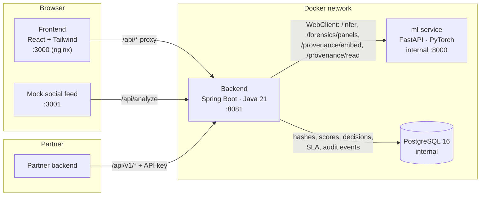

- **Frontend** — React 19 single-page app, served by nginx, which also proxies `/api/*` to the backend. Public pages load immediately; moderator pages are code-split and load on demand.
- **Backend** — the only public API. Owns security, the decision engine, SLA clocks, complaints, provenance, reports, API keys and rate limiting. Talks to the ML service over the internal Docker network only.
- **ml-service** — stateless inference. Loads the models once at startup. Returns scores, heatmap, hashes, family, forensic signature, and writes / reads provenance manifests. Not reachable from outside.
- **PostgreSQL** — structured data only, no images.

### 5.2 Analysing an image

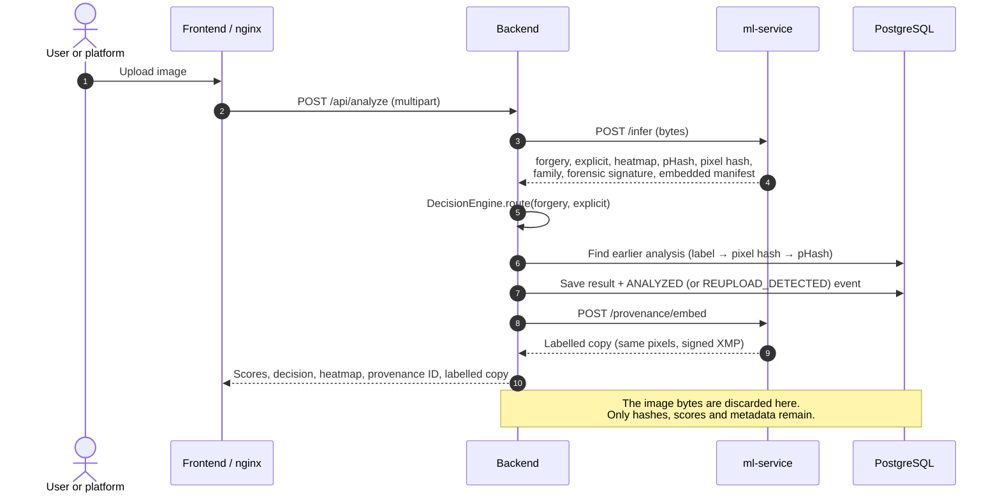

### 5.3 Decision rules

The same thresholds drive the backend decision and the user-facing verdict (defaults; all configurable):

| Condition | Decision | Verdict shown |
|---|---|---|
| forgery ≥ 0.85 **or** explicit ≥ 0.85 | `AUTO_FLAG` | *Likely forged* |
| forgery ≥ 0.50 **or** explicit ≥ 0.50 | `REVIEW` (human queue) | *Needs a closer look* |
| otherwise | `ALLOW` | *Looks genuine* |

The verdict headline is based on the forgery score alone. The explicit score affects routing and appears only under **See details**, so the headline never labels a person's image as "explicit".

### 5.4 Reporting an image (person affected)

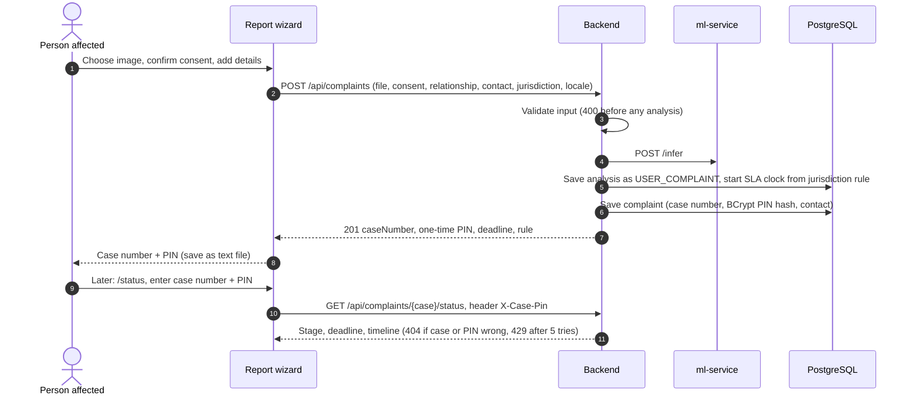

### 5.5 Moderator decision with undo

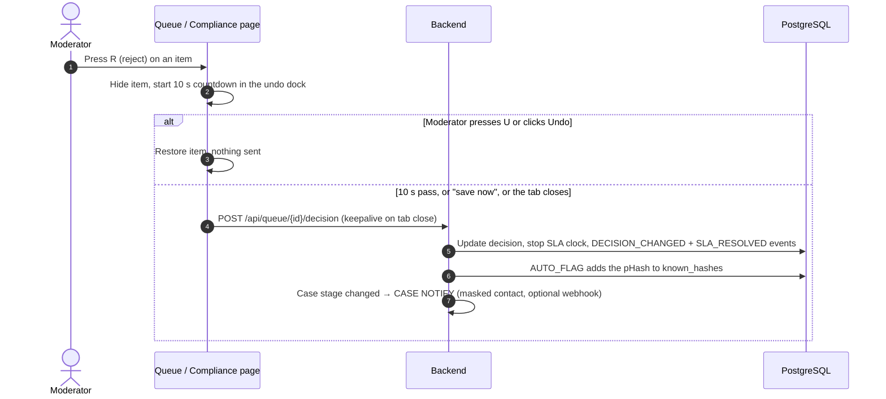

Undo is done in the browser *before* anything is sent, so the audit log stays strictly append-only and no side effect ever needs reversing.

### 5.6 SLA lifecycle

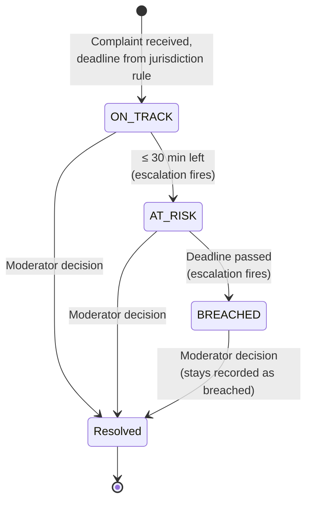

`SlaClockService` re-evaluates open clocks every 15 seconds (configurable). The rule label (for example "India IT Rules 2026 — 2h") is frozen onto the case when the clock starts, so later edits to the rules table never rewrite open cases.

### 5.7 Check before you post (on-device hashing)

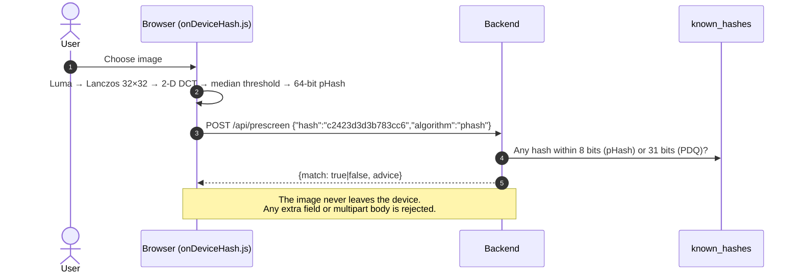

The JavaScript hash is a bit-exact port of the Python `imagehash.phash` the server uses, verified by test vectors, so browser and server fingerprints can be compared directly.

### 5.8 Provenance labels and verification

- **Label.** An XMP packet (JPEG APP1 or PNG iTXt) carrying provenance ID, SHA-256 of the decoded pixels, timestamp, scores, decision, issuer and optional `derivedFrom`, signed with HMAC-SHA256.
- **Read-back statuses.** `VERIFIED`, `CONTENT_MODIFIED` (pixels edited after labelling) or `INVALID_SIGNATURE` (manifest forged or edited).
- **Without a label.** If metadata was stripped, re-uploads are still traced by identical pixel hash, then identical pHash.
- **Public view.** `/verify` and `GET /api/verify/{id}` show the decision, scores, hashes, re-upload count and events, without complaint references or moderator names.

### 5.9 Signed evidence reports

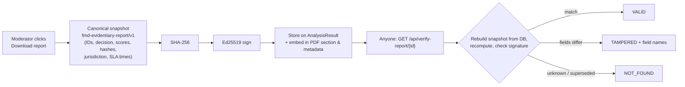

Forensic panels are drawn from a coarse numeric **forensic signature** saved at analysis time (14×14 attention grid, 16×16 error-level grid, 32×32 log-spectrum grid, 32-bin radial profile). These numbers cannot be turned back into the image, so reports work without keeping the media. A moderator may attach the original for full-resolution panels; it is checked against the stored pixel hash and discarded afterwards.

### 5.10 Machine-learning pipeline

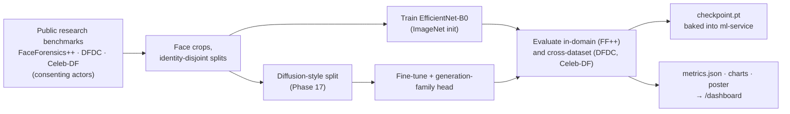

- **Forgery model:** EfficientNet-B0 backbone, binary head, plus an optional family head on the same pooled features, trained on fakes only. Family is reported as `unknown` when the forgery score is below 0.5 or when 0.35 < P(diffusion) < 0.65.
- **Explainability:** Grad-CAM on the last convolutional block, returned as a PNG overlay.
- **Explicit classifier:** separate model, so the two scores are independent and one cannot mask the other.
- **Hashes:** pHash (64-bit DCT) for similarity, SHA-256 of decoded pixels for exact identity, PDQ supported for StopNCII-style imports.

### 5.11 Data model

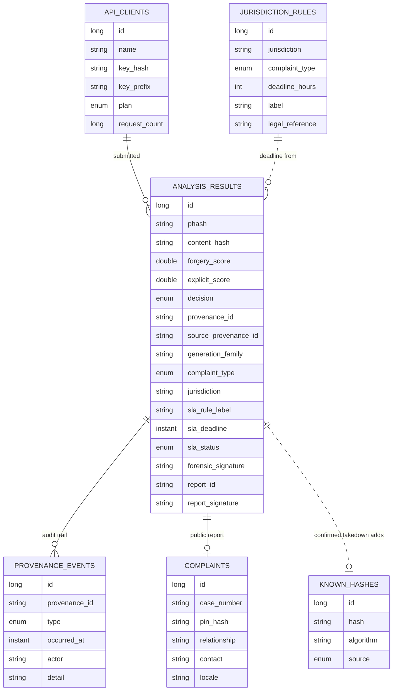

Nothing in this model can hold image bytes.

### 5.12 Security model

| Surface | Authentication | Notes |
|---|---|---|
| Public pages and `/api/analyze`, `/api/complaints`, `/api/prescreen`, `/api/verify*`, `/api/stats` | None | Rate-sensitive endpoints accept only what they need (prescreen rejects anything but a hash) |
| Case status | Case number + PIN in the `X-Case-Pin` header | PIN never in the URL; BCrypt; same 404 for unknown or wrong; lockout after 5 failures |
| Moderator endpoints (`/api/queue`, `/api/compliance/*`, `/api/admin/*`) | HTTP Basic, role `MODERATOR` | Signed-out UI routes redirect to sign-in and return afterwards |
| Partner API (`/api/v1/**`) | API key only (`X-API-Key` or Bearer) | Separate stateless security chain; moderator credentials are rejected there and keys never open moderator endpoints |
| ml-service, PostgreSQL | Not exposed | Internal Docker network only |

Secrets that must be changed outside development: moderator password, `PROVENANCE_SIGNING_KEY`, the report-signing keypair (use a KMS/HSM), and `API_DEMO_KEY` (leave empty).

### 5.13 Privacy design

| Kept | Never kept |
|---|---|
| Perceptual hash, pixel SHA-256 | The uploaded image |
| Forgery / explicit scores, decision, family | The labelled copy (returned, not stored) |
| Coarse numeric forensic signature | An original attached for a report (verified, then discarded) |
| SLA and provenance timestamps, audit events | Anything from the on-device check (only a hash is sent, nothing is stored) |
| For public reports: case number, PIN hash, optional contact and notes | The PIN itself |

Moderators see blurred placeholders generated from the hash, so they are never shown the harmful image through this tool.

---

## 6. User workflows

The landing page (`/`) is the front door. Each role has a card that leads into its flow, and each flow ends by pointing to the next sensible step, so there are no dead ends.

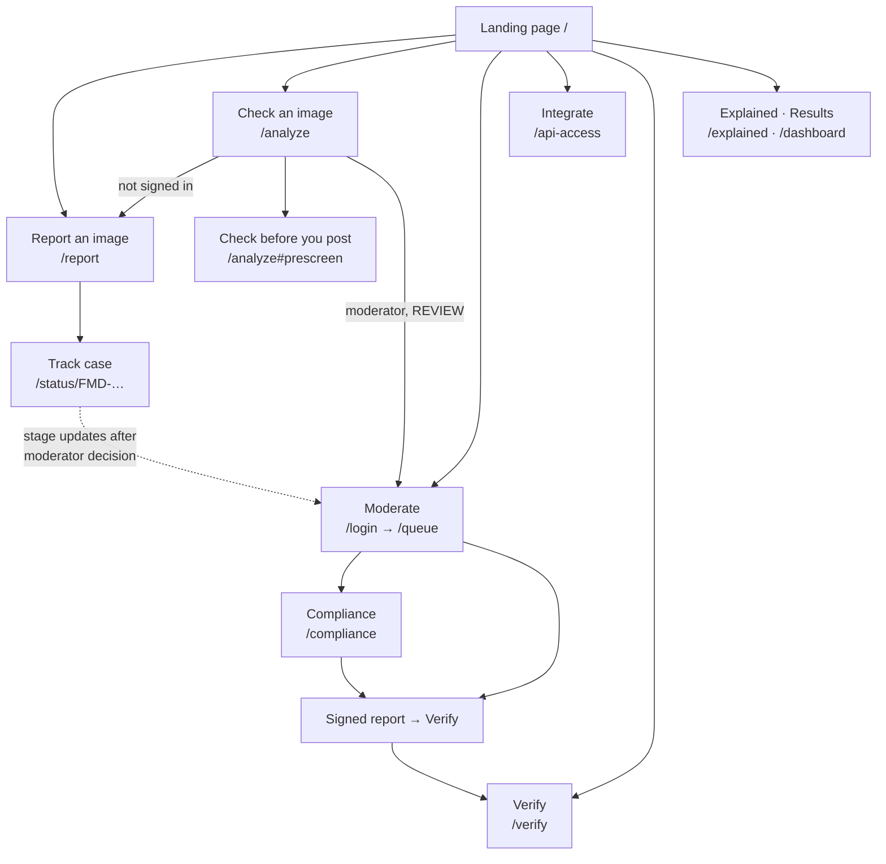

### 6.1 Person affected

1. On the landing page, choose **Report an image** (or **Track a case** if they already have one).
2. **Choose the image.** A privacy note explains that the image is checked and then discarded; the preview is blurred. A link offers the on-device check instead.
3. **Who is in it.** *It's me* or *I'm helping someone*, plus a consent checkbox.
4. **Details (optional).** Where it was seen, notes, an email or phone for updates, and the country, which sets the legal deadline.
5. **Review and send.** They receive a case number and a PIN, with a button to save both as a text file.
6. **Track.** On `/status` they enter both and see *Being reviewed*, the deadline, and a timeline. After a moderator acts it changes to *Content removed* or *Reviewed, not removed*, and a notice is sent if they left a contact.

### 6.2 Visitor checking an image

1. Landing page → **Check an image** (`/analyze`).
2. Drop an image. The result leads with the verdict and what happens next; **See details** reveals scores, generation family and the heatmap.
3. If the image shows them, a card offers **Report it** (`/report`).
4. They can download a labelled copy that carries a verifiable provenance label.
5. **Check before you post** (same page) tests an image against known abusive content without uploading it.

### 6.3 Moderator

1. **Sign in** (`/login`), which lands on the queue.
2. **Queue:** items with the nearest legal deadline come first. Use the keyboard to approve, reject, skip, or select similar items and act on them together. Every decision can be undone for 10 seconds.
3. **Compliance:** live countdowns for every open complaint, escalation times, jurisdiction badges and the rules card. **Take down** or **Dismiss** stops the clock.
4. **Evidence:** **Download report** produces the signed PDF; **Verify report integrity** confirms it.
5. **API:** issue and manage partner keys on `/api-access`.

### 6.4 Partner platform

1. A moderator creates a client on `/api-access` and hands over the key (shown once).
2. The platform calls `POST /api/v1/analyze` for each upload and acts on `decision`: publish on `ALLOW`, hold on `REVIEW`, block on `AUTO_FLAG`.
3. It watches `X-RateLimit-*` headers and backs off on `429`, and checks `GET /api/v1/usage` for quota.
4. The mock social feed on port 3001 shows this integration end to end.

### 6.5 Verifier

1. Landing page → **Verify** (`/verify`).
2. Enter a provenance ID or drop a labelled file to see the signature and pixel checks and the full audit trail.
3. Enter a report ID (`RPT-…`) from a PDF to check its Ed25519 signature: `VALID`, `TAMPERED` (which fields changed) or `NOT_FOUND`.

---

## 7. How it helps

| Stakeholder | Benefit |
|---|---|
| **People affected** | Report in minutes without an account or legal language, in their own language; know the legal deadline; see the outcome; never have to upload again to check a known image |
| **Moderators** | Deadline-first ordering means the most urgent case is always on top; blurred thumbnails reduce exposure to harmful content; keyboard, batch and near-duplicate selection cut clicks; undo removes the fear of a mis-click |
| **Platforms** | One API call per upload; automatic routing so humans only see the uncertain cases; proof of meeting each deadline; no liability for storing harmful media |
| **Regulators and courts** | Verifiable, signed reports and an append-only audit trail instead of screenshots; rules and legal references are visible |
| **The public** | A free way to check an image and to check before sharing; plain-language explanations of what the system does and does not claim |
| **Researchers** | Honest separation of in-domain and cross-dataset results, GAN-era vs diffusion-era blocks, and reproducible scripts |

---

## 8. How it is different

### 8.1 Compared with other approaches

| Capability | This platform | Detection-only tools | Hash-matching services | Manual review only |
|---|---|---|---|---|
| Catches **new** fakes nobody has seen before | Yes | Yes | No | Partial |
| Catches **re-uploads** of known images | Yes | No | Yes | Partial |
| Routes to allow / human / auto-flag | Yes | No | Partial | No |
| Tracks the legal takedown deadline per country | Yes | No | No | Partial |
| Produces verifiable, signed evidence | Yes | No | No | No |
| Never stores the image | Yes | Partial | Yes | No |
| No-account reporting for affected people, with tracking | Yes | No | Partial | Partial |

"Partial" means some tools in that category offer it, or it is possible with extra manual work. The categories are generalisations, not a claim about any specific product.

### 8.2 Design choices that set it apart

1. **Two independent scores.** A forgery score and an explicit score from separate models, so an explicit fake can't hide behind a low forgery score, and vice versa.
2. **Detection plus workflow.** The score is the start, not the end: routing, queue, deadlines, notifications and evidence are part of the same system.
3. **Deadlines are data.** Jurisdiction rules live in a table with legal references; adding a country is an SQL insert. Rule labels are frozen per case for auditability.
4. **Privacy by construction.** No table can hold image bytes. Reports draw panels from a non-invertible numeric signature. The on-device check sends only a hash, and the endpoint rejects anything else.
5. **Append-only truth.** Audit events are never edited. Undo happens before submission, so it never needs to rewrite history.
6. **Verifiable by anyone.** Signed provenance labels on images and Ed25519-signed reports can be checked publicly without an account.
7. **Built for the person affected.** No account, four steps, two languages, case number + PIN, plain-language stages and deadlines.
8. **Honest about limits.** Results are labelled with their data source, and the landing page shows latency and design facts rather than headline accuracy.
9. **One-command deployment.** `docker compose up` runs everything locally, including the mock platform.

---

## 9. Results and honest caveats

| Measure | Value | What it means |
|---|---|---|
| End-to-end latency (`POST /api/analyze`, CPU, full stack) | p50 131.7 ms · mean 134.1 ms · p95 188.2 ms | Fast enough to screen uploads inline (n = 5 after warm-up) |
| False-positive rate on a clean set | 0 / 15 at threshold 0.5 | No clean image was flagged in this small **synthetic** set |
| Accuracy / AUC (FF++ in-domain, DFDC and Celeb-DF held out) | 1.0 | From a **smoke run on synthetic splits** with the bundled demo checkpoint |
| Diffusion-era AUC, before → after retraining | 0.119 → 1.000 | On a **synthetic diffusion-inpainting stand-in**; GAN-era set did not regress |
| Generation-family head | 40/40 diffusion, 15/15 GAN-era | Same synthetic sets |

> **Read these carefully.** The accuracy figures show that the pipeline works end to end. They are **not** real-world detection claims. Report-quality numbers need licensed FaceForensics++ / DFDC / Celeb-DF crops placed under `ml/data/crops`, retraining, and re-running the evaluation (see the README). Detecting diffusion-era fakes in general is an open research problem.

The dashboard (`/dashboard`) shows these metrics with the same caveats, plus live decision counts.

---

## 10. Technology stack

| Layer | Technology |
|---|---|
| Frontend | React 19, Vite, Tailwind CSS v4, react-router-dom 7, lucide-react icons, i18next / react-i18next, served by nginx |
| Backend | Spring Boot 3.4, Java 21, Spring Security, Spring Data JPA, WebClient, OpenPDF, Ed25519 (JDK), BCrypt |
| ML service | Python 3.12, FastAPI, PyTorch (CPU), torchvision EfficientNet-B0, transformers (NSFW), OpenCV, Pillow, imagehash |
| Database | PostgreSQL 16 (H2 in backend tests) |
| Packaging | Docker, Docker Compose |
| Testing | JUnit 5 + MockMvc, pytest, Node test runner, oxlint |

---

## 11. Repository structure

```
backend/                  Spring Boot API
  config/                 Enum constraint sync, jurisdiction rule seeder, clock, WebClient
  controller/             Analyze, Queue, Compliance, Complaint, Verify, ReportVerification,
                          Prescreen, ApiV1, ApiClientAdmin, Auth, Stats
  model/                  AnalysisResult, Complaint, ProvenanceEvent, KnownHash, JurisdictionRule,
                          ApiClient, enums (Decision, SlaStatus, ComplaintType, PlanTier, ...)
  security/               Security chains, API-key filter, rate limiter
  service/                DecisionEngine, Analysis, MlClient, SlaClock, Escalation, Compliance,
                          Case, CaseNotification, Provenance, Report, ReportSigning,
                          ForensicPanelRenderer, Prescreen, ApiKey
ml-service/               FastAPI: /health, /infer, /forensics/panels, /provenance/embed, /provenance/read
ml/                       Data pipeline, training, evaluation, explainability, poster, Phase 17 scripts
  models/                 forgery_model.py + checkpoint.pt
  results/                metrics.json, charts, poster, failure gallery
frontend/
  src/pages/              Landing, Demo (/analyze), ReportWizard, CaseStatus, ModerationQueue,
                          Compliance, Verify, Dashboard, ApiAccess, Explained, Login
  src/components/         Layout, ui kit, VerdictBadge, PrescreenCard, PrivacyNote, LanguageToggle, ...
  src/context/            Auth, Stats, Toast, Decision (undo)
  src/lib/                verdict, queue, cases, errors, provenance, family, ...
  src/utils/              onDeviceHash.js (browser pHash)
  src/i18n/               en.json, hi.json
mock-social-feed/         Static "platform" calling /api/analyze on each post
docs/                     This document
API_DOCS.md · ONE_PAGER.md · IMPLEMENTATION_PLAN.md · README.md
docker-compose.yml · docker-compose.dev.yml · .env.example
```

---

## 12. Running it

```bash
cp .env.example .env          # PowerShell: Copy-Item .env.example .env
docker compose up --build -d
docker compose ps             # wait for "healthy"; ml-service may take 1–3 minutes
```

| URL | Page |
|---|---|
| http://localhost:3000 | Landing page |
| http://localhost:3000/analyze | Check an image (and Check before you post) |
| http://localhost:3000/report | Report wizard |
| http://localhost:3000/status | Case status |
| http://localhost:3000/queue | Moderation queue (`moderator` / `moderator`) |
| http://localhost:3000/compliance | SLA monitor |
| http://localhost:3000/verify | Provenance and report verification |
| http://localhost:3000/dashboard | Results |
| http://localhost:3000/api-access | Partner API keys |
| http://localhost:3000/explained | Plain-language one-pager |
| http://localhost:3000/terms · /privacy | Terms and Conditions · Privacy Policy |
| http://localhost:3001 | Mock social feed |

Every setting is an environment variable with a safe default. The full table is in the [README configuration section](../README.md#configuration). A guided 5-minute demo script is in the [README demo section](../README.md#demo-script-about-5-minutes).

---

## 13. API summary

| Group | Endpoints | Auth |
|---|---|---|
| Analyse | `POST /api/analyze` | Public |
| Report and track | `POST /api/complaints`, `GET /api/complaints/{caseNumber}/status` | Public / PIN |
| Prescreen | `POST /api/prescreen` | Public (hash only) |
| Verify | `GET /api/verify/{id}`, `POST /api/verify`, `GET /api/verify-report/{id}`, `GET /api/verify-report/public-key` | Public |
| Moderation | `GET /api/queue`, `POST /api/queue/{id}/decision`, `POST /api/queue/{id}/report` | Moderator |
| Compliance | `POST /api/compliance/complaints`, `GET /api/compliance/queue` · `/breaches` · `/summary` · `/rules` | Moderator (filing is public) |
| Admin | `/api/admin/clients…`, `/api/admin/known-hashes…` | Moderator |
| Partner | `POST /api/v1/analyze`, `GET /api/v1/usage` | API key |
| Misc | `GET /api/stats`, `POST /api/auth/login`, `GET /api/auth/me` | Public |

Full parameters and responses: [README API table](../README.md#api) and [`API_DOCS.md`](../API_DOCS.md).

---

## 14. Testing

| Suite | Command | Covers |
|---|---|---|
| Backend (83 tests) | `cd backend && mvn test` | Decision engine, API, auth, SLA and jurisdiction rules, provenance, PDF and signed reports, API keys and rate limits, prescreen, public complaints (case + PIN, lockout, notifications, queue order) |
| ML service | `cd ml-service && python -m pytest` | Health, `/infer`, NSFW, provenance manifests, forensic signature, generation family |
| ML pipeline | `cd ml && python -m pytest tests data/tests` | Data pipeline, model, plots, poster, diffusion split and family head |
| Frontend | `cd frontend && npm test` | Browser pHash parity with Python, Hindi/English key coverage, case-number and contact validation, queue urgency order, near-duplicates |
| Lint / build | `npm run lint`, `npm run build` | Static checks, production bundle |

---

## 15. Ethics, safety and data policy

- **No real harmful imagery, anywhere.** The repository never includes, downloads, generates or references real non-consensual or explicit images: not in code, fixtures, tests or sample data. Training and testing use only public research benchmarks with consenting actors (**FaceForensics++, DFDC, Celeb-DF**) or synthetic data. The prescreen demo uses a synthetic pattern.
- **No images stored.** Only perceptual hashes, scores and metadata go into the database.
- **Humans in the loop.** Uncertain cases go to a person. Moderators see blurred placeholders, never the image.
- **Minimal personal data.** Public reports keep only a hashed PIN and, if the reporter chooses, a contact detail and notes, used only for status notices.
- **No hidden inference.** Jurisdiction is chosen explicitly, never guessed from IP address.
- **Honest claims.** Every metric is labelled with its data source; the landing page avoids accuracy headlines.

---

## 16. Limitations

- **Model performance is unproven on real data.** Metrics come from synthetic smoke splits; retraining on licensed benchmark data is required for real figures. No detector generalises perfectly to new generators.
- **Images only.** Video and audio are out of scope.
- **Faces.** The forgery model is trained on face crops; non-face manipulations are not its target.
- **Keys in development mode.** The report-signing key is a file on disk and the provenance key is a shared secret; production needs a KMS/HSM and proper rotation. Report timestamps use the server clock; legal admissibility would need an RFC 3161 timestamp authority and legal review.
- **Single-instance state.** Rate-limit buckets and PIN lockouts are in memory per backend instance.
- **Notifications are a stub.** Logging plus an optional webhook; no email or SMS provider.
- **StopNCII compatibility, not integration.** Matching logic and import are ready; a live integration needs formal participation approval and credentials.
- **Translation.** The Hindi strings are in-house and should be reviewed by a native speaker.
- **Single moderator role.** No per-team permissions or assignment.

---

## 17. Roadmap

1. Retrain and evaluate on licensed FaceForensics++ / DFDC / Celeb-DF data and real diffusion fakes; publish per-dataset results.
2. Video support (frame sampling, temporal consistency).
3. KMS/HSM-backed signing, key rotation with published history, RFC 3161 timestamps.
4. Distributed rate limiting and lockout (Redis).
5. Email / SMS notifications through a provider, with templates per language.
6. Live StopNCII participation and server-side PDQ on every upload.
7. More jurisdictions (EU DSA, UK Online Safety Act, Brazil, Australia) with reviewed legal references.
8. More languages, reviewed by native speakers.
9. Moderator teams, assignment, and wellbeing controls (exposure limits, breaks).
10. C2PA-compatible provenance manifests.

---

## 18. Glossary

| Term | Meaning |
|---|---|
| **Deepfake / forgery** | An image in which a face has been swapped, generated or edited to show something that did not happen |
| **NCII** | Non-consensual intimate imagery |
| **Forgery score** | Model's estimate (0–1) that the face in the image is manipulated |
| **Explicit score** | Separate model's estimate (0–1) that the image is sexually explicit |
| **Grad-CAM heatmap** | Picture showing which regions most influenced the forgery score |
| **GAN-era / diffusion-era** | Two generations of image-generation technology; fakes from each leave different traces |
| **Perceptual hash (pHash)** | A short fingerprint that stays nearly the same when an image is resized or recompressed, and cannot be turned back into the image |
| **Hamming distance** | Number of differing bits between two hashes; small means visually similar |
| **PDQ** | Meta's 256-bit perceptual hash, used by StopNCII |
| **StopNCII** | A service where victims hash their own images so platforms can block them without ever seeing them |
| **SLA** | Service-level agreement; here, the legal deadline to act on a complaint |
| **Provenance ID** | Unique ID given to every analysed image, used to trace it later |
| **Manifest / label** | Signed metadata embedded in an image file describing its analysis |
| **Audit trail** | Append-only list of everything that happened to an item |
| **Ed25519** | A modern digital-signature algorithm used to sign reports |
| **Case number / PIN** | What a reporter uses to track a case without an account |
| **AUTO_FLAG / REVIEW / ALLOW** | The three routing decisions: act automatically, send to a human, or let through |

---

## 19. FAQ

**Does it store my photo?**
No. The image is checked in memory and discarded. Only its fingerprint, the scores and the decision are kept. The on-device check doesn't even send the photo.

**Can a moderator see my photo?**
No. Moderators see a blurred placeholder generated from the fingerprint, plus the scores.

**Do I need an account to report?**
No. You get a case number and PIN instead. Keep them safe: the PIN is shown only once.

**What if I lose my PIN?**
It can't be recovered, because it is stored only in scrambled form. File a new report if needed.

**How fast will my report be handled?**
The deadline depends on your country's rule, for example 2 hours in India and 48 hours in the US, and is shown on your status page.

**Is the detector always right?**
No. It is a screening tool: uncertain cases go to a human, and its accuracy has not yet been established on real-world data (see section 9).

**How can someone confirm a report wasn't altered?**
Enter the report ID on `/verify` or call `GET /api/verify-report/{id}`. Any change to the recorded facts shows as `TAMPERED`.

**Can other platforms use it?**
Yes, through the partner API with an API key and plan-based rate limits.

---

## 20. Project history

| Phase | Delivered |
|---|---|
| 0 | Project scaffolding, Docker Compose skeleton |
| 1 | Offline data pipeline with identity-disjoint splits |
| 2 | EfficientNet-B0 forgery model |
| 3 | Grad-CAM explainability |
| 4 | Explicit-content classifier |
| 5 | FastAPI inference service |
| 6 | Decision engine |
| 7 | Spring Boot API layer |
| 8 | Authentication and roles |
| 9 | React frontend |
| 10 | Mock social feed integration |
| 11 | Testing and evaluation, results poster |
| 12 | Deployment and exhibition prep, premium UI |
| 13 | Compliance SLA engine with escalation |
| 14 | Provenance labels and audit trail |
| 15 | Evidentiary PDF reports |
| 16 | Self-serve partner API with keys and rate limits |
| 17 | Diffusion-era robustness and generation-family head |
| 18 | On-device hashing, StopNCII-compatible prescreen |
| 19 | Multi-jurisdiction compliance rules |
| 20 | Cryptographically signed reports |
| 21 | User-friendly UX: report wizard, case status, plain verdicts, keyboard queue, undo, accessibility, Hindi |
| — | Landing page with role-based entry points, and this documentation |
| — | Dark / light themes, Terms and Conditions, Privacy Policy |
