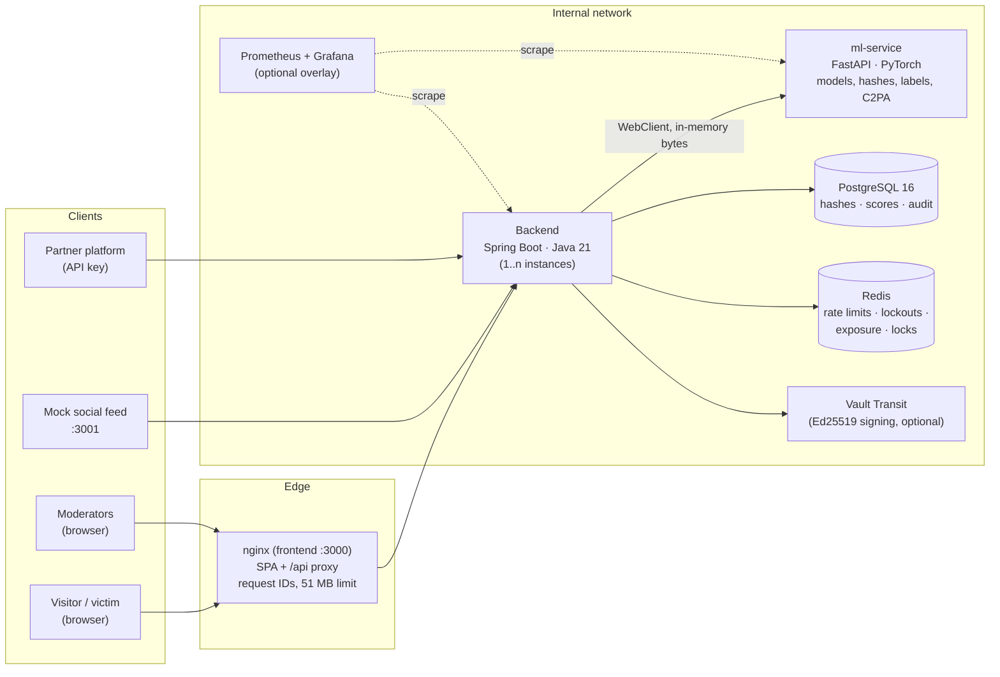
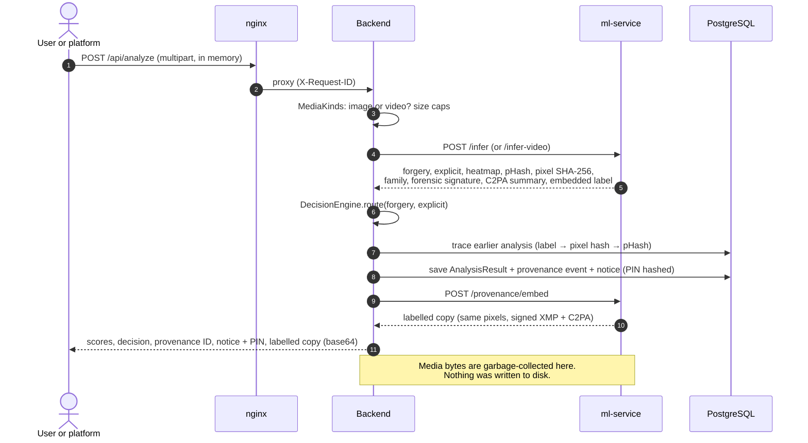
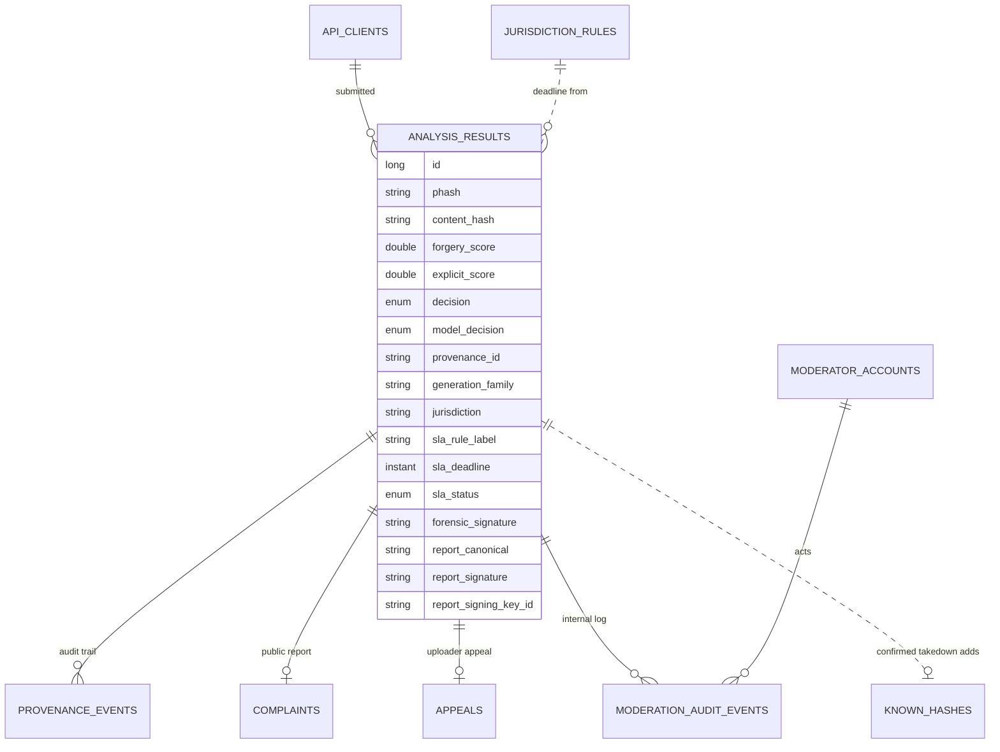
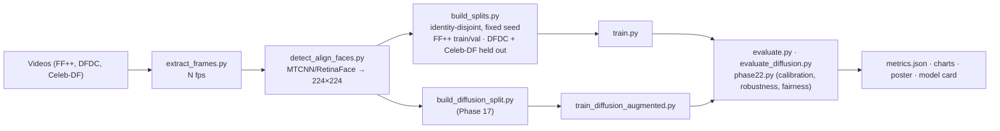
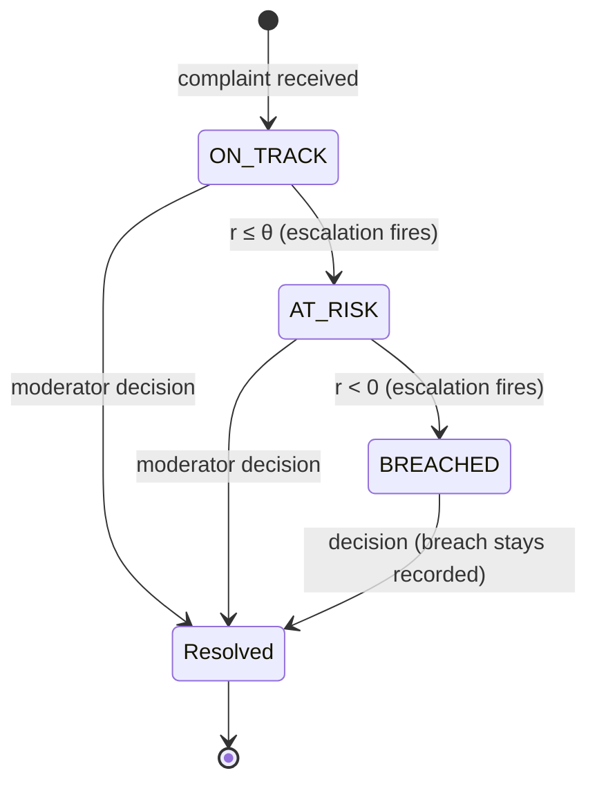
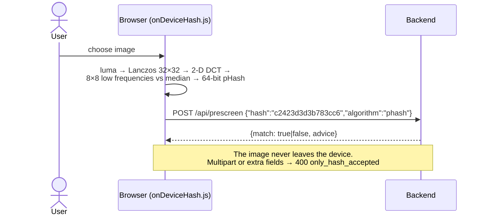
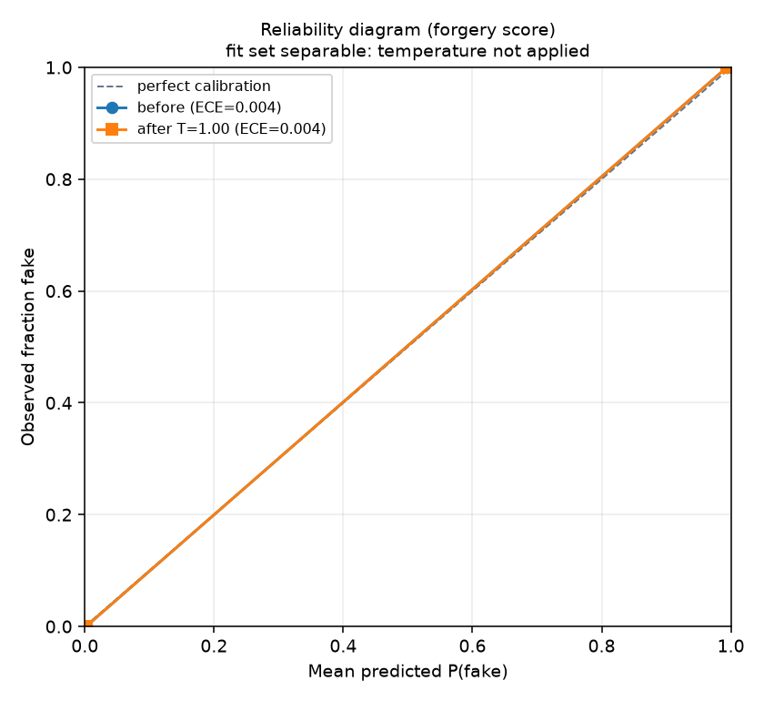
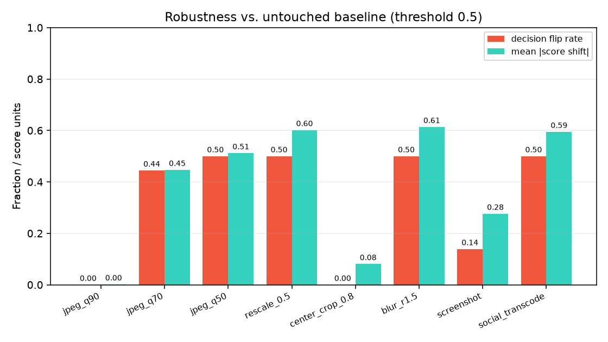

# Forged Media Detection: A Privacy-Preserving Trust-and-Safety System for Deepfake and Non-Consensual Intimate Imagery

**Research and Project Report**

| | |
|---|---|
| **Author** | Sunil Maurya |
| **Repository** | [Forged-Obscene-Media-Detection-Engine](https://github.com/SunilMaurya-18/Forged-Obscene-Media-Detection-Engine) |
| **Version** | 1.0 (covers implementation Phases 0–25) |
| **Date** | 28 September 2026 |
| **Stack** | Java 21 / Spring Boot 3.4 · Python 3.12 / FastAPI / PyTorch · React 19 / Tailwind 4 · PostgreSQL 16 · Redis · Docker Compose |

---

## Abstract

Generative models can now produce convincing manipulated images of real people in seconds. The most harmful use is non-consensual intimate imagery (NCII), both synthetic ("deepfake nudes") and real images shared without consent. Legislators have responded by putting a clock on platforms: the amended Indian IT Rules as modelled in this project require action on a user's deepfake or NCII complaint within 2 hours and on a government order within 3 hours, and the US TAKE IT DOWN Act requires removal within 48 hours. Existing tools address one piece each. Detectors output a score but no workflow, hash-matching catches only images already known, and manual review is slow and harms the moderators who do it.

This report presents **Forged Media Detection**, an end-to-end trust-and-safety system that combines detection, routing, legal deadline tracking, victim reporting, due process and verifiable evidence in one platform. It is designed around one hard constraint: **raw media is never persisted**. The system scores every image, or every sampled video frame, with two independent models: an EfficientNet-B0 forgery detector with a GAN/diffusion family head, and a separate explicit-content classifier. It routes each item to `ALLOW`, `REVIEW` or `AUTO_FLAG`, starts a jurisdiction-specific takedown clock, and records an append-only provenance trail. Evidentiary reports are signed with Ed25519 over a canonical snapshot of the record and can be verified by anyone. A "check before you post" prescreen computes a perceptual hash in the browser and sends only the hash. Moderators get blurred, greyscale media, exposure limits, second review before any takedown is reversed, and an appeals process modelled on Article 20 of the EU Digital Services Act. Operators get CI, metrics, horizontal scaling through shared state, key management through a KMS, and a threat model.

The software is complete and tested: 138 backend tests, 58 ml-service tests, 24 ML-pipeline tests, 29 frontend tests and 4 browser end-to-end tests. The full stack runs with one command. The reference deployment saturates at about 8 analyses per second on a laptop CPU. The **model results are deliberately reported as pipeline validation, not real-world accuracy**: the bundled checkpoint was trained on synthetic crops because the licensed benchmarks (FaceForensics++, DFDC, Celeb-DF) require access approval. The robustness evaluation exposes a concrete failure mode: genuine images re-encoded as a social app would re-encode them are scored as forged (decision flip rate 0.50). This report documents the design, methods, results and limitations in full, so the system can be retrained and re-evaluated on real data with the same tooling.

**Keywords:** deepfake detection, non-consensual intimate imagery, content moderation, perceptual hashing, digital provenance, C2PA, Ed25519, takedown compliance, privacy by design, human-in-the-loop, trust and safety.

---

## Table of contents

1. [Introduction](#1-introduction)
2. [Background and related work](#2-background-and-related-work)
3. [Requirements and design principles](#3-requirements-and-design-principles)
4. [System architecture](#4-system-architecture)
5. [Machine-learning methodology](#5-machine-learning-methodology)
6. [Decision engine](#6-decision-engine)
7. [Compliance engine: jurisdiction-aware takedown clocks](#7-compliance-engine-jurisdiction-aware-takedown-clocks)
8. [Provenance and verifiable evidence](#8-provenance-and-verifiable-evidence)
9. [Victim-centred reporting and prevention](#9-victim-centred-reporting-and-prevention)
10. [Moderation workflow, due process and wellbeing](#10-moderation-workflow-due-process-and-wellbeing)
11. [Partner API](#11-partner-api)
12. [Engineering and operations](#12-engineering-and-operations)
13. [Evaluation and results](#13-evaluation-and-results)
14. [Security and privacy analysis](#14-security-and-privacy-analysis)
15. [Ethical, legal and social considerations](#15-ethical-legal-and-social-considerations)
16. [Limitations](#16-limitations)
17. [Future work](#17-future-work)
18. [Conclusion](#18-conclusion)
- [References](#references)
- [Appendix A: API summary](#appendix-a-api-summary)
- [Appendix B: Key configuration parameters](#appendix-b-key-configuration-parameters)
- [Appendix C: Development history](#appendix-c-development-history)
- [Appendix D: Reproducing the results](#appendix-d-reproducing-the-results)
- [Appendix E: Glossary](#appendix-e-glossary)

---

## 1. Introduction

### 1.1 Motivation

Face-swap applications and diffusion-based image generators have made it trivial to produce a realistic image of a real person doing something they never did. The harms fall into two overlapping categories:

1. **Manipulated media** (defamation, fraud, election disinformation): the image is fake, and whether it is explicit is irrelevant.
2. **Intimate imagery shared without consent**: the image may be synthetic *or* entirely real. Its harm comes from the lack of consent, not from manipulation.

For victims, speed matters above everything. An intimate image spreads across platforms within hours, and each re-share multiplies the harm. Regulators have therefore moved from asking platforms to "act expeditiously" to setting explicit deadlines, measured in hours.

At the same time, the people doing the work are harmed by it. Content moderators exposed to abusive imagery show elevated rates of psychological distress [Steiger et al., 2021]. Any credible system must reduce, not increase, their exposure.

### 1.2 Problem statement

A platform receiving user uploads, complaints and government orders needs to:

- **Detect** likely manipulated or explicit media at upload time, fast enough to sit inline.
- **Route** each item to the right outcome: publish, human review, or immediate hold, with humans deciding every uncertain case.
- **Meet legal deadlines** that depend on the jurisdiction and the type of complaint, and prove afterwards that it did.
- **Let victims report** without creating an account, and track their case privately.
- **Prevent re-uploads** of content already confirmed as abusive, without asking victims to hand over the image again.
- **Give the people being moderated due process**: a statement of reasons, and an appeal decided by someone else.
- **Produce evidence** that a court, regulator or partner can verify without trusting the platform's word.
- **Protect moderators** from unnecessary exposure.
- Do all of this **without storing the harmful media**, because every stored copy is another place it can leak from.

### 1.3 Objectives

| # | Objective | How it is met (section) |
|---|---|---|
| O1 | Two independent detection signals with explainability | §5, §6 |
| O2 | Configurable, auditable routing with a human-review band | §6, §10 |
| O3 | Jurisdiction-aware takedown clocks with escalation | §7 |
| O4 | Traceable provenance labels and tamper-evident, publicly verifiable reports | §8 |
| O5 | No-account victim reporting in English and Hindi, with on-device prescreening | §9 |
| O6 | Appeals, second review, teams, escalation, wellbeing controls and transparency reporting | §10 |
| O7 | A partner-facing API with keys and rate limits | §11 |
| O8 | Production-grade engineering: CI, observability, HA state, key management, supply-chain checks | §12 |
| O9 | Honest, reproducible evaluation: accuracy, calibration, robustness, fairness, load | §13 |
| O10 | Privacy by construction: no raw media stored anywhere | §3, §14 |

### 1.4 Contributions

1. **An integrated architecture** that joins detection, routing, compliance, provenance, reporting, due process and evidence around a no-raw-media constraint, and shows the constraint is workable end to end: moderators, reports and re-upload tracing all function from hashes, scores and coarse numeric forensic summaries.
2. **A record-bound signature scheme** for evidentiary reports: a versioned canonical snapshot signed with Ed25519, verified by rebuilding the snapshot from the live record and diffing it field by field, with KMS-backed keys, rotation and RFC 3161 timestamps.
3. **A hash-only prescreen** whose browser implementation is a bit-exact port of the server's pHash, with an oracle that reveals only match/no-match.
4. **A data-driven compliance engine** where deadlines are rows, not constants, resolved from an explicitly declared jurisdiction (never geo-IP), with a frozen rule label per case for auditability.
5. **An evaluation toolkit** (calibration, robustness, fairness) that refuses to publish misleading numbers: it flags degenerate calibration, reports fairness as `not_run` without annotations, and surfaced a real compression-fragility failure mode in the demo checkpoint.
6. **A complete, reproducible implementation** with a one-click demo, architecture decision records and a threat model.

### 1.5 Scope

In scope: still images and short videos (scored frame by frame), faces as the primary manipulation target, explicit-content scoring, and the full moderation and compliance workflow.

Out of scope: audio and voice deepfakes, temporal video forgeries (lip sync, motion inconsistencies), identification of people, and training on any real non-consensual or explicit imagery, which the project rules prohibit.

### 1.6 Organisation of this report

§2 reviews the background. §3 sets out requirements and principles. §4 describes the architecture. §5 to §11 explain each subsystem in depth. §12 covers engineering. §13 presents the evaluation. §14 and §15 discuss security, privacy and ethics. §16 to §18 cover limitations, future work and conclusions.

---

## 2. Background and related work

### 2.1 How manipulated faces are made

**GAN-era manipulation.** FaceForensics++ [Rössler et al., 2019] collects four classic methods: Deepfakes and FaceSwap (identity swap), and Face2Face and NeuralTextures (expression re-enactment). These pipelines typically blend a generated face region into a real frame. They leave blending boundaries and characteristic periodic artefacts from the up-sampling layers of generator networks, which are visible in the frequency spectrum [Durall et al., 2020; Frank et al., 2020].

**Diffusion-era manipulation.** Latent diffusion models generate or in-paint images by iterative denoising. They do not leave the same grid-like spectral artefacts, and detectors trained only on GAN output lose much of their accuracy on diffusion images [Corvi et al., 2023; Ojha et al., 2023]. Fine-tuning with diffusion examples recovers much of the gap. Phase 17 of this project implements that approach (§5.4).

### 2.2 Detection approaches

| Approach | Idea | Strengths | Weaknesses |
|---|---|---|---|
| Spatial CNN classifiers (XceptionNet, EfficientNet) | Learn manipulation cues directly from face crops | Strong in-domain accuracy; simple to deploy | Generalise poorly to unseen generators and to heavy compression [Wang et al., 2020] |
| Frequency-domain analysis | Look for spectral peaks from up-sampling | Explainable; cheap | Weaker against diffusion; destroyed by resampling |
| Error Level Analysis (ELA) | Re-compress and compare error levels; edited regions often differ [Krawetz, 2007] | Human-interpretable | Noisy; confounded by re-compression |
| Foundation-model features | Linear probes on large pre-trained vision models [Ojha et al., 2023] | Better cross-generator generalisation | Heavier; still an active research area |
| Provenance (C2PA) | Cryptographically signed capture and edit history [C2PA, 2024] | Proves origin when present | Absent on most content; easily stripped |
| Perceptual hashing | Match re-uploads of known content [Zauner, 2010; Meta PDQ, 2019] | Fast, private (hash only) | Catches only known images; collidable [Struppek et al., 2022] |

The design conclusion is that **no single signal is sufficient**. This system combines a learned classifier with frequency and ELA signatures for explanation, provenance labels and C2PA reading, and perceptual hashing, and it routes uncertain cases to humans.

### 2.3 Explainability

Grad-CAM [Selvaraju et al., 2017] weights the final convolutional feature maps by the gradient of the output score to produce a coarse heatmap of where the model "looked". It explains attention, not tampering. The model card and the reports say so explicitly. ELA and FFT panels complement it with model-independent forensic views.

### 2.4 Hash sharing and StopNCII

StopNCII.org lets a victim generate a hash of an intimate image on their own device and share only that hash with participating platforms, which block matching uploads. Its image hash is PDQ [Meta, 2019], a 256-bit perceptual hash. The principle, that *the image never leaves the device*, directly informs this project's prescreen (§9.3, [ADR 0004](adr/0004-hash-only-prescreen.md)). A live StopNCII integration requires formal approval as a participating organisation. This project implements compatible matching logic only.

### 2.5 Content provenance

The Coalition for Content Provenance and Authenticity (C2PA) specifies manifests that bind signed assertions (creator, tool, edit actions, "AI-generated") to a media file [C2PA, 2024]. This project both **reads** C2PA manifests on upload and **writes** one into the labelled copy it returns, alongside its own HMAC-signed XMP label (§8.1).

### 2.6 Regulatory landscape

| Jurisdiction | Instrument | Relevant duty | How the project models it |
|---|---|---|---|
| India | IT (Intermediary Guidelines and Digital Media Ethics Code) Rules, as amended in 2026 | Short takedown windows for NCII/deepfake complaints and government orders; labelling and traceability of AI content | `IN` rules: 2 h user complaint, 3 h government order (configurable); provenance labels |
| United States | TAKE IT DOWN Act (2025) | Remove NCII, including AI-generated depictions, within 48 h of a valid request | `US` rule: 48 h |
| European Union | Digital Services Act, Regulation (EU) 2022/2065 | Statement of reasons (Art. 17), internal complaint handling (Art. 20), transparency reporting (Arts. 15, 24) | `EU` rules (pending legal review), appeals with a separate clock, statement of reasons, transparency report |
| United Kingdom | Online Safety Act 2023 | Illegal-content duties, complaints procedures | `GB` rules (pending legal review) |
| Australia | Online Safety Act 2021 (eSafety) | Removal notices for image-based abuse | `AU` rules (pending legal review) |
| Other | — | — | Configurable `GENERIC` fallback (24 h by default) |

Deadlines for EU, UK and Australia are marked *pending legal review* in the product. They are platform targets, not legal advice.

### 2.7 Moderator wellbeing and due process

Research on commercial content moderation documents secondary trauma and recommends exposure limits, greyscale and blur by default, opt-in reveal, and access to support [Steiger et al., 2021]. On the user side, the Santa Clara Principles [2021] and the DSA call for notice, a statement of reasons, and an appeal decided by a different person. Both sets of recommendations are implemented in §10.

### 2.8 Gap analysis

| Capability | Typical detector API | Hash-matching service | Manual review tools | **This system** |
|---|:---:|:---:|:---:|:---:|
| Score unseen content | Yes | No | No | **Yes** (two models) |
| Catch known re-uploads | No | Yes | Partial | **Yes** (pHash / PDQ, labels, pixel hash) |
| Human-review workflow | No | No | Yes | **Yes** (queue, teams, escalation, undo) |
| Jurisdiction-aware legal clocks | No | No | Rarely | **Yes** |
| Victim reporting without an account | No | Partial | No | **Yes** (EN / HI) |
| Appeals / statement of reasons | No | No | Partial | **Yes** |
| Publicly verifiable evidence | No | No | No | **Yes** (Ed25519 + TSA) |
| No raw media stored | Varies | Yes | No | **Yes** |

---

## 3. Requirements and design principles

### 3.1 Functional requirements

- FR1: Accept an image (≤ 25 MB) or video (≤ 50 MB) and return two scores, a routing decision, a heatmap, hashes and a provenance ID.
- FR2: Maintain a moderation queue ordered by legal urgency, with approve / reject / escalate / assign actions.
- FR3: Start a takedown clock for complaints and government orders according to jurisdiction rules; escalate when at risk or breached.
- FR4: Accept victim reports without an account; issue a case number and PIN; expose a PIN-protected status page.
- FR5: Accept hash-only prescreen queries.
- FR6: Issue every uploader a notice number and PIN; allow an appeal against an automatic removal.
- FR7: Generate signed evidentiary PDFs; verify them publicly.
- FR8: Publish an aggregate transparency report.
- FR9: Offer an authenticated, rate-limited partner API.

### 3.2 Non-functional requirements

| Category | Requirement |
|---|---|
| Privacy | No raw media on disk, in the database, or in logs |
| Latency | Inline screening: sub-second end-to-end for a single image on CPU |
| Availability | Horizontally scalable backend; shared rate limits, lockouts and locks |
| Security | Least privilege; refuse to start in production with demo secrets; keys in a KMS |
| Auditability | Append-only event trail; signed, verifiable reports |
| Accessibility | Keyboard navigation, skip links, no information conveyed by colour alone, bilingual end-user screens |
| Reproducibility | One-command deployment; every metric traceable to a script and a file |

### 3.3 Design principles

1. **Privacy by construction** ([ADR 0001](adr/0001-no-raw-media-persistence.md)). No schema field can hold media bytes. Uploads are held in memory and dropped.
2. **Humans decide the hard cases.** Automation handles clear cases. A review band sends uncertain ones to people, and reversing a takedown needs two people.
3. **Independent signals** ([ADR 0002](adr/0002-two-independent-models.md)). Forgery and explicitness are different questions with different thresholds.
4. **Verifiable, not trusted** ([ADR 0003](adr/0003-ed25519-report-signatures.md)). Anyone can check a report with a public key.
5. **Explicit over inferred** ([ADR 0005](adr/0005-explicit-jurisdiction-no-geoip.md)). Jurisdiction is declared, never guessed from an IP address.
6. **Honest scope.** Every metric states its data source, and limitations are documented next to results.

---

## 4. System architecture

### 4.1 Overview



| Component | Responsibility | Technology |
|---|---|---|
| **Frontend** | Public pages (landing, tour, analyze, report, status, appeal, verify, transparency), moderator console (queue, compliance, API access, support), bilingual UI | React 19, Vite, Tailwind 4, react-router 7, react-i18next, served by unprivileged nginx |
| **Backend** | The only public API: security, decision engine, SLA clocks, complaints, appeals, moderation, provenance, reports and signing, API keys, rate limiting, transparency, demo | Spring Boot 3.4, Spring Security, Spring Data JPA, WebClient, OpenPDF, JDK Ed25519, BouncyCastle (TSP) |
| **ml-service** | Stateless inference: forgery and explicit scores, Grad-CAM, pHash, pixel hash, generation family, forensic signature, video frame sampling, provenance label embed and read, C2PA read and write | FastAPI, PyTorch (CPU or CUDA), torchvision, transformers, Pillow, OpenCV, imagehash, PyAV, c2pa-python |
| **PostgreSQL** | Structured data only | PostgreSQL 16 (H2 in tests) |
| **Redis** | Shared state across backend instances | Redis with Lua scripts, or in-memory for a single instance |
| **Mock social feed** | Demonstrates inline platform integration | Static app on nginx |
| **Observability** | Metrics, alerts, dashboards | Micrometer, Prometheus, Grafana |

The backend has 119 Java source files (about 11,400 lines). The ml-service has about 2,600 lines of Python, the offline ML pipeline about 3,200, and the frontend about 10,300 lines of JSX and JavaScript.

### 4.2 Request flow: analysing an image



### 4.3 Trust boundaries

Only the edge (nginx, or Caddy for the hosted demo) publishes ports. The ml-service, PostgreSQL, Redis and Vault sit on the internal Docker network. The backend's management port (8090, for health and Prometheus) is internal-only. The backend runs two separate Spring Security filter chains: a stateless chain for `/api/v1/**` that accepts only API keys, and a session/Basic chain for everything else. Moderator credentials never open the partner API, and API keys never open moderator endpoints.

### 4.4 Data model



Every entity holds identifiers, hashes, scores, timestamps and text. **None can hold image bytes.** The only binary column in the schema belongs to the demo module and stores the demo story's signed PDF, which contains forensic grids but no image.

### 4.5 Deployment topologies

| Compose file | Purpose |
|---|---|
| `docker-compose.yml` | One-command full stack (frontend, feed, backend, ml-service, Postgres, Redis) |
| `docker-compose.dev.yml` | Extra ports and live-mounted ml-service code |
| `docker-compose.ha.yml` | Second backend sharing Redis (demonstrates shared rate limits) |
| `docker-compose.observability.yml` | Prometheus (with alert rules) and a provisioned Grafana dashboard |
| `docker-compose.gpu.yml` | CUDA build of the ml-service |
| `docker-compose.demo.yml` | Hosted public demo behind Caddy with automatic HTTPS |

---

## 5. Machine-learning methodology

### 5.1 Data and ethics

The intended training data is **FaceForensics++** (train/validation), with **DFDC** [Dolhansky et al., 2020] and **Celeb-DF** [Li et al., 2020] held out entirely for cross-dataset testing. All three contain consenting actors and require access requests (`ml/data/download_instructions.md`). They are not bundled.

Because approval was not yet available, the bundled checkpoint was trained on **synthetic crops** generated by `ml/data/make_synthetic_crops.py` (smooth gradients labelled *real*, high-frequency 8×8 block textures labelled *fake*) and a **synthetic diffusion-inpainting stand-in** (`ml/data/build_diffusion_split.py --source synthetic`). Every tool accepts `--crops/--splits`, so the whole evaluation re-runs unchanged on licensed data.

The project rule is absolute: **no real non-consensual or explicit imagery** appears anywhere in code, fixtures, tests or samples. Demo images are drawn from geometric shapes at runtime.

### 5.2 Data pipeline



Splits are **identity-disjoint**: no person appears in more than one split, so the model cannot score well by memorising faces.

### 5.3 Forgery model

- **Backbone:** EfficientNet-B0 [Tan & Le, 2019] from torchvision, ImageNet-initialised. It was chosen for its accuracy-to-compute ratio, since the service must run inline on a CPU.
- **Input:** 224×224 RGB, ImageNet normalisation.
- **Head:** one logit $z$. The forgery score is $s_f = \sigma(z / T)$, where $T = 1$ unless a promoted calibration temperature exists (§5.7).
- **Training:** binary cross-entropy, per-epoch checkpointing and metric logging (`ml/train.py`).

### 5.4 Diffusion-era adaptation and the generation-family head

Phase 17 measured the GAN-trained checkpoint on a held-out diffusion-style test set (the pre-retraining baseline), then fine-tuned with diffusion examples mixed into training. A second head on the same pooled features predicts the **generation family** (GAN or diffusion). It is trained on fakes only and reported as `unknown` when:

$$ s_f < 0.5 \quad \text{or} \quad 0.35 < P(\text{diffusion}) < 0.65 $$

so the system never guesses a family for an image it believes is real, or when the head is undecided. A GAN-era regression guard (`allowed_regression = 0.02`) blocked promotion if in-domain accuracy dropped.

### 5.5 Explicit-content classifier

A separate pretrained classifier, `Falconsai/nsfw_image_detection` (via Hugging Face `transformers`), produces $s_e \in [0,1]$. It runs in its own code path and never reads $s_f$. A colour-heuristic fallback (`NSFW_BACKEND=heuristic`) lets the stack run offline; the compose demo uses it, and the model card warns that it is far weaker than the real classifier.

### 5.6 Explainability and the forensic signature

For each image the ml-service produces:

- a **Grad-CAM** overlay from the last convolutional block (returned to the caller, not stored);
- a **forensic signature**: a 14×14 attention grid, a 16×16 error-level grid, a 32×32 log-magnitude spectrum grid and a 32-bin radial spectral profile.

The forensic signature is a few kilobytes of numbers that cannot be inverted back into the image. It is stored, and it lets moderators and reports show *where* the model looked and *what* the spectrum and error levels look like, without the image ever being kept (§8.4).

### 5.7 Calibration

A classifier's score is only meaningful as a probability if it is calibrated. Temperature scaling [Guo et al., 2017] fits a single scalar $T > 0$ on the validation set by minimising negative log-likelihood:

$$ T^* = \arg\min_T \; -\frac{1}{n}\sum_{i=1}^{n} \Big[ y_i \log \sigma(z_i/T) + (1-y_i)\log\big(1-\sigma(z_i/T)\big) \Big] $$

Calibration quality is measured by the **expected calibration error** [Naeini et al., 2015] over $M$ confidence bins $B_m$:

$$ \mathrm{ECE} = \sum_{m=1}^{M} \frac{|B_m|}{n} \, \big| \mathrm{acc}(B_m) - \mathrm{conf}(B_m) \big| $$

and by the **Brier score** [Brier, 1950], $\frac{1}{n}\sum_i (p_i - y_i)^2$. `ml/calibration.py` also draws a reliability diagram.

**Safeguard.** If the fit set is perfectly separable, NLL keeps decreasing as $T \to 0$ and no finite optimum exists. The tool detects this and reports the calibration as **degenerate** instead of publishing a meaningless temperature. The runtime applies a temperature only when `ml/models/calibration.json` exists, which only `calibration.py --promote` writes, and ignores values outside $[0.05, 20]$. The ml-service's `/health` endpoint reports whether calibration is active.

### 5.8 Robustness protocol

Uploads are rarely pristine: platforms re-encode, resize and screenshot. `ml/robustness.py` applies each transform $t$ to held-out images and reports AUC, accuracy, mean score shift, and the **decision flip rate** at threshold $\tau = 0.5$:

$$ \mathrm{flip}(t) = \frac{1}{n}\sum_{i=1}^{n} \mathbb{1}\big[\, \mathbb{1}[s(x_i) \ge \tau] \ne \mathbb{1}[s(t(x_i)) \ge \tau] \,\big] $$

Transforms: JPEG quality 90, 70 and 50; downscale-upscale 0.5; centre crop 80%; Gaussian blur $r = 1.5$; "screenshot" (resample, gamma, JPEG 85); and "social transcode" (0.75× then JPEG 75).

### 5.9 Fairness protocol

A false "forged" verdict harms the person pictured, so the **false-positive-rate disparity** across groups is the headline fairness metric. `ml/fairness.py` computes per-group FPR, FNR and AUC with bootstrap 95% confidence intervals and the maximum disparity, from any labels file with annotation columns (`skin_tone`, `age_band`, `gender_presentation`). It refuses to report groups smaller than 30 images or missing a class, and it records `not_run` with the reason when no annotations exist. It never infers or invents demographic groups.

### 5.10 Video

`/infer-video` decodes the clip from memory with PyAV and samples frames at `VIDEO_FPS` (1.0 by default). The rate is lowered for long clips so that at most `VIDEO_MAX_FRAMES` (64) samples span the whole clip. Each frame is scored by both models; forgery frames are batched (`VIDEO_BATCH_SIZE`, 8), and batched scores match single-image scores to $10^{-5}$. For frame scores $s_1 \ge s_2 \ge \dots \ge s_N$, the clip is routed on:

$$ \text{forgery: } \bar{s}_f = \frac{1}{k}\sum_{j=1}^{k} s_{f,j} \;(\text{top-}k\text{ mean}, k=3) \qquad \text{explicit: } \bar{s}_e = \max_j s_{e,j} $$

The top-k mean resists a single noisy frame while still reacting to a short manipulated segment. The maximum is used for explicit content because a single explicit frame is enough to cause harm. Both aggregates are configurable. The compact per-frame timeline is stored; frames never are.

---

## 6. Decision engine

`DecisionEngineService.route` is a pure function of the two scores and four configurable thresholds:

$$
\mathrm{route}(s_f, s_e) =
\begin{cases}
\texttt{AUTO\_FLAG} & \text{if } s_f \ge \theta^{f}_{\text{flag}} \;\lor\; s_e \ge \theta^{e}_{\text{flag}} \\
\texttt{REVIEW} & \text{else if } s_f \ge \theta^{f}_{\text{rev}} \;\lor\; s_e \ge \theta^{e}_{\text{rev}} \\
\texttt{ALLOW} & \text{otherwise}
\end{cases}
$$

The defaults are $\theta_{\text{flag}} = 0.85$ and $\theta_{\text{rev}} = 0.50$ for both scores (`DECISION_*` environment variables). The demo `.env` lowers the forgery review threshold to 0.05 so the synthetic "manipulated sample" reliably reaches the queue.

| Decision | User-facing verdict | What happens |
|---|---|---|
| `AUTO_FLAG` | *Likely forged* | Held immediately; appealable; confirming the takedown adds its pHash to the known-hash list |
| `REVIEW` | *Needs a closer look* | Enters the moderation queue |
| `ALLOW` | *Looks genuine* | Published |

**Design choices.**
- *OR-routing.* Either harm alone is sufficient: an explicit deepfake cannot hide behind a low forgery score, and a real intimate image cannot hide behind a low forgery score either.
- *Verdict wording.* The headline verdict follows the forgery score only. The explicit score affects routing but appears only under "See details", so the interface never labels a person's image "explicit" in its headline.
- *Model decision preserved.* `modelDecision` stores the original routing, so human agreement with the model can be measured live (§13.7).

---

## 7. Compliance engine: jurisdiction-aware takedown clocks

### 7.1 Rules as data

Deadlines live in the `jurisdiction_rules` table (jurisdiction, complaint type, deadline, label, legal reference), seeded by `JurisdictionRuleSeeder` for `IN`, `US`, `EU`, `GB`, `AU` and `GENERIC`, with `USER_COMPLAINT`, `GOVERNMENT_ORDER` and `APPEAL` types. Adding a jurisdiction is an SQL insert, with no code change.

### 7.2 Resolution

Given an explicitly declared jurisdiction $j$ (or the operator default, `IN`) and complaint type $c$, `SlaClockService` normalises $j$ (upper case, `UK` → `GB`) and looks up, in order:

1. the exact row $(j, c)$;
2. the `EU` row, if $j$ is an EU member state;
3. the `GENERIC` row;
4. the configured default window.

The chosen rule's label (for example "India IT Rules 2026") is **frozen onto the case** when the clock starts, so later edits to the rules table never rewrite open cases. Jurisdiction is never inferred from the requester's IP address ([ADR 0005](adr/0005-explicit-jurisdiction-no-geoip.md)).

### 7.3 State machine

With deadline $D$, current time $t$, remaining time $r = D - t$ and at-risk threshold $\theta$ (30 minutes by default):

$$ \text{status} = \begin{cases} \texttt{BREACHED} & r < 0 \\ \texttt{AT\_RISK} & 0 \le r \le \theta \\ \texttt{ON\_TRACK} & r > \theta \end{cases} $$



A scheduler re-evaluates open clocks every 15 seconds. With several backend instances, a **shared lock** in Redis ensures only one instance runs each pass. Escalations are logged, counted as a Prometheus metric, and optionally POSTed to a webhook. Appeals run on their own clock through the same machinery.

---

## 8. Provenance and verifiable evidence

### 8.1 Provenance labels

Each analysed image receives a **provenance ID** and a labelled copy with identical pixels, carrying:

- an **XMP manifest** (JPEG APP1 or PNG iTXt) with the provenance ID, the SHA-256 of the decoded pixels, a timestamp, the scores, the decision, the issuer and an optional `derivedFrom`, signed with **HMAC-SHA256**;
- a **C2PA manifest** signed with a development certificate (validators report it as `VALID_UNTRUSTED` until a trust-list certificate is configured).

Reading a label back yields `VERIFIED`, `CONTENT_MODIFIED` (pixels edited after labelling) or `INVALID_SIGNATURE` (manifest forged or edited).

### 8.2 Re-upload tracing

On upload, the backend looks for an earlier analysis in order of strength: embedded label, then identical pixel hash, then identical pHash. A match records a `REUPLOAD_DETECTED` event on the original's trail, so stripping metadata does not break tracing.

### 8.3 Public audit trail

`GET /api/verify/{provenanceId}` and the `/verify` page show the decision, scores, hashes, re-upload count and events, without complaint references or moderator names.

### 8.4 Evidentiary reports

A moderator can generate a PDF containing the decision, both scores, the provenance ID, SLA timestamps, forensic panels (Grad-CAM-style attention, ELA, FFT), the video frame-score strip, C2PA details, escalation details and the audit trail. Panels are rendered from the stored forensic signature. A moderator may attach the original for full-resolution panels: it is checked against the stored pixel hash (422 on mismatch) and discarded. **Items at or above the explicit review threshold never embed the image**, so a report can be forwarded without forwarding the abuse.

### 8.5 Signature scheme

Let $C_v(\cdot)$ be the canonicalisation function of version $v$ (`fmd-evidentiary-report/v2`), which maps a record to a fixed, ordered list of the fields the report asserts. At signing time:

$$ h = \mathrm{SHA\text{-}256}\big(C_v(\text{record})\big), \qquad \sigma = \mathrm{Ed25519.Sign}_{sk}(h) $$

The snapshot, $h$, $\sigma$, the key ID and an optional RFC 3161 timestamp token are stored on the record, and the PDF prints the report ID, key ID, content hash and signature.

**Verification** (`GET /api/verify-report/{reportId}`):

1. Look up the record; return `NOT_FOUND` for an unknown or superseded report ID.
2. Resolve the public key by key ID (retired keys stay in the keyring). An unknown key → `TAMPERED`.
3. Check that the stored snapshot hashes to the stored $h$ and that $\sigma$ verifies. Failure means the signature record itself was altered → `TAMPERED`.
4. If a timestamp token exists, verify it against trusted TSA certificates.
5. Rebuild $C_v$ from the **current** record and diff it against the stored snapshot. Any difference → `TAMPERED`, **naming the changed fields**. Otherwise → `VALID`.

Ed25519 [Bernstein et al., 2012; RFC 8032] was chosen over HMAC (symmetric, so verifiers could forge), RSA-PSS (large signatures, more parameters to misconfigure), ECDSA (per-signature nonce whose misuse leaks the key) and in-PDF PAdES signatures (sign the file, not the facts, and bring heavy dependencies). The full rationale is in [ADR 0003](adr/0003-ed25519-report-signatures.md).

### 8.6 Key management

| Aspect | Implementation |
|---|---|
| Providers | `FileSigningKeyProvider` (development keyring) or `VaultTransitSigningKeyProvider`, where the private key never leaves Vault |
| Key ID | First 16 hex characters of SHA-256 of the DER-encoded public key, recomputable by anyone |
| Rotation | `POST /api/admin/signing-keys/rotate` (senior moderators only, audit-logged); retired keys stay published at `/api/verify-report/keys` |
| Timestamps | Optional RFC 3161 TSA (`REPORT_TSA_URL`): proves *when* a signature was made, so a later-stolen key cannot back-date reports |
| Production guard | `DemoSecretsGuard` refuses to start outside the `dev` profile with file keys (unless explicitly allowed), default passwords or demo keys |

---

## 9. Victim-centred reporting and prevention

### 9.1 Report wizard

A four-step flow (choose image → confirm it is you, or that you act on someone's behalf, and give consent → optional details and contact → submit), available in English and Hindi. It returns a human-friendly **case number** and a one-time **PIN** (stored as a BCrypt hash). Input is validated before any analysis runs. A visible privacy statement appears before any file is chosen.

### 9.2 Case status

`GET /api/complaints/{caseNumber}/status` takes the PIN in the `X-Case-Pin` header, never in the URL. It returns a plain-language stage (`IN_REVIEW`, `REMOVED`, `NO_ACTION`), a verdict, the legal deadline and a timeline, and never returns scores, hashes or internal IDs. Unknown cases and wrong PINs return the same `404`. Five wrong PINs lock the case for 15 minutes; lockouts are shared across instances. Status changes trigger a notification hook that logs a masked contact and optionally calls a webhook.

### 9.3 Check before you post (hash-only prescreen)



The browser hash is a **bit-exact port** of the Python `imagehash.phash` the server uses, verified by shared test vectors. The backend compares by Hamming distance:

$$ d(h_1, h_2) = \mathrm{popcount}(h_1 \oplus h_2), \qquad \text{match} \iff d \le \tau, \quad \tau_{\text{pHash}} = 8/64, \;\; \tau_{\text{PDQ}} = 31/256 $$

**The oracle reveals only match or no-match**: no distance, no source, no row ID. An attacker therefore cannot iteratively nudge an image until it slips under the threshold, or learn where a hash came from. Known hashes come from moderator-confirmed takedowns, bulk import of trusted lists (for example StopNCII-style feeds) and seeds. A takedown reversed on appeal removes the hash it added. **A match is advisory**: it never removes content by itself.

---

## 10. Moderation workflow, due process and wellbeing

### 10.1 Queue and decisions

The queue is ordered by nearest legal deadline. Moderators can use single-key shortcuts (A approve, R reject, S skip), batch-select near-duplicates by pHash, and rely on a **10-second undo**: a decision is held in the browser and sent only when the window closes, the moderator clicks "Save now", or the tab closes (using `keepalive`). Because undo happens before anything is sent, the audit trail stays strictly append-only and nothing server-side ever needs reversing.

### 10.2 Separation of duties

- **Second review.** Overturning an `AUTO_FLAG` creates a *proposal*; the takedown stays in place until a *different* moderator confirms it.
- **Teams and assignment.** Items can be assigned to a moderator or routed to a team pool that only that team (or a senior) can claim.
- **Escalation.** Any item can be escalated to a senior; escalated items, and their second review, require a senior.
- **Conflict of interest.** For appeals, everyone who made or upheld the contested takedown, and the moderator recorded as contesting it, is barred from deciding.

### 10.3 Appeals and statement of reasons

Every upload receives a **notice number and PIN**. For a removal, the uploader sees a **statement of reasons** (grounds, legal or policy basis, whether detection and decision were automated, redress options), following DSA Article 17. An automatic removal can be appealed once (DSA Article 20 style). The appeal runs on its own SLA clock (72 hours by default), must be decided by an unconflicted moderator, and granting it proposes a restore that goes through second review. The outcome appears in the audit trail and the signed report.

### 10.4 Moderator wellbeing

- Media are shown **greyscale and blurred by default**; revealing an item is opt-in and audit-logged.
- A **per-session exposure counter** (40 items by default) enforces a 15-minute break; the session resets after 2 hours idle. Counters are shared across backend instances.
- During a break, decisions and reports are refused (`423`), and a support-resources page is linked from the console.

### 10.5 Transparency reporting

`GET /api/transparency?period=…` (`YYYY-MM`, `YYYY-Qn`, `YYYY`, or `last-Nd` with $7 \le N \le 366$) and a printable `/transparency` page publish volumes, decisions, SLA compliance, appeal outcomes and overturn rates. **Aggregates only**: counts smaller than `TRANSPARENCY_MIN_CELL` (5) are withheld (small-cell suppression), so no individual case can be singled out.

---

## 11. Partner API

`POST /api/v1/analyze` lets a third-party platform screen uploads inside its own pipeline. It returns the decision, scores, hashes, provenance ID and a re-upload reference, with optional heatmap and labelled copy.

- **Authentication:** `X-API-Key` (or Bearer). Only a SHA-256 hash and a prefix of each key are stored; the key is shown once.
- **Rate limits:** a token bucket per client (FREE 10, PRO 60, ENTERPRISE 600 requests per minute), shared across instances through Redis, with `X-RateLimit-*` headers and `429` plus `Retry-After`.
- **Errors:** a stable machine-readable `error` code on every response, including `413 too_large` and `422 unreadable_media`.
- **Usage:** `GET /api/v1/usage` reports the plan, remaining quota and counts. Keys can be rotated and revoked from the console.

The integration guide is [`API_DOCS.md`](../API_DOCS.md).

---

## 12. Engineering and operations

### 12.1 Testing strategy

| Suite | Tests | What it covers |
|---|---:|---|
| Backend (JUnit 5, MockMvc, H2; Testcontainers for Redis) | 138 | Decision engine boundaries; API and auth; SLA and jurisdiction resolution; provenance; PDF and signed reports (VALID / TAMPERED / NOT_FOUND, v1 and v2); key providers and TSA (against fakes); API keys and rate limits; prescreen; complaints and PIN lockout; video routing; C2PA; appeals and conflicts; teams and second review; wellbeing; transparency suppression; shared state; request IDs; demo story, reset and public-mode upload filter |
| ml-service (pytest) | 58 | Health, `/infer`, explicit scoring, provenance manifests, forensic signature, generation family, calibration loading, `/infer-video` (no disk writes, batching equivalence), C2PA read and write, logging |
| ML pipeline (pytest) | 24 | Data pipeline, model, plots, poster, diffusion split, family head, calibration, robustness and fairness tooling |
| Frontend (Node test runner, oxlint) | 29 | On-device pHash parity with the server, Hindi/English key coverage, case-number and contact validation, queue urgency order, near-duplicates, media, appeal and demo helpers |
| End-to-end (Playwright) | 4 | The README demo script through the UI (analyse → REVIEW → approve → SLA countdown → provenance verify → report VALID), the mock feed, request IDs through nginx, the one-click tour |

### 12.2 Continuous integration and supply chain

A GitHub Actions workflow runs every suite on each push and pull request, builds all images, starts the stack, runs a smoke test (including request-ID propagation into the ml-service logs and both metrics endpoints), then runs Playwright, the two-instance rate-limit check and the production-refusal check. Trivy fails the build on fixable critical CVEs, and a CycloneDX SBOM is produced for each image. Dependabot tracks dependencies. The backend and ml-service run as UID 10001; the frontend and feed use unprivileged nginx.

### 12.3 Observability

Micrometer exposes decision counts, latency histograms, SLA breaches and ml-service errors; the ml-service exposes `fmd_ml_requests_total` and `fmd_ml_request_duration_seconds`. Prometheus alert rules include `AnalyzeLatencyHigh` (backend p95 over 5 seconds for 10 minutes). A provisioned Grafana dashboard runs 25 Prometheus queries, all verified to return data against the running stack. Both services write ECS-style JSON access logs that share an `X-Request-ID`, so one request can be followed across the stack.

### 12.4 Horizontal scaling

A `SharedState` interface (atomic token buckets, set-if-absent with TTL, counters) has a Redis implementation (Lua scripts) and an in-memory one for a single instance. It carries rate limits, PIN lockouts, exposure counters, the SLA scheduler lock, the demo locks and cooldowns. `ops/ha-ratelimit-check.sh` shows that ten requests alternated across two backends empty one shared bucket, and the eleventh is refused by both.

### 12.5 One-click demo and public demo

`/tour` seeds, on the first click, a complete story from synthetic images drawn on the server: an auto-flagged upload, the uploader's appeal, a signed report (verifiable in place), a complaint close to its deadline and a breached government order. Seeding is idempotent and lock-protected across instances. `docker-compose.demo.yml` hosts it publicly behind Caddy. In public mode every multipart upload on every route must be a bundled synthetic sample (or a labelled copy the demo issued), uploads share an instance-wide budget, visitors may reset with a cooldown, and everything is wiped every six hours ([`PUBLIC_DEMO.md`](PUBLIC_DEMO.md)).

---

## 13. Evaluation and results

> **How to read this section.** §13.1 to §13.5 use the **demo checkpoint trained on synthetic data**. They show that the training and evaluation pipeline works, and they expose real failure modes. They are **not** evidence of real-world deepfake detection accuracy. §13.6 and §13.7 measure the software itself and are real measurements.

### 13.1 Detection accuracy (synthetic splits)

| Split | n | Accuracy | Precision | Recall | F1 | AUC |
|---|---:|---:|---:|---:|---:|---:|
| FF++-style, in-domain | 10 | 1.000 | 1.000 | 1.000 | 1.000 | 1.000 |
| DFDC-style, held out | 10 | 1.000 | 1.000 | 1.000 | 1.000 | 1.000 |
| Celeb-DF-style, held out | 10 | 1.000 | 1.000 | 1.000 | 1.000 | 1.000 |

The cross-dataset generalisation gap is 0.0 on every metric. Clean-set false-positive rate at threshold 0.5: **0 / 15**. Generation-family accuracy on fakes: 40/40 diffusion and 15/15 GAN-era.

**Interpretation.** Perfect scores on tiny synthetic sets mean only that the synthetic classes are trivially separable. Real cross-dataset evaluation on licensed crops is expected to show a substantial gap, as the literature consistently reports [Rössler et al., 2019; Li et al., 2020].

### 13.2 Diffusion-era adaptation

| Model | n | Accuracy | AUC |
|---|---:|---:|---:|
| GAN-trained checkpoint (baseline) | 80 | 0.500 | **0.119** |
| After diffusion-augmented fine-tuning | 80 | 1.000 | **1.000** |

The AUC gain is 0.881, with no GAN-era regression (within the 0.02 margin). The baseline AUC below 0.5 shows the GAN-trained model ranked diffusion fakes as *more* genuine than real images, which is consistent with published findings that GAN cues do not transfer [Corvi et al., 2023]. The absolute numbers come from a synthetic stand-in, and diffusion-era detection remains an open research problem.

### 13.3 Calibration

| Quantity | Value |
|---|---|
| Status | **Degenerate**: the synthetic validation set is perfectly separable, so no finite temperature minimises NLL |
| Temperature applied | 1.0 (none; not promoted) |
| ECE / Brier (fit n = 12, evaluation n = 24) | 0.0022 / 0.0000 |



**Interpretation.** The low ECE reflects separable data, not good calibration. A score of 0.67 from this checkpoint is **not** a 67% probability. Scores should be treated as a ranking until a temperature is fitted and promoted on real validation data; the review band exists so that uncertain items reach a person.

### 13.4 Robustness

| Transform | Flip rate | AUC | Effect |
|---|---:|---:|---|
| JPEG quality 90 | 0.00 | 1.00 | Stable |
| Centre crop 80% | 0.00 | 1.00 | Stable |
| Screenshot (resample + tone + JPEG 85) | 0.14 | 1.00 | Real images pushed up |
| JPEG quality 70 | 0.44 | 0.11 | Real images pushed to *fake* |
| JPEG quality 50 | 0.50 | 0.00 | Real images pushed to *fake* |
| Downscale-upscale 0.5 | 0.50 | 0.00 | Real images pushed to *fake* |
| Gaussian blur $r = 1.5$ | 0.50 | 0.00 | Real images pushed to *fake* |
| Social transcode (0.75× + JPEG 75) | 0.50 | 0.00 | Real images pushed to *fake* |



**Finding.** This is the most important result in the evaluation. The demo checkpoint learned the shortcut "blocky, high-frequency texture means fake". Ordinary JPEG compression and resampling add exactly that texture, so real-image scores shift by +0.89 to +1.00 while fakes barely move. **A genuine photo re-shared through a social app is likely to be scored as forged.** This matches the broader literature on compression fragility [Wang et al., 2020] and shows why robustness must be measured, not assumed.

**Mitigations.** Train with JPEG, blur, rescale and transcode augmentation, and gate checkpoint promotion on a social-transcode flip rate of at most 0.05. The system-level defences already in place are the review band, human confirmation of takedowns, and second review of reversals.

### 13.5 Fairness

Status: **not run.** The synthetic splits carry no demographic annotations, so no fairness claim can be made. The audit tool is ready (§5.9) and will run unchanged on an annotated research set. Any FPR disparity above a few percentage points should block release.

### 13.6 System performance

**End-to-end latency** (`POST /api/analyze`, full Docker stack on CPU, n = 5 after warm-up): mean 134.1 ms, p50 131.7 ms, p95 188.2 ms.

**Load test** (k6, open arrival-rate model; Intel Core i5-13420H, 8 cores / 12 threads, 16 GB RAM; the whole stack, both backends, Prometheus, Grafana and k6 on the same machine):

| Offered (req/s) | Served (req/s) | ml `/infer` p50 | ml `/infer` p95 | Observation |
|---:|---:|---:|---:|---|
| 0.5 – 6 | = offered | 0.16 – 0.18 s | 0.24 s | End-to-end p50 263 ms, p95 375 ms; no failures |
| 7 | 7.0 | 0.15 s | 0.24 s | Keeping up |
| 8 | 8.0 | 0.16 s | 0.24 s | At the knee |
| 10 | 7.3 | 0.42 s | 0.94 s | Saturated; requests queue |
| 12 | 7.8 | 0.40 s | 0.90 s | Saturated; end-to-end p95 8.8 s |

**Saturation: about 8 requests per second** (about 480 images per minute) on one laptop CPU. The backend adds about 90 ms on top of inference (database write, labelled-copy call, JSON encoding). No request failed; the slowest (17 s) stayed well inside the 60 s ml-service timeout. A second ml-service worker raised the plateau only from about 7.5 to 8.4 req/s, because workers compete for the same cores. On a dedicated machine, or with more replicas, throughput scales out.

**Video batching** (64 frames, forgery model, CPU): 61 frames/s at batch 1 and 70 frames/s at batch 8, a gain of about 15%. Batching matters more on a GPU; the GPU configuration exists but was not measured, because no NVIDIA GPU was available.

### 13.7 Functional verification

- All 253 automated tests listed in §12.1 pass, except three backend Redis tests that need Testcontainers and are skipped where Docker-in-Docker is unavailable (they run in CI).
- Signed reports verify `VALID` on both backend instances. Changing a stored score makes verification return `TAMPERED` and name the field.
- In public-demo mode against the real stack, a personal file is refused (`403 demo_samples_only`), a bundled sample is accepted, and the fourth upload within a budget of three per minute is refused (`429 demo_rate_limited`).
- With `SPRING_PROFILES_ACTIVE=prod` and default secrets, the backend refuses to start and lists each problem; the ml-service refuses `APP_PROFILE=prod` with the demo provenance key.

**Live human-agreement signal.** `GET /api/stats` compares moderators' final decisions with the model's original routing: REVIEW items confirmed versus cleared, the AUTO_FLAG overturn rate, and a precision proxy. Unlike the benchmarks above, this comes from real moderation traffic and is the first number to watch after deployment.

### 13.8 Discussion

The results separate cleanly into two kinds. The **system** works as designed: it is fast enough to sit inline, it scales horizontally, its evidence verifies, and its privacy, security and due-process guarantees are enforced by code and tests. The **model** is a placeholder whose honest evaluation revealed a serious shortcut. The architecture anticipates exactly this: the model is one replaceable component, its scores are triage signals behind human review, and the evaluation tooling that found the flaw will judge its replacement.

---

## 14. Security and privacy analysis

The full analysis is in [`THREAT_MODEL.md`](THREAT_MODEL.md). The design rationale is in the [architecture decision records](adr/README.md).

### 14.1 Threat summary

| Threat | Main mitigations | Residual risk |
|---|---|---|
| **Adversarial uploads** (evasion, false flags, decoder exploits, resource exhaustion) | Two independent models plus human review; measured robustness; hash matching of re-uploads; size, duration and frame caps; magic-byte sniffing; non-root containers; no disk writes; rate limits | **Medium**: detectors can be evaded; public `/api/analyze` has no edge rate limit outside demo mode |
| **Key theft** | Vault Transit keeps the private key out of the application; startup refuses demo secrets; rotation with a published keyring; RFC 3161 timestamps; API keys stored hashed | **Low** with Vault and a TSA; **Medium** with the file keyring; the provenance HMAC key is symmetric |
| **Hash-list poisoning** | Matches are advisory; every hash records its source; reversing a takedown removes its hash; bare match/no-match oracle; conservative thresholds | **Low–Medium**: bulk import is a single-moderator action; perceptual-hash collisions are feasible |
| **Moderator account compromise** | Second review of reversals, senior-only escalations, appeal conflicts, append-only audit, signed reports expose later edits, BCrypt, `SameSite=Strict` session cookie | **Medium**: no MFA or login throttling; one moderator can take content down |
| **Report forgery** | Record-bound Ed25519 signatures, field-level diff, public keyring, PDF hash in the trail, superseded-report detection, timestamps | **Low**: recipients must actually run the check |
| **Public-demo abuse** | Synthetic-only uploads on every route, isolation (dev profile only, own VM), scheduled and visitor resets with cooldown, upload budget, `noindex` | **Low**: offensive free text persists until the next reset |

### 14.2 Privacy properties

| Kept | Never kept |
|---|---|
| Perceptual hash, SHA-256 of pixels | The uploaded image or video |
| Scores, decision, generation family | Video frames |
| Coarse forensic signature grids | The labelled copy (returned, not stored) |
| SLA and provenance timestamps, audit events | An original attached for a report (verified, then discarded) |
| Case number, PIN hash, optional contact and notes | The PIN itself; anything from the on-device check except the hash |

Multipart uploads are held in memory by both Spring (`file-size-threshold` above the upload limit) and Starlette (raised spool size), so media never touches a temporary file. A database breach would leak hashes, numbers and small grids, none of which can be turned back into the image. A 64-bit pHash is not zero information, however: a coarse, blurred approximation can sometimes be recovered, which is why the known-hash list is never published.

---

## 15. Ethical, legal and social considerations

1. **No harmful training data.** Only consenting-actor research benchmarks and synthetic images are used.
2. **Automation with accountability.** Scores triage, humans decide. Thresholds are configuration, so operators explicitly own the trade-off between false positives (wrongly flagging a real person) and false negatives (missed abuse).
3. **Consent is not in the pixels.** Neither model can tell consensual from non-consensual imagery. Consent enters only through the complaint flow and human review.
4. **Due process.** A statement of reasons, a notice and PIN for every uploader, an appeal decided by someone else, and aggregate public transparency.
5. **Moderator care.** Blurred, greyscale media by default, opt-in reveals, exposure limits and enforced breaks.
6. **Accessibility and language.** Plain-language verdicts, keyboard operation, no colour-only states, and Hindi end-user screens.
7. **Surveillance restraint.** No face identification, no demographic inference, no geo-IP location.
8. **Dual use.** A detector's scores can be used to tune evasion. The public prescreen oracle is therefore minimal, and the threat model recommends coarsening public score output for internet-facing deployments.
9. **Legal text is a template.** Terms, privacy policy and the Hindi translation need review by counsel and a native speaker; EU, UK and Australian deadlines are marked pending legal review.

---

## 16. Limitations

1. **Synthetic model training.** Every accuracy figure is pipeline validation. Real performance is unknown until retraining on licensed data.
2. **Compression fragility** (§13.4): genuine re-shared photos are likely to be flagged by the demo checkpoint.
3. **Uncalibrated scores** (§13.3).
4. **No fairness evidence** (§13.5).
5. **Faces and still images first.** There is no audio, lip-sync or temporal-consistency modelling; videos are judged frame by frame.
6. **Explicit score in the demo is a heuristic.**
7. **Development keys and certificates.** The compose stack uses a file keyring, no TSA and a development C2PA certificate; production needs Vault (or another KMS), a TSA and a trust-list certificate. The Vault and TSA integrations are tested against local fakes, not live services.
8. **StopNCII is compatible, not connected.** A live integration needs formal approval.
9. **Authentication.** Moderator sign-in is HTTP Basic without MFA or login throttling.
10. **Notifications are stubs** (log and webhook only).
11. **Measured on one laptop CPU.** GPU throughput is not measured.
12. **The public demo is configuration**; no hosted instance is operated by this repository.

---

## 17. Future work

| Priority | Item | Why |
|---|---|---|
| High | Retrain and evaluate on licensed FF++, DFDC, Celeb-DF and real diffusion fakes | Replace pipeline validation with real evidence |
| High | Compression-robust training with a promotion gate (social-transcode flip ≤ 0.05) | Fix the dominant failure mode |
| High | Fit and promote calibration on real validation data | Make scores interpretable as probabilities |
| High | Annotated fairness audit | Evidence that no group bears more false positives |
| High | SSO with MFA for moderators; failed-login lockout | Close the largest residual security risk |
| Medium | Senior-only, audited known-hash import | Reduce hash-list poisoning risk |
| Medium | Edge rate limits and coarser public score output | Reduce probing and flooding |
| Medium | Foundation-model features (e.g. CLIP linear probes) for cross-generator generalisation | Track the state of the art [Ojha et al., 2023] |
| Medium | Temporal video modelling and audio deepfake detection (e.g. ASVspoof-trained models) | Extend coverage beyond still frames |
| Medium | Browser PDQ implementation (WASM) and a real StopNCII partnership | Industry-standard hash interoperability |
| Low | Asymmetric provenance labels; PAdES signature layered over the record signature | Third-party label verification; viewer-visible signatures |
| Low | Private set intersection for the prescreen | The server would not even learn the queried hash |
| Low | GPU benchmarking | Capacity planning for large platforms |

---

## 18. Conclusion

This project shows that a trust-and-safety system for deepfakes and NCII can cover the whole chain (detection, routing, legal deadlines, victim reporting, prevention, due process, moderator protection and verifiable evidence) while **never storing the harmful media it exists to remove**. Hashes, scores and coarse numeric forensic summaries turn out to be enough for moderators to act, for reports to explain, and for re-uploads to be traced. Record-bound Ed25519 signatures make the platform's evidence checkable by people who have no reason to trust it, and explicit, data-driven jurisdiction rules make every deadline explainable.

The engineering is production-shaped: 253 automated tests, CI with supply-chain scanning, metrics and alerts, horizontal scaling through shared state, KMS-backed key management, and startup guards that refuse unsafe configurations. The evaluation is deliberately candid. The bundled model is a synthetic placeholder, and the project's own robustness tooling showed it would misjudge re-compressed genuine photos. Rather than hiding that result, the architecture contains it: scores are triage behind human review, the model is replaceable, and the same tooling will measure its successor on real data.

The most valuable next step is therefore not more features but better evidence: retraining on licensed benchmarks with compression augmentation, then publishing calibrated, robustness-gated and fairness-audited results through the pipeline that already exists.

---

## References

1. Rössler, A., Cozzolino, D., Verdoliva, L., Riess, C., Thies, J., & Nießner, M. (2019). *FaceForensics++: Learning to Detect Manipulated Facial Images.* ICCV.
2. Dolhansky, B., Bitton, J., Pflaum, B., Lu, J., Howes, R., Wang, M., & Canton Ferrer, C. (2020). *The DeepFake Detection Challenge (DFDC) Dataset.* arXiv:2006.07397.
3. Li, Y., Yang, X., Sun, P., Qi, H., & Lyu, S. (2020). *Celeb-DF: A Large-scale Challenging Dataset for DeepFake Forensics.* CVPR.
4. Tan, M., & Le, Q. V. (2019). *EfficientNet: Rethinking Model Scaling for Convolutional Neural Networks.* ICML.
5. Selvaraju, R. R., Cogswell, M., Das, A., Vedantam, R., Parikh, D., & Batra, D. (2017). *Grad-CAM: Visual Explanations from Deep Networks via Gradient-based Localization.* ICCV.
6. Guo, C., Pleiss, G., Sun, Y., & Weinberger, K. Q. (2017). *On Calibration of Modern Neural Networks.* ICML.
7. Naeini, M. P., Cooper, G. F., & Hauskrecht, M. (2015). *Obtaining Well Calibrated Probabilities Using Bayesian Binning.* AAAI.
8. Brier, G. W. (1950). *Verification of Forecasts Expressed in Terms of Probability.* Monthly Weather Review, 78(1).
9. Wang, S.-Y., Wang, O., Zhang, R., Owens, A., & Efros, A. A. (2020). *CNN-Generated Images Are Surprisingly Easy to Spot… for Now.* CVPR.
10. Durall, R., Keuper, M., & Keuper, J. (2020). *Watch Your Up-Convolution: CNN Based Generative Deep Neural Networks Are Failing to Reproduce Spectral Distributions.* CVPR.
11. Frank, J., Eisenhofer, T., Schönherr, L., Fischer, A., Kolossa, D., & Holz, T. (2020). *Leveraging Frequency Analysis for Deep Fake Image Recognition.* ICML.
12. Corvi, R., Cozzolino, D., Zingarini, G., Poggi, G., Nagano, K., & Verdoliva, L. (2023). *On the Detection of Synthetic Images Generated by Diffusion Models.* ICASSP.
13. Ojha, U., Li, Y., & Lee, Y. J. (2023). *Towards Universal Fake Image Detectors that Generalize Across Generative Models.* CVPR.
14. Krawetz, N. (2007). *A Picture's Worth: Digital Image Analysis and Forensics.* Black Hat USA.
15. Zauner, C. (2010). *Implementation and Benchmarking of Perceptual Image Hash Functions.* Master's thesis, Upper Austria University of Applied Sciences.
16. Meta (Facebook) (2019). *The TMK+PDQF Video-Hashing Algorithm and the PDQ Image Similarity Algorithm.* Technical report, ThreatExchange.
17. Struppek, L., Hintersdorf, D., Neider, D., & Kersting, K. (2022). *Learning to Break Deep Perceptual Hashing: The Use Case NeuralHash.* ACM FAccT.
18. Bernstein, D. J., Duif, N., Lange, T., Schwabe, P., & Yang, B.-Y. (2012). *High-speed High-security Signatures.* Journal of Cryptographic Engineering, 2(2).
19. Josefsson, S., & Liusvaara, I. (2017). *Edwards-Curve Digital Signature Algorithm (EdDSA).* RFC 8032.
20. Adams, C., Cain, P., Pinkas, D., & Zuccherato, R. (2001). *Internet X.509 Public Key Infrastructure Time-Stamp Protocol (TSP).* RFC 3161.
21. Coalition for Content Provenance and Authenticity (2024). *C2PA Technical Specification*, version 2.x.
22. Mitchell, M., Wu, S., Zaldivar, A., Barnes, P., Vasserman, L., Hutchinson, B., Spitzer, E., Raji, I. D., & Gebru, T. (2019). *Model Cards for Model Reporting.* FAT\*.
23. Steiger, M., Bharucha, T. J., Venkatagiri, S., Riedl, M. J., & Lease, M. (2021). *The Psychological Well-Being of Content Moderators.* CHI.
24. Santa Clara Principles on Transparency and Accountability in Content Moderation (2021), version 2.0.
25. Regulation (EU) 2022/2065 of the European Parliament and of the Council (Digital Services Act).
26. United Kingdom (2023). *Online Safety Act 2023.*
27. Australia (2021). *Online Safety Act 2021.*
28. United States (2025). *TAKE IT DOWN Act* (Tools to Address Known Exploitation by Immobilizing Technological Deepfakes on Websites and Networks Act).
29. Government of India. *Information Technology (Intermediary Guidelines and Digital Media Ethics Code) Rules, 2021*, as amended.
30. Nygard, M. (2011). *Documenting Architecture Decisions.* Cognitect blog.
31. Shostack, A. (2014). *Threat Modeling: Designing for Security.* Wiley.
32. StopNCII.org. *How StopNCII.org works.* Revenge Porn Helpline / SWGfL.

---

## Appendix A: API summary

| Group | Endpoints | Access |
|---|---|---|
| Analyse | `POST /api/analyze` | Public |
| Report and track | `POST /api/complaints`, `GET /api/complaints/{case}/status` | Public / PIN |
| Appeals | `POST /api/appeals`, `GET /api/appeals/{notice}/status`; `GET /api/appeals`, `POST /api/appeals/{id}/decision` | Notice + PIN / Moderator |
| Prescreen | `POST /api/prescreen` | Public (hash only) |
| Verify | `GET /api/verify/{id}`, `POST /api/verify`, `GET /api/verify-report/{id}`, `/public-key`, `/keys` | Public |
| Moderation | `GET /api/queue`, `POST /api/queue/{id}/decision` · `/second-review` · `/assign` · `/escalate` · `/reveal` · `/report`, `GET /api/moderation/me` · `/teams`, `POST /api/moderation/break` | Moderator (some actions senior-only) |
| Compliance | `POST /api/compliance/complaints`, `GET /api/compliance/queue` · `/breaches` · `/summary` · `/rules` | Moderator (filing is public) |
| Transparency | `GET /api/transparency?period=` | Public |
| Admin | `/api/admin/clients…`, `/api/admin/known-hashes…`, `POST /api/admin/signing-keys/rotate` | Moderator / Senior |
| Partner | `POST /api/v1/analyze`, `GET /api/v1/usage` | API key |
| Demo | `GET /api/demo`, `POST /api/demo/story`, `POST /api/demo/reset`, `GET /api/demo/samples/{name}`, `GET /api/demo/report.pdf` | Public (reset: senior, or anyone in public mode) |

Full parameters are in the [README API reference](../README.md#api-reference) and [`API_DOCS.md`](../API_DOCS.md).

## Appendix B: Key configuration parameters

| Parameter | Default | Meaning |
|---|---|---|
| `DECISION_FORGERY_AUTO_FLAG` / `DECISION_EXPLICIT_AUTO_FLAG` | 0.85 | Auto-flag thresholds |
| `DECISION_FORGERY_REVIEW` / `DECISION_EXPLICIT_REVIEW` | 0.50 | Review thresholds |
| `COMPLIANCE_SLA_USER_COMPLAINT` / `_GOVERNMENT_ORDER` / `_AT_RISK` | PT2H / PT3H / PT30M | Default windows and at-risk threshold |
| `COMPLIANCE_DEFAULT_JURISDICTION` | IN | Jurisdiction when none is declared |
| `PRESCREEN_PHASH_MAX_DISTANCE` / `PRESCREEN_PDQ_MAX_DISTANCE` | 8 / 31 | Hamming match thresholds |
| `VIDEO_FPS` / `VIDEO_TOP_K` / `VIDEO_MAX_FRAMES` / `VIDEO_BATCH_SIZE` | 1.0 / 3 / 64 / 8 | Video sampling and aggregation |
| `WELLBEING_EXPOSURE_LIMIT` / `WELLBEING_BREAK_DURATION` | 40 / PT15M | Exposure limit and break length |
| `TRANSPARENCY_MIN_CELL` | 5 | Small-cell suppression |
| `COMPLAINTS_MAX_PIN_ATTEMPTS` / `COMPLAINTS_PIN_LOCKOUT` | 5 / PT15M | PIN brute-force protection |
| `API_RATE_LIMIT_FREE` / `_PRO` / `_ENTERPRISE` | 10 / 60 / 600 | Partner requests per minute |
| `REPORT_SIGNING_PROVIDER` / `REPORT_TSA_URL` | file / none | Signing key provider and timestamp authority |
| `STATE_STORE` | redis (compose) | Shared state backend |
| `DEMO_ENABLED` / `DEMO_PUBLIC` / `DEMO_RESET_INTERVAL` | true (compose) / false / PT6H | One-click and public demo |

The complete list is in the [README configuration section](../README.md#configuration).

## Appendix C: Development history

| Phases | Theme | Main outcomes |
|---|---|---|
| 0–1 | Scaffolding and data pipeline | Four-service Compose skeleton; frame extraction, face alignment, identity-disjoint splits |
| 2–5 | Models and inference service | EfficientNet-B0 forgery model; Grad-CAM, FFT and ELA; explicit classifier; FastAPI `/infer` |
| 6–10 | Product core | Decision engine; Spring Boot API; moderator auth; React UI; mock social feed |
| 11–12 | Evaluation and packaging | Metrics, ROC and confusion charts, latency and FPR, poster; one-command deployment |
| 13–16 | Market readiness | SLA engine; provenance labels; evidentiary PDFs; partner API with keys and rate limits |
| 17 | Diffusion-era robustness | Diffusion split, fine-tuning, generation-family head |
| 18 | On-device hashing | Browser pHash, hash-only prescreen, known-hash list |
| 19 | Multi-jurisdiction rules | Rules table, `IN` / `US` / `GENERIC`, frozen labels |
| 20 | Signed reports | Ed25519 canonical snapshots, VALID / TAMPERED / NOT_FOUND |
| 21 | User-friendly UX | Report wizard, case PIN, verdict badges, undo, shortcuts, accessibility, Hindi |
| 22 | Model credibility | Calibration, robustness, fairness tooling; moderator agreement; model card |
| 23 | Trust-and-safety depth | Video, C2PA, appeals, teams and escalation, wellbeing, more jurisdictions, transparency |
| 24 | Engineering maturity | CI, Playwright, observability, Redis shared state, KMS keys and TSA, supply chain, load test |
| 25 | Presentation | One-click demo, hosted public demo, ADRs, threat model, launch video |

## Appendix D: Reproducing the results

```bash
# Full stack
cp .env.example .env
docker compose up -d --build --wait

# Model metrics (synthetic workspace, or pass --crops/--splits for licensed data)
python ml/phase11_eval.py        # accuracy, latency, false positive rate
python ml/phase22.py             # calibration, robustness, fairness → ml/results/metrics.json + charts

# Tests
docker run --rm -v "$PWD/backend:/app" -v fmd-m2:/root/.m2 -w /app maven:3.9.9-eclipse-temurin-21 mvn -q test
(cd ml-service && python -m pytest)
(cd ml && python -m pytest tests data/tests)
(cd frontend && npm run lint && npm test)
(cd e2e && npx playwright test)

# Load test (see load/README.md)
docker run --rm -i --network forgedmediadetection_default -v "$PWD/load:/load" grafana/k6 \
  run -e BASE_URL=http://backend:8080 -e PROFILE=ramp -e STEPS=0.5,1,2,4,6,8,10,12 /load/analyze.js
```

Every number in §13 traces to `ml/results/metrics.json`, `load/README.md` or a named test.

## Appendix E: Glossary

| Term | Meaning |
|---|---|
| **AUC** | Area under the ROC curve: the probability that a random fake is scored above a random real image |
| **AUTO_FLAG / REVIEW / ALLOW** | The three routing outcomes |
| **C2PA** | Coalition for Content Provenance and Authenticity; standard for signed media provenance manifests |
| **Canonical snapshot** | Fixed, ordered serialisation of the fields a report asserts; what the signature covers |
| **ECE** | Expected calibration error |
| **ELA** | Error Level Analysis: re-compression residuals that can reveal edited regions |
| **Flip rate** | Share of images whose routing changes because of a transform alone |
| **Grad-CAM** | Gradient-weighted class activation mapping; a coarse heatmap of model attention |
| **HMAC** | Keyed hash for message authentication (symmetric) |
| **KMS / HSM** | Key management service / hardware security module |
| **NCII** | Non-consensual intimate imagery |
| **pHash / PDQ** | Perceptual hashes (64-bit DCT hash / Meta's 256-bit hash) that stay similar under small edits |
| **Provenance ID** | Traceable identifier embedded in each labelled copy |
| **SLA** | Service-level agreement; here, the legal takedown deadline |
| **Small-cell suppression** | Withholding small counts in published statistics to prevent re-identification |
| **TSA** | Time-Stamping Authority (RFC 3161) |
| **XMP** | Extensible Metadata Platform; metadata packet embedded in image files |
