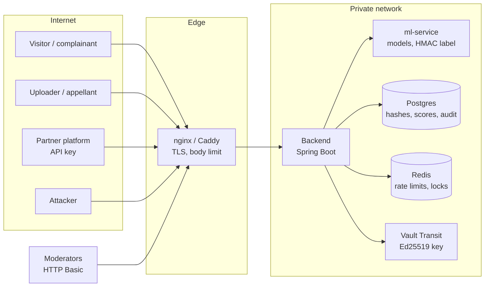

# Threat model

What an attacker can do to this system, what stops them today, and what is still open. Each threat
lists **mitigations in place** (with the code that enforces them) and **residual risk**: the part we
have not solved, stated plainly so an operator can decide whether it is acceptable for their
deployment.

Last reviewed: 2026-09-28 (Phase 25). Review again whenever an item in
[Assumptions](#assumptions-and-out-of-scope) stops being true, a new public endpoint is added, or
before a production launch.

Related: [Architecture Decision Records](adr/README.md) (several mitigations below exist only because
of those decisions), [Model card](MODEL_CARD.md), [Public demo guide](PUBLIC_DEMO.md).

---

## System and trust boundaries

| Boundary | Crosses it | Trusted? |
|----------|-----------|----------|
| Internet to edge | Uploads, hashes, complaints, appeals, PINs, API calls | No: anything from here may be hostile |
| Edge to backend | The same, plus moderator credentials | Authenticated per request (Basic auth, API key, case PIN) |
| Backend to ml-service | Media bytes, in memory | Internal network only; not published in compose |
| Backend to Postgres / Redis / Vault | Records, counters, signing requests | Internal network, credentials from env |

### Assets

| Asset | Why it matters |
|-------|----------------|
| Media in flight | Intimate images of real people. Never stored ([ADR 0001](adr/0001-no-raw-media-persistence.md)), but present in memory while being analysed |
| Decisions and the audit trail | Determine whether content stays up; evidence for regulators and courts |
| Report signing key | Makes reports trustworthy to third parties ([ADR 0003](adr/0003-ed25519-report-signatures.md)) |
| Provenance HMAC key | Makes labelled copies verifiable |
| Known-hash list | Warns people before they re-share abuse ([ADR 0004](adr/0004-hash-only-prescreen.md)) |
| Moderator accounts | Can take content down, reverse takedowns, import hashes |
| Case and appeal PINs | Let complainants and uploaders see their case without an account |
| Model availability | Takedown deadlines are hours, not days |

---

## Summary

| # | Threat | Likelihood | Impact | Residual after mitigations |
|---|--------|:---------:|:------:|----------------------------|
| [T1](#t1-adversarial-uploads) | Adversarial uploads (evasion, false flags, parser and resource attacks) | High | Medium | **Medium**: detectors can be evaded; humans are the backstop |
| [T2](#t2-key-theft) | Key theft (signing key, HMAC key, API keys, secrets) | Low | High | **Low** with Vault Transit and a TSA; **Medium** with the file keyring |
| [T3](#t3-hash-list-poisoning) | Hash-list poisoning | Medium | Medium | **Low-Medium**: matches are advisory, but import is not four-eyes |
| [T4](#t4-moderator-account-compromise) | Moderator account compromise | Medium | High | **Medium**: no MFA or login throttling yet |
| [T5](#t5-report-forgery) | Report forgery or tampering | Medium | High | **Low**: detectable by anyone who runs the check |
| [T6](#t6-public-demo-abuse) | Abuse of the hosted public demo | High | Low | **Low**: synthetic-only, isolated, reset every few hours |

Likelihood and impact are qualitative (Low / Medium / High) for a mid-sized platform deployment.

---

## T1. Adversarial uploads

**Who and why.** Abusers who want their content to stay up; trolls who want innocent content taken
down; anyone probing a public upload endpoint.

### Scenarios

1. **Evasion.** Recompress, crop, add noise or adversarial perturbations, or run a "laundering" model
   so a forged or explicit image scores below the review threshold.
2. **Threshold probing.** Upload many variants and watch the scores to find the edge of the decision
   boundary.
3. **Induced false positives.** Craft innocent content that scores high, to flood the review queue or
   get a rival's content held.
4. **Resource exhaustion.** Huge files, decompression bombs, long or high-frame-rate video.
5. **Parser exploits.** Malformed JPEG, PNG or MP4 aimed at image and video decoders; polyglot files that
   are both an image and something else.

### Mitigations in place

- **Two independent models, human in the loop.** Both scores must be evaded at once. Anything in the
  review band goes to a person, and reversing a takedown needs a second moderator
  ([ADR 0002](adr/0002-two-independent-models.md), `DecisionEngineService`, `ModerationService`).
- **Robustness is measured, not assumed.** `ml/robustness.py` scores the forgery model under JPEG
  recompression, resizing, blur, noise and combined "social media" chains; results are in
  `ml/results/` and the [model card](MODEL_CARD.md).
- **Re-uploads are caught without the model.** Confirmed takedowns add a perceptual hash, so a
  lightly edited re-upload matches even if it evades the classifier.
- **Size and duration caps at every layer.** 51 MB at nginx; 25 MB images and 50 MB videos in the
  backend and the ml-service (413 above that); at most `VIDEO_MAX_FRAMES` sampled frames per video.
  Pillow's decompression-bomb guard is left on.
- **Content sniffing.** `MediaKinds` checks magic bytes (ISO-BMFF brands, WebM, AVI) as well as the
  declared type and extension before choosing the image or video decoder. Media the ml-service cannot
  decode is refused (422 `unreadable_media` on the partner API) rather than scored.
- **Blast radius.** The backend and ml-service containers run as an unprivileged user (UID 10001). The
  ml-service is not published outside the compose network. Uploads are never written to disk
  (ADR 0001), so a malicious file cannot persist on the host.
- **Rate limits.** Partner API keys have per-client token buckets shared across instances through
  Redis. On the public demo, uploads draw from an instance-wide budget (`DEMO_UPLOADS_PER_MINUTE`).

### Residual risk

- **Detectors can be beaten.** A determined adversary with a local copy of a similar model will find
  perturbations that pass. The scores are a triage signal, not a verdict, and the system must never be
  sold as proof that something is authentic.
- **The public `/api/analyze` endpoint returns scores and is not rate-limited outside public-demo
  mode.** This enables threshold probing and makes flooding the ML service cheap. *Recommended:* put
  per-IP limits at the edge (nginx `limit_req` or the platform's WAF) for any internet-facing
  deployment, and consider coarsening the public response to a decision without raw scores.
- **Decoder vulnerabilities** in Pillow, PyAV/FFmpeg or ImageIO are inherited. Keep base images patched
  (CI builds images on every push); consider a seccomp profile or gVisor for the ml-service.
- **Induced false positives** cost moderator time. The review queue, team routing and SLA escalation
  surface the backlog, but there is no automated detection of a coordinated flood.

---

## T2. Key theft

**Who and why.** An attacker who wants reports or labels that look genuine, or an insider leaving
with keys.

### Keys and secrets in scope

| Secret | Used for | Where it lives |
|--------|----------|----------------|
| Report signing key (Ed25519) | Signing evidentiary reports | Vault Transit (`REPORT_SIGNING_PROVIDER=vault`), or a file keyring in dev |
| Provenance key (HMAC-SHA256) | Signing the manifest embedded in labelled copies | `PROVENANCE_SIGNING_KEY` env on the ml-service |
| Partner API keys | Partner platform access | Only a SHA-256 hash is stored; the key is shown once on creation |
| Moderator passwords | Console access | BCrypt hashes |
| Vault token, DB and Redis passwords | Infrastructure | Environment variables |

### Mitigations in place

- **The private signing key can stay out of the application.** With Vault Transit the backend only
  asks Vault to sign; stealing the backend host, its disk or a heap dump does not yield the key.
- **Refusal to run with demo secrets.** Outside the dev profile, `DemoSecretsGuard` (backend) and
  `startup_guard.py` (ml-service) refuse to start with default or short keys and passwords, or with the
  file keyring unless it is explicitly allowed.
- **Rotation without breaking history.** `POST /api/admin/signing-keys/rotate` (senior moderators
  only) switches to a new key; retired public keys stay published so old reports still verify, and
  every rotation is audited.
- **Timestamps bound the damage.** With an RFC 3161 Time-Stamping Authority configured, each
  signature carries a third-party timestamp, so a stolen key cannot produce convincingly back-dated
  reports.
- **API keys are useless at rest.** Only their SHA-256 hash is stored; keys can be rotated or revoked
  per client, and usage is rate-limited.

### Residual risk

- **File keyring deployments** (allowed with `REPORT_SIGNING_ALLOW_FILE_KEYS`) keep the private key on
  disk. Anyone with the volume can sign.
- **No revocation list for signing keys.** Rotating after a compromise stops *new* signatures with
  the old key, but the old key stays trusted for reports it "signed", including forged ones, unless an
  operator removes it from the keyring. That also invalidates the genuine reports it signed. With a
  TSA, reports timestamped after the compromise date can be rejected by policy; without one, they
  cannot be told apart.
- **The provenance key is symmetric.** Whoever holds it can mint labelled copies that verify. It is
  meant to stay inside one trust boundary (backend and ml-service). *Recommended:* move labels to the
  same asymmetric signing as reports if third parties ever verify labels independently.
- **Secrets in environment variables** are visible to anyone who can inspect the containers. Use the
  orchestrator's secret store in production.

---

## T3. Hash-list poisoning

**Who and why.** Someone who wants legitimate content to trigger "already known abuse" warnings (to
discredit a victim, a journalist or the tool itself), or who wants real abuse removed from the list.

### Scenarios

1. **Insider or compromised moderator** imports hashes of innocent images, or confirms a takedown of
   innocent content so its hash joins the list.
2. **Poisoned upstream list**: a bulk import from a partner feed that contains bad entries.
3. **Collision crafting**: an image built so its pHash lands within 8 bits of a listed hash, so an
   innocent-looking picture "matches".
4. **Removal**: reversing takedowns to pull hashes of real abuse off the list.

### Mitigations in place

- **A match is advisory.** The prescreen answers match or no match to the person checking. It never
  removes, blocks or down-ranks content; takedowns always go through the models and a moderator
  decision ([ADR 0004](adr/0004-hash-only-prescreen.md)).
- **Every entry records where it came from.** `INTERNAL_CONFIRMED` (with the analysis ID), imported
  (with the operator's note) or seeded, plus a timestamp. A bad import can be found and reverted by
  source.
- **Takedown-derived hashes follow the decision.** When an appeal or second review reverses a
  takedown, the hash that takedown added is removed; imported and seeded hashes are never touched by
  that path.
- **Removing a takedown needs two people.** Reversing an `AUTO_FLAG` needs a second moderator, and
  appeals cannot be decided by anyone who set or upheld the takedown.
- **The oracle reveals nothing useful.** No distance, source or row ID comes back, so an attacker
  cannot measure how close a crafted collision is.
- **Conservative thresholds** (pHash 8 of 64 bits, PDQ 31 of 256 bits) keep accidental collisions rare.

### Residual risk

- **Import is a single-moderator action.** `POST /api/admin/known-hashes/import` requires the
  MODERATOR role, not a senior, and has no second review. *Recommended:* restrict it to
  `SENIOR_MODERATOR`, and add an audit event and a transparency counter for imports.
- **Collisions are feasible** for perceptual hashes; published attacks exist. The effect is a false
  warning, not a takedown, but it can still frighten a user.
- **No list-wide integrity check.** Someone with direct database access can add or delete rows
  without trace. Database access control and backups are the only guard.

---

## T4. Moderator account compromise

**Who and why.** Phishing, password reuse, a stolen laptop, or a malicious insider. A moderator can
take content down, propose reversals, decide appeals, import hashes and create API clients.

### Mitigations in place

- **Separation of duties.** Reversing a takedown needs a second, different moderator, and escalated
  items need a senior. Appeals are blocked for everyone who set or upheld the contested takedown.
  Signing-key rotation is senior-only.
- **Everything is attributable.** Every decision, override, appeal outcome and reveal is recorded in
  the moderation audit log and the provenance timeline with the moderator's username. Signed reports
  freeze who decided what.
- **Signed reports expose after-the-fact edits.** If a compromised account (or anyone with database
  access) changes a decision after a report was issued, verification returns `TAMPERED` and names the
  changed fields.
- **Credentials.** Passwords are BCrypt-hashed. Outside dev, the startup guard refuses default or short
  moderator passwords. HTTPS is terminated at the edge (Caddy for the hosted demo).
- **Wellbeing limits cap exposure per session**, which also caps how much one session can act on
  before a forced break.
- **Transparency.** The public transparency report shows aggregate decision and appeal volumes, so a
  sudden spike of takedowns or reversals is visible from outside.

### Residual risk

- **No multi-factor authentication and no login throttling.** HTTP Basic credentials can be guessed
  or replayed; case and appeal PINs have lockouts, but moderator logins do not. *Recommended:* put the
  console behind an SSO identity provider with MFA (OIDC), or at minimum add a failed-login lockout
  using the same `PinAttemptGuard` pattern.
- **A single moderator can take content down.** Only reversals are four-eyes. A compromised account can
  flag many items, and each confirmed takedown also adds a hash (T3). Appeals and second review
  restore content, but only after an uploader notices and appeals.
- **Sessions.** The console uses a server session plus Basic auth, with CSRF tokens disabled. The
  session cookie is `SameSite=Strict` and `HttpOnly`, so a cross-site request never carries it, and
  most state changes take JSON bodies that a cross-site form cannot send. A browser that ignores
  `SameSite` would reopen classic CSRF; re-enabling CSRF tokens would close it for good.
- **No anomaly detection** on moderator behaviour (volume, hours, geography).

---

## T5. Report forgery

**Who and why.** A party to a dispute who wants a report saying content was (or was not) flagged; a
bad actor impersonating the platform to a court or the police; an insider rewriting history.

### Scenarios

1. **Fabricate a PDF** from scratch that looks like one of ours.
2. **Edit a genuine PDF**: change scores, dates or the decision, keeping the signature block.
3. **Change the record** in the database after the report was issued, then claim the report was wrong.
4. **Replay an old report** after the decision changed.
5. **Sign with a stolen key** (see T2).

### Mitigations in place

- **Signatures over the record, checkable by anyone** ([ADR 0003](adr/0003-ed25519-report-signatures.md)).
  `GET /api/verify-report/{reportId}` returns `VALID`, `TAMPERED` (with changed fields) or `NOT_FOUND`.
  Public keys are published at `/api/verify-report/keys` for offline checks.
- **Fabricated PDFs fail.** A made-up report ID is `NOT_FOUND`; a real ID with altered content does not
  match the record the server shows.
- **Edited PDFs are detectable.** The PDF's SHA-256 is recorded in the provenance trail and returned in
  a response header when the report is generated, so a recipient can compare the file they were sent.
- **Changed records are caught.** Verification rebuilds the snapshot from the current record and diffs
  it against what was signed.
- **Replays are flagged.** Verifying anything but the latest report for an analysis says which report
  superseded it.
- **Signature-record tampering is caught.** If someone edits the stored signature or snapshot, the
  stored hash, signature and snapshot no longer agree, and the result is `TAMPERED`.
- **Timestamps** (RFC 3161) fix *when* a report was signed, independent of our clock.

### Residual risk

- **Recipients must actually run the check.** A PDF that is never verified can be edited freely. The
  report prints the verify URL and instructions on its signature page, but nothing forces a recipient
  to use them.
- **PDF viewers show no signature.** There is no PAdES signature a viewer would flag as broken.
- **A stolen key plus database write access** can produce a consistent forged record and signature.
  Vault Transit (key never leaves Vault) and a TSA make this much harder, not impossible.
- **The verify endpoint is ours.** A recipient who distrusts the operator can check the signature
  offline with the published key, but that proves only that the operator signed that snapshot, not that
  the snapshot is true.

---

## T6. Public demo abuse

The hosted demo (`docker-compose.demo.yml`, [guide](PUBLIC_DEMO.md)) is deliberately open: moderator
logins are printed on the tour, and anyone can reset it.

### Scenarios

1. Upload real people's photos, including intimate or illegal images, to a public instance.
2. Use the published moderator logins to post offensive text in appeals, complaints or notes.
3. Flood uploads or resets to take the demo down.
4. Treat the demo as a free forgery-detection API.

### Mitigations in place

- **Synthetic media only.** In public mode every multipart upload on every route (public, moderator
  and partner API) is checked by SHA-256 against the bundled synthetic samples and the labelled copies
  the instance issued for them. Anything else is refused with `403 demo_samples_only` before any model
  runs (`DemoUploadFilter`, `DemoUploadGuard`).
- **Isolation.** The demo refuses to run outside the dev profile, so it cannot be switched on in a
  production deployment. The guide requires its own VM and database, and only Caddy publishes ports.
- **Everything is wiped** every `DEMO_RESET_INTERVAL` (default 6 hours), and on demand. Visitor resets
  have a cooldown (`DEMO_RESET_COOLDOWN`) shared across instances. Resets and story seeding are
  serialised with shared locks.
- **Upload budget.** In public mode, uploads draw from an instance-wide token bucket
  (`DEMO_UPLOADS_PER_MINUTE`, default 60), so a flood slows everyone down instead of exhausting the
  models.
- **No published partner key.** `API_DEMO_KEY` is blank on the hosted demo; keys that visitors create
  are deleted on reset.
- **Not indexed.** Caddy sends `X-Robots-Tag: noindex`, HSTS, `nosniff` and a strict referrer policy.

### Residual risk

- **Offensive free text** (appeal statements, complaint notes) is visible to other visitors until the
  next reset. Keep the reset interval short for a busy demo.
- **The upload budget is shared.** One abuser can use it up and make the demo slow for everyone for a
  minute at a time. Add per-IP limits at the edge if that happens.
- **Shared moderator logins mean no accountability** on the demo, by design. Never reuse those
  credentials, the database or the signing keys anywhere else.

---

## Assumptions and out of scope

- The operator runs the stack on infrastructure it controls, with TLS at the edge, and does not publish
  Postgres, Redis, Vault or the ml-service to the internet (the compose files do not).
- Host, hypervisor and cloud-account compromise are out of scope; so are denial-of-service attacks
  beyond what an edge rate limit or CDN handles.
- The models' fairness, calibration and failure modes are covered in the [model card](MODEL_CARD.md),
  not here.
- Legal process (which authority may order a takedown, evidentiary rules for a given court) is the
  operator's responsibility; the system records and signs what happened.
